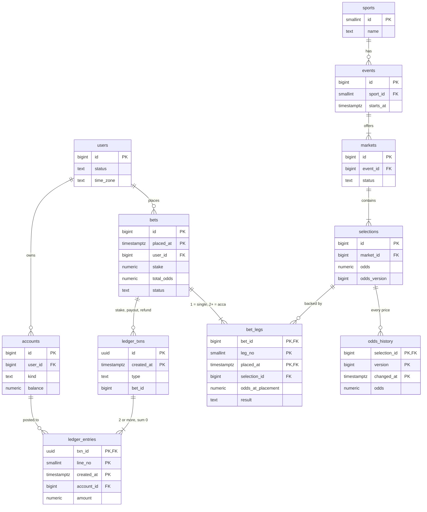

**Short answer:** I keep a **normalised core in Postgres**: catalogue (`sports → competitions → events → markets → selections`), `bets` with one `bet_legs` row per selection (a single has one leg, an accumulator several, each with its own `odds_at_placement`), and money as a **double-entry ledger** (`accounts`, `ledger_txns`, `ledger_entries`). The database enforces what it can (`stake > 0`, `odds > 1`, `balance >= 0`, entries per transaction sum to zero) and `accounts.balance` is a cached sum updated in the same transaction. I denormalise on purpose for the hot queries, add partial indexes for "my open bets" and "open legs on this market", and plan for growth from day one: **monthly range partitions** on `bets`, `bet_legs`, the ledger and `odds_history`, archive old partitions, replicas for history, sharding by user only last.

## Picture it



**How to read it:**
- Left half is money, right half is the catalogue; `bets` and `bet_legs` join them. `competitions`, `idempotency_keys`, `outbox` and `rg_usage` are in the DDL but left out of the picture.
- `ledger_txns ||--|{ ledger_entries`: every money movement is one transaction with at least two signed entries that sum to zero. `accounts.balance` is a cached sum of its entries.
- `bets ||--|{ bet_legs`: every bet has at least one leg. A single is one leg; an accumulator is several, each with the price the user got for that selection.
- The big append-only tables (`bets`, `bet_legs`, `ledger_txns`, `ledger_entries`, `odds_history`) have the time column in their primary key. That is the partition key, and Postgres requires it in every unique constraint of a partitioned table.
- `selections` holds the **current** price and version; `odds_history` holds every price it ever had.

## Explanation

### The DDL (PostgreSQL)

Catalogue first. Small tables, plain foreign keys.

```sql
CREATE TABLE users (
  id          BIGINT GENERATED ALWAYS AS IDENTITY PRIMARY KEY,
  email       TEXT        NOT NULL,
  country     CHAR(2)     NOT NULL,
  time_zone   TEXT        NOT NULL,                 -- IANA name, e.g. 'Europe/London'
  status      TEXT        NOT NULL DEFAULT 'ACTIVE'
              CHECK (status IN ('ACTIVE','SUSPENDED','SELF_EXCLUDED','CLOSED')),
  created_at  TIMESTAMPTZ NOT NULL DEFAULT now()
);
CREATE UNIQUE INDEX users_email ON users (lower(email));

CREATE TABLE sports (
  id    SMALLINT PRIMARY KEY,
  name  TEXT NOT NULL UNIQUE
);

CREATE TABLE competitions (
  id        BIGINT   PRIMARY KEY,
  sport_id  SMALLINT NOT NULL REFERENCES sports,
  name      TEXT     NOT NULL,
  UNIQUE (id, sport_id)                             -- target for the composite FK below
);

CREATE TABLE events (
  id              BIGINT      PRIMARY KEY,
  competition_id  BIGINT      NOT NULL,
  sport_id        SMALLINT    NOT NULL,             -- copy, for "football events today"
  name            TEXT        NOT NULL,
  starts_at       TIMESTAMPTZ NOT NULL,
  status          TEXT        NOT NULL DEFAULT 'SCHEDULED'
                  CHECK (status IN ('SCHEDULED','LIVE','FINISHED','ABANDONED')),
  FOREIGN KEY (competition_id, sport_id) REFERENCES competitions (id, sport_id)
);
CREATE INDEX events_sport_start ON events (sport_id, starts_at);

CREATE TABLE markets (
  id        BIGINT PRIMARY KEY,
  event_id  BIGINT NOT NULL REFERENCES events,
  type      TEXT   NOT NULL,                        -- MATCH_RESULT, TOTAL_GOALS_2_5, ...
  status    TEXT   NOT NULL DEFAULT 'OPEN'
            CHECK (status IN ('OPEN','SUSPENDED','CLOSED','RESULTED'))
);
CREATE INDEX markets_event ON markets (event_id);

CREATE TABLE selections (
  id            BIGINT        PRIMARY KEY,
  market_id     BIGINT        NOT NULL REFERENCES markets,
  name          TEXT          NOT NULL,
  odds          NUMERIC(10,4) NOT NULL CHECK (odds > 1),   -- current decimal price
  odds_version  BIGINT        NOT NULL DEFAULT 0,
  result        TEXT          CHECK (result IN ('WIN','LOSE','VOID')),  -- NULL until resulted
  updated_at    TIMESTAMPTZ   NOT NULL DEFAULT now()
);
CREATE INDEX selections_market ON selections (market_id);
```

The composite FK on `events` is a trick worth saying: `sport_id` is a denormalised copy, but the FK to `competitions (id, sport_id)` makes it impossible for the copy to disagree with the source.

Bets. Every bet has legs; a single is one leg. Bet ids come from an ID generator (Snowflake-style or UUIDv7), as in [F8](../academy/lessons/F8.md).

```sql
CREATE TABLE bets (
  id                BIGINT        NOT NULL,          -- from the ID generator
  placed_at         TIMESTAMPTZ   NOT NULL,          -- partition key
  user_id           BIGINT        NOT NULL REFERENCES users,
  bet_type          TEXT          NOT NULL CHECK (bet_type IN ('SINGLE','ACCUMULATOR')),
  leg_count         SMALLINT      NOT NULL CHECK (leg_count BETWEEN 1 AND 20),
  stake             NUMERIC(19,4) NOT NULL CHECK (stake > 0),
  currency          CHAR(3)       NOT NULL,
  total_odds        NUMERIC(14,4) NOT NULL CHECK (total_odds > 1),  -- product of leg odds, frozen
  potential_payout  NUMERIC(19,4) NOT NULL,          -- the contract, frozen at placement
  status            TEXT          NOT NULL
                    CHECK (status IN ('PENDING','OPEN','WON','LOST','VOID','REJECTED','CASHED_OUT')),
  payout            NUMERIC(19,4) CHECK (payout >= 0),
  settled_at        TIMESTAMPTZ,
  CHECK ((bet_type = 'SINGLE') = (leg_count = 1)),
  PRIMARY KEY (id, placed_at)
) PARTITION BY RANGE (placed_at);

CREATE TABLE bet_legs (
  bet_id             BIGINT        NOT NULL,
  placed_at          TIMESTAMPTZ   NOT NULL,         -- copy of bets.placed_at (partition key + FK)
  leg_no             SMALLINT      NOT NULL CHECK (leg_no >= 1),
  selection_id       BIGINT        NOT NULL REFERENCES selections,
  market_id          BIGINT        NOT NULL,         -- copy from the selection, no FK (see pitfalls)
  event_id           BIGINT        NOT NULL,         -- copy, for liability per event
  odds_at_placement  NUMERIC(10,4) NOT NULL CHECK (odds_at_placement > 1),
  odds_version       BIGINT        NOT NULL,         -- the price version the user accepted
  result             TEXT          CHECK (result IN ('WIN','LOSE','VOID')),  -- NULL = undecided
  settled_at         TIMESTAMPTZ,
  PRIMARY KEY (bet_id, leg_no, placed_at),
  UNIQUE (bet_id, selection_id, placed_at),          -- no selection twice in one bet
  FOREIGN KEY (bet_id, placed_at) REFERENCES bets (id, placed_at)
) PARTITION BY RANGE (placed_at);
```

What a `CHECK` cannot do across rows (leg count matches the number of leg rows, `total_odds` equals the product, no two legs on related outcomes of the same event) is validated in the service, in the same transaction that inserts the rows.

Money: the ledger, extended from [F8](../academy/lessons/F8.md).

```sql
CREATE TABLE accounts (
  id        BIGINT GENERATED ALWAYS AS IDENTITY PRIMARY KEY,
  user_id   BIGINT        REFERENCES users,          -- NULL for the operator's accounts
  kind      TEXT          NOT NULL
            CHECK (kind IN ('USER_CASH','HOUSE_STAKES','HOUSE_PNL','PSP_CLEARING')),
  currency  CHAR(3)       NOT NULL,
  balance   NUMERIC(19,4) NOT NULL DEFAULT 0,        -- cached sum of entries (user accounts)
  CHECK (user_id IS NULL OR balance >= 0),
  UNIQUE (user_id, kind, currency)
);

CREATE TABLE ledger_txns (
  id          UUID        NOT NULL,
  created_at  TIMESTAMPTZ NOT NULL,
  type        TEXT        NOT NULL CHECK (type IN
              ('DEPOSIT','WITHDRAWAL','BET_STAKE','BET_PAYOUT','BET_LOST','BET_REFUND','REVERSAL')),
  bet_id      BIGINT,                                -- no FK: bets is partitioned on another time
  ext_ref     TEXT,                                  -- payment provider's id for deposits
  PRIMARY KEY (id, created_at)
) PARTITION BY RANGE (created_at);
CREATE INDEX ledger_txns_bet ON ledger_txns (bet_id) WHERE bet_id IS NOT NULL;

CREATE TABLE ledger_entries (
  txn_id      UUID          NOT NULL,
  line_no     SMALLINT      NOT NULL,
  created_at  TIMESTAMPTZ   NOT NULL,                -- = the txn's created_at (partition key)
  account_id  BIGINT        NOT NULL REFERENCES accounts,
  amount      NUMERIC(19,4) NOT NULL CHECK (amount <> 0),   -- signed
  PRIMARY KEY (txn_id, line_no, created_at),
  FOREIGN KEY (txn_id, created_at) REFERENCES ledger_txns (id, created_at)
) PARTITION BY RANGE (created_at);
```

**"Entries of one transaction sum to zero."** A `CHECK` sees one row, so it cannot express this. Two ways, and I use both:

```sql
CREATE FUNCTION ledger_txn_must_balance() RETURNS trigger LANGUAGE plpgsql AS $$
BEGIN
  IF (SELECT sum(amount) FROM ledger_entries
      WHERE txn_id = NEW.txn_id AND created_at = NEW.created_at) <> 0 THEN
    RAISE EXCEPTION 'ledger txn % does not balance', NEW.txn_id;
  END IF;
  RETURN NULL;
END $$;

CREATE CONSTRAINT TRIGGER ledger_balanced
  AFTER INSERT ON ledger_entries
  DEFERRABLE INITIALLY DEFERRED                  -- runs at COMMIT, after all lines are in
  FOR EACH ROW EXECUTE FUNCTION ledger_txn_must_balance();
```

1. **Deferred constraint trigger** (above): checked at `COMMIT`, so the transaction can insert its lines one by one. The lookup uses the primary key prefix `txn_id`. On a partitioned table, test that your Postgres version puts the trigger on every partition, or create it per partition.
2. **The application** writes every movement through one `postTransaction(lines)` method that refuses unbalanced input, and a **reconciliation job** (F8 deep dive 3) runs "every txn sums to zero" and "every cached balance equals its entries" on a replica and pages if either returns a row. The trigger catches bugs at write time; the job catches anything that bypassed it.

Append-only is enforced too: `REVOKE UPDATE, DELETE ON ledger_txns, ledger_entries FROM app_user;`. Corrections are new `REVERSAL` transactions.

The supporting tables keep F8's shape, with `NUMERIC(19,4)` for money and a `published_at` on the outbox:

```sql
CREATE TABLE idempotency_keys (
  user_id     BIGINT      NOT NULL,
  idem_key    UUID        NOT NULL,
  bet_id      BIGINT,
  created_at  TIMESTAMPTZ NOT NULL,
  PRIMARY KEY (user_id, idem_key)                  -- the unique index; NOT partitioned
);

CREATE TABLE outbox (
  id            BIGINT GENERATED ALWAYS AS IDENTITY PRIMARY KEY,
  topic         TEXT        NOT NULL,
  msg_key       TEXT        NOT NULL,
  payload       JSONB       NOT NULL,
  created_at    TIMESTAMPTZ NOT NULL DEFAULT now(),
  published_at  TIMESTAMPTZ
);

CREATE TABLE rg_usage (
  user_id       BIGINT        NOT NULL REFERENCES users,
  kind          TEXT          NOT NULL,              -- STAKE_DAY, DEPOSIT_DAY, LOSS_WEEK
  period_start  DATE          NOT NULL,              -- in the user's time zone
  used          NUMERIC(19,4) NOT NULL DEFAULT 0 CHECK (used >= 0),
  PRIMARY KEY (user_id, kind, period_start)
);
```

### Type choices to defend

- **Money is `NUMERIC(19,4)`, never `float`/`double`.** It is exact decimal and maps to `BigDecimal`. Four decimals leave room for intermediate results (stake × odds) before the payout is rounded to the currency's minor unit by a written rule. F8's sketch uses `NUMERIC(14,2)`; the idea is the same. **`BIGINT` minor units** (pence) are also correct, and smaller and faster. But the scale differs by currency (JPY has 0 decimals, BHD has 3), and odds multiplication still needs a rounding rule in code. I pick one and use it everywhere. Mixing both is how rounding bugs happen.
- **Odds are `NUMERIC(10,4)` decimal odds.** A fractional price like 4/3 becomes 2.3333, so two decimals are not enough.
- **`TIMESTAMPTZ` everywhere.** It stores an absolute instant (UTC internally) and converts on display. Plain `TIMESTAMP` loses the zone and breaks when users, servers and the feed are in different zones.
- **Status as `TEXT + CHECK`, not a Postgres `ENUM`.** An enum is 4 bytes and self-documenting. Adding a value is easy (`ALTER TYPE ... ADD VALUE`), but removing one means recreating the type, and both sides of a deploy must agree. `TEXT + CHECK` maps directly to JPA `@Enumerated(EnumType.STRING)`, and changing the list is a constraint swap that can be done without a long lock (pitfalls). A lookup table with an FK is the third option when statuses carry data (a label, an "is final" flag).

### Single vs accumulator

`bets` holds what belongs to the whole bet: who, stake, combined odds, potential payout, status. `bet_legs` holds one row per selection with that leg's `odds_at_placement` and `odds_version`. For a single, `total_odds` equals its one leg's odds. Settlement works per leg: a `LOSE` leg makes the whole bet `LOST` at once; the bet is `WON` only when no leg is undecided and none lost; a `VOID` leg counts as odds 1.0. F8's core design was singles only, with `selection_id` on `bets`. Moving it to `bet_legs` gives one model for both, so there is a single settlement path.

`odds_at_placement` is not denormalisation. It is a **fact frozen at placement**: the price the user was promised. It must never be recomputed from `selections.odds`, which keeps moving.

### Why a double-entry ledger instead of `UPDATE balance`

- **Audit:** the balance has a full history. Every penny is explained by a transaction with a type and a bet or payment reference. Regulators and support teams ask "why is my balance X?"; the entries answer it.
- **Reconciliation:** "money is never created or destroyed" becomes a query (`sum = 0` per txn, cached balance = sum of entries), so bugs are found, not guessed.
- **No lost updates in the history:** entries are insert-only, so two writers never overwrite each other's record. The one mutable row, `accounts.balance`, is changed with a conditional `UPDATE ... SET balance = balance - :stake WHERE ... AND balance >= :stake` in the **same transaction** as the entries ([Q6](../academy/lessons/Q6.md)).
- **History and corrections:** a mistake is fixed with a reversing transaction, so both the error and the fix stay visible. Point-in-time balances ("what was it on 1 March?") are a sum up to a timestamp.

`accounts.balance` is a **cached projection**: reading the balance is one row, not a `SUM` over millions of entries. It is updated in the same transaction as the entries, so it can never be ahead of or behind them, and `CHECK (balance >= 0)` is the last line of defence against a double spend. The house accounts are not updated per bet (one hot row for the whole platform); their balance is derived later.

### Normalise vs denormalise

Normalised (3NF) by default: the catalogue, users and accounts, bets and legs, the ledger. Each fact has one home, so updates touch one row and integrity comes from keys.

Denormalised on purpose, each copy with a reason and a rule to keep it right:

| Copy | Why | Kept right by |
|---|---|---|
| `events.sport_id` | "football events starting today" without joining competitions | composite FK to `competitions (id, sport_id)` |
| `bets.user_id` | "my bets" index without going through the ledger or account | set once at insert, never changes |
| `bet_legs.market_id`, `event_id` | settle a market and compute liability per event without joining 2–3 tables over millions of rows | copied from the selection in the insert; selections never move between markets |
| `bet_legs.placed_at` | it is the partition key and part of the FK to `bets` | copied from the parent in the same insert |
| `bets.total_odds`, `potential_payout` | the contract; liability sums need it | frozen at placement, never recomputed |
| `accounts.balance` | O(1) balance read and the `balance >= stake` guard | same transaction as the entries + reconciliation |
| Settled-results summary | finance and trading reports without scanning `bets` | built off the hot path (below) |

The summary: a table `daily_settlement_summary (day, sport_id, market_type, currency, bets, stakes, payouts)` updated by a consumer of `BetSettled` events from the outbox, or a materialized view refreshed with `REFRESH MATERIALIZED VIEW CONCURRENTLY` (which needs a unique index on the view). Reports read the summary or a warehouse, never the hot `bets` table on the primary.

### Indexes, one per query

```sql
-- 1. "My open bets": newest first, only the small OPEN slice is indexed
CREATE INDEX bets_user_open ON bets (user_id, placed_at DESC) WHERE status = 'OPEN';

-- 2. "My bet history": keyset pagination (placed_at, id)
CREATE INDEX bets_user_time ON bets (user_id, placed_at DESC, id DESC);

-- 3. "Bets on this market" (trader view, liability) and "settle this market":
--    only undecided legs; INCLUDE (bet_id) saves a heap visit for the trader view
CREATE INDEX bet_legs_open_by_market ON bet_legs (market_id, selection_id)
  INCLUDE (bet_id) WHERE result IS NULL;

-- 4. Legs of one bet: the primary key (bet_id, leg_no, placed_at) already covers it.

-- 5. Account statement
CREATE INDEX ledger_entries_account_time ON ledger_entries (account_id, created_at DESC);

-- 6. Idempotency: PRIMARY KEY (user_id, idem_key) is the unique index. Lookup and claim in one.

-- 7. Outbox relay: only unpublished rows, oldest first
CREATE INDEX outbox_unpublished ON outbox (id) WHERE published_at IS NULL;
```

Why partial indexes: open bets and undecided legs are a tiny, constantly changing slice of a huge table. A partial index stays small and hot in memory, and rows drop out of it when they settle. The query's `WHERE` must imply the index predicate (write `status = 'OPEN'` literally, not as a bind parameter) or the planner cannot use it ([Q5](../academy/lessons/Q5.md)).

If you keep F8's singles-only shape (`selection_id` on `bets`), index 3 becomes F8's `CREATE INDEX bets_open_by_selection ON bets (selection_id) WHERE status = 'OPEN';`.

### Growth: 5M bets a day

The arithmetic: 5M bets/day is ~58/s on average and several hundred to thousands per second at peaks. With ~2 legs per bet and ~2 ledger transactions per bet (stake, then settlement) of 2+ entries each, that is roughly 5M bets, 10M legs, 10M ledger txns and 20M+ entries a day, ~150M bets a month. Measure the real row and index sizes; tens of GB a month of the big tables is the order to expect.

The ladder, in order ([Q8](../academy/lessons/Q8.md)):
1. **Partition by month** from day one: `bets` and `bet_legs` on `placed_at`, `ledger_txns` and `ledger_entries` on `created_at`, `odds_history` on `changed_at`. Queries with a time range touch one or two partitions (pruning). Each partition's indexes are small. `VACUUM` works per partition. Create partitions ahead with a scheduled job (or the `pg_partman` extension), and alert if next month's is missing.
2. **The PK must include the partition key.** That is why the PKs are `(id, placed_at)` and why the idempotency key lives in its own unpartitioned table. Uniqueness of `bets.id` alone across partitions comes from the ID generator, not the database.
3. **Retire old partitions**, don't `DELETE`: `ALTER TABLE bets DETACH PARTITION bets_2024_01 CONCURRENTLY;` (Postgres 14+), export it to cold storage or a warehouse, then drop it. Betting records have legal retention periods, so "drop" means after archiving, never instead of it. Detach `bet_legs` (the child) before `bets` for the same month.
4. **BRIN on time columns** of huge append-only tables, e.g. `CREATE INDEX odds_history_changed_brin ON odds_history USING brin (changed_at);`. Rows arrive in time order, so a block-range index of a few pages replaces a B-tree of gigabytes for time-range scans (audits, archiving, reports). It is not for point lookups.
5. **Read replicas** for history, statements and reports. Never for the balance used in a debit.
6. **Shard by `user_id`/account** only when one writer cannot keep up after all of the above. Every money transaction touches one user plus append-only house entries, so it stays on one shard. The cost: settling one market fans out to every shard, house accounts are split per shard and summed, cross-user reports need a warehouse, ids must be globally unique (the ID generator again), and resharding is a project.

### Odds history

`selections.odds` and `odds_version` hold the current price (and Redis holds the hot copy that the bet service reads). Every change is also appended:

```sql
CREATE TABLE odds_history (
  selection_id  BIGINT        NOT NULL REFERENCES selections,
  version       BIGINT        NOT NULL,
  odds          NUMERIC(10,4) NOT NULL CHECK (odds > 1),
  changed_at    TIMESTAMPTZ   NOT NULL,
  PRIMARY KEY (selection_id, version, changed_at)
) PARTITION BY RANGE (changed_at);
```

It is insert-only, written by a Kafka consumer in batches (multi-row `INSERT` or `COPY`), never inside the bet transaction. The primary key serves "price history of this selection". Because a leg stores `odds_version`, a dispute ("I was offered 2.10") is one lookup: `WHERE selection_id = :s AND version = :v`. Old partitions go to cold storage like the bets.

## Example

**My open bets** (index 1):

```sql
EXPLAIN (ANALYZE, BUFFERS)
SELECT b.id, b.placed_at, b.stake, b.total_odds, b.potential_payout, b.bet_type
FROM bets b
WHERE b.user_id = 42 AND b.status = 'OPEN'
ORDER BY b.placed_at DESC
LIMIT 20;
```

Intent of the plan: an `Append` (or `Merge Append`) of **Index Scans on `bets_user_open`** in each partition, no `Seq Scan`, no big `Sort`, a handful of buffers. There is no `placed_at` filter, because an ante-post bet (say, on a tournament winner) can stay open for months. That is fine: in old partitions the partial index holds almost nothing, so each probe costs a page or two.

**Settle a market, step 1** (index 3), one batch per worker, legs only:

```sql
WITH batch AS (
  SELECT bet_id, leg_no, placed_at
  FROM bet_legs
  WHERE market_id = :marketId AND result IS NULL
    AND placed_at >= :marketCreatedAt          -- prunes partitions older than the market
  ORDER BY bet_id
  LIMIT 1000
  FOR UPDATE SKIP LOCKED
)
UPDATE bet_legs l
SET result = CASE WHEN l.selection_id = :winningSelectionId THEN 'WIN' ELSE 'LOSE' END,
    settled_at = now()
FROM batch b
WHERE l.bet_id = b.bet_id AND l.leg_no = b.leg_no AND l.placed_at = b.placed_at
  AND l.result IS NULL                           -- idempotent: re-runs change nothing
RETURNING l.bet_id, l.placed_at;
```

Step 2, same transaction: for each returned bet, lock the parent (`SELECT ... FROM bets WHERE id = :id AND placed_at = :t FOR UPDATE`), then read its legs in a new statement. Any `LOSE` → `LOST`; all decided and none lost → `WON` with the payout computed in Java with `BigDecimal` (product of `WIN` leg odds, `VOID` = 1.0, rounded by the house rule) and a `BET_PAYOUT` ledger transaction; otherwise leave it `OPEN`. The bet update is guarded by `AND status = 'OPEN'`. Plan intent: Index Scan on `bet_legs_open_by_market` in only the recent partitions, no `Seq Scan`.

**Statement** (index 5): `WHERE account_id = :a AND created_at >= :from AND created_at < :to ORDER BY created_at DESC LIMIT 50` prunes to the months asked for, then walks the index in order.

## Pitfalls and follow-ups

- **Why double-entry instead of updating a balance?** A bare balance has no history, can't be reconciled, and a bug silently creates or loses money. Entries that sum to zero give audit, reconciliation, safe corrections and point-in-time balances; the cached balance keeps reads O(1).
- **Where normalise, where denormalise?** Normalise the core so each fact lives once. Denormalise only for a named hot query, with a rule that keeps the copy right (composite FK, set-once columns, same-transaction update, or off-path summaries). Snapshots like `odds_at_placement` are facts, not copies.
- **Indexes for "my open bets", "bets on this market", "settle this market"?** `bets (user_id, placed_at DESC) WHERE status = 'OPEN'`; `bet_legs (market_id, selection_id) INCLUDE (bet_id) WHERE result IS NULL` for both market queries (with singles-only, `bets (selection_id) WHERE status = 'OPEN'`).
- **5M rows a day?** Monthly range partitions with the key in the PK, detach and archive old months, BRIN for time scans, replicas for reads, summaries for reports, shard by user last.
- **Odds history?** Append-only `odds_history` partitioned by time; current price on `selections` and in Redis; legs store `odds_version` so any accepted price can be traced.
- **Accumulator settled by two workers at once.** Worker A settles leg 1, worker B leg 2 of the same bet; each checks "all legs decided?" and sees the other's leg still undecided, so neither pays. Locking the parent `bets` row before checking makes the second one wait and then see the first one's committed leg. A sweeper that finds `OPEN` bets with no undecided legs is the safety net.
- **A unique "one payout per bet" key?** On a partitioned `ledger_txns`, `UNIQUE (bet_id, type)` must include `created_at`, so it only holds within a month. The real guard is `status = 'OPEN'` in the same transaction. For a database backstop, use a small unpartitioned table keyed by `(bet_id, settlement_round)`, the same trick as `idempotency_keys`.
- **FK cost on partitioned tables.** FKs into partitioned tables work (Postgres 12+) but each insert does an index lookup, and every FK check takes a `FOR KEY SHARE` lock on the referenced row. That does not block a normal non-key `UPDATE` of that row (the odds update on `selections`). But thousands of bets a second on one favourite's row create multixact overhead, so load-test it. That is why `bet_legs.market_id` and `event_id` carry no FK, and why `ledger_txns.bet_id` has none (it would also block detaching old `bets` partitions). If the `selection_id` FK shows up in profiles, drop it and rely on the service plus reconciliation.
- **Creating an index on a big partitioned table.** `CREATE INDEX CONCURRENTLY` does not work on the partitioned parent. Create the index `ON ONLY` the parent, build it `CONCURRENTLY` on each partition, then `ALTER INDEX ... ATTACH PARTITION` each one. See [zero-downtime-schema-migrations](zero-downtime-schema-migrations.md).
- **Enum migration.** With `TEXT + CHECK`: deploy code that can read the new value, then `ADD CONSTRAINT ... CHECK (...) NOT VALID`, `VALIDATE CONSTRAINT` (a lighter lock that lets reads and writes continue), drop the old constraint. With a Postgres `ENUM`: `ADD VALUE` is cheap, removing a value means a new type and a column rewrite.
- **Soft deletes.** Not for money or bets: they are never deleted, only moved through statuses, and history is append-only. Markets and selections also use status, not `deleted_at`. For users, account closure is a status; a data-erasure request anonymises personal fields while financial records stay for their retention period. If you do add `deleted_at` anywhere, every unique index needs `WHERE deleted_at IS NULL`.
- **Time zones.** Store `TIMESTAMPTZ`, run the database and JVM in UTC, convert at the edge. Partition bounds are UTC instants. "Today" for a daily stake limit is the **user's** day: compute `period_start` with `(now() AT TIME ZONE users.time_zone)::date`, not the server's date.
- **Hot rows.** The house account balance is never updated per bet, and odds are written to `selections` conflated, not per tick. See [design-sports-betting-platform](design-sports-betting-platform.md).

More: [sql-optimization-performance-scalability](sql-optimization-performance-scalability.md) for reading plans and scaling SQL, and [design-betting-bet-placement-lld](design-betting-bet-placement-lld.md) for the Java side of placing a bet against this schema. PostgreSQL docs: [Table partitioning](https://www.postgresql.org/docs/current/ddl-partitioning.html), [Partial indexes](https://www.postgresql.org/docs/current/indexes-partial.html), [BRIN indexes](https://www.postgresql.org/docs/current/brin.html), [CREATE TRIGGER](https://www.postgresql.org/docs/current/sql-createtrigger.html).

## Say it in 2 minutes

"The core is normalised Postgres. The catalogue goes sports, competitions, events, markets, selections, and each selection holds its current price and a version. A bet row holds the stake, the combined odds and the potential payout, and a `bet_legs` row per selection holds the price the user got for that leg. So a single is one leg and an accumulator is several, with one settlement path. Money is a double-entry ledger: every movement is a transaction with entries that sum to zero, append-only, and corrections are reversals. The database enforces stake above zero, odds above one, balance never negative, and a deferred constraint trigger checks each transaction balances at commit. A reconciliation job checks it again and checks that the cached `accounts.balance` matches the entries. That balance is updated in the same transaction with a conditional `UPDATE`, which is the double-spend guard. Money is `NUMERIC(19,4)` and time is `TIMESTAMPTZ`. I denormalise only for named queries: `market_id` and `event_id` on legs, frozen odds and payout, the cached balance, and a settlement summary for reports. The indexes are partial: open bets by user and time, undecided legs by market for settlement, the ledger by account and time, and the unpublished outbox. At 5M bets a day I partition bets, legs, the ledger and odds history by month with the time column in the primary key, archive old partitions, use BRIN for time scans and replicas for history. I shard by user only last, because then settling one market fans out to every shard."

Go deeper: [Q5 · Indexes and reading EXPLAIN](../academy/lessons/Q5.md), [Q6 · Transactions, isolation, locking and MVCC](../academy/lessons/Q6.md), [Q8 · Scaling databases](../academy/lessons/Q8.md), [F8 · Design a sports betting platform](../academy/lessons/F8.md).
