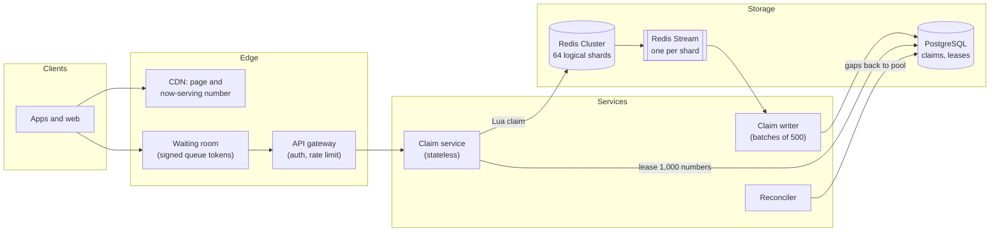
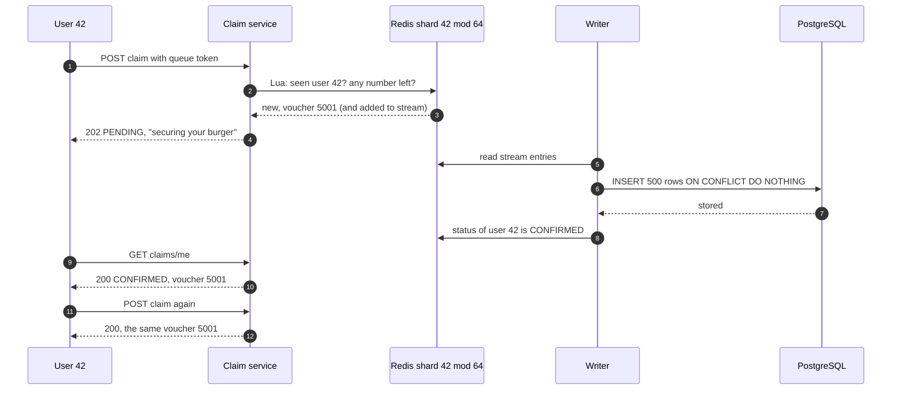
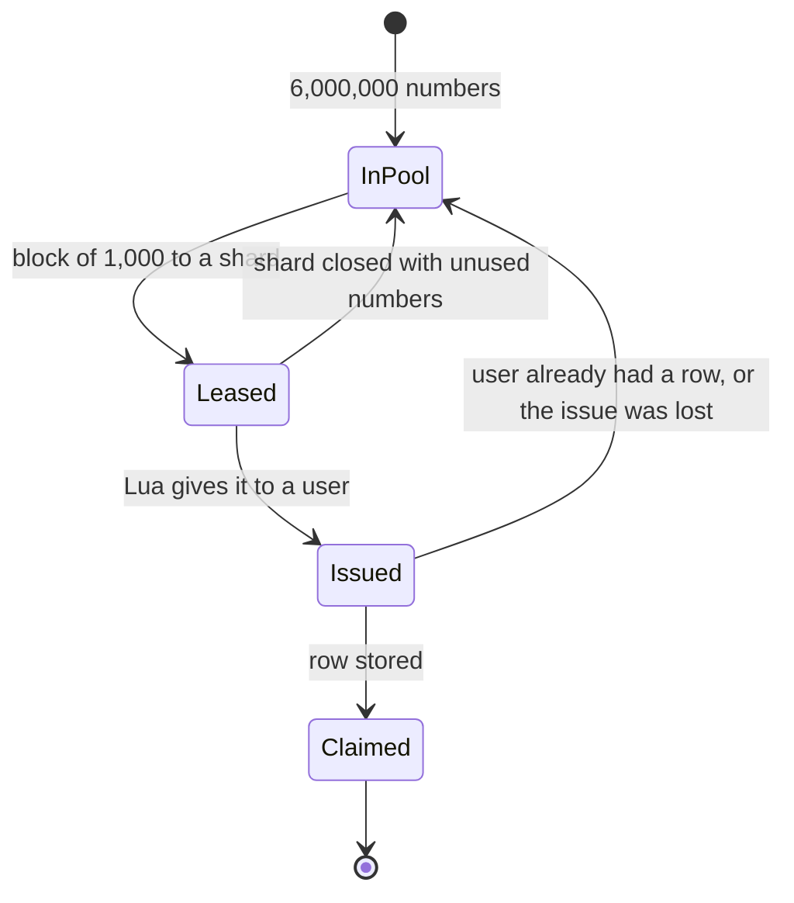

**Short answer:** Make all 6 million vouchers numbered, and let PostgreSQL enforce the promise: one row per claim, `UNIQUE(user)` and `UNIQUE(voucher number)`. Redis shards take the burst: each user hashes to one shard, where a Lua script checks "already claimed?" and hands out the next number from a leased block of 1,000. A waiting room lets in about 15k claims/s, so the stock is gone in about 7 minutes and 3 minutes are left to recover. A reconciler finds numbers that were handed out but never stored and gives them to waiting users, so nothing is oversold and nothing is left over.

## Picture it







**How to read it:**
- Steps 1-4 touch only Redis, so the burst never reaches the database directly.
- Steps 5-7 make it true: the voucher counts only when its row exists. Both unique constraints are there.
- Steps 11-12: a second tap returns the same voucher. It is not an error.
- In the state picture, every way for a number to get lost leads back to the pool.

## Requirements

**Say the agreed scope first**
- Logged-in users, one burger each, no payment, no delivery, no choice of restaurant. The result is a voucher.
- 6,000,000 vouchers, 10 minutes, start time known in advance.

**Non-functional**
- Hard rules: never more than 6M, never two per user.
- All 6M claimed in 10 minutes, **if** at least 6M people come. No system can create demand, so agree this with the interviewer.
- A claim answer in under 300 ms; confirmation within about 2 s.
- Survive the loss of a Redis primary, an availability zone or any service instance.

**Negotiate**
- *Multi-region?* Start with one region and three zones: one country, ten minutes, one source of truth. The multi-region version is in the follow-ups.
- *Fairness?* Random among early arrivals, then first come first served.

## Estimates

- 6M / 600 s = **10k successful claims/s** on average. Target 15k/s, which finishes in about 6 min 40 s.
- Say 20M users arrive. Most load is people waiting, and it is all in the first minute.
- If 20M clients poll every 20 s that is 1M requests/s, so it must be a CDN file, not our API.
- First-second peak without a waiting room: 20M taps in 10 s = 2M/s. With it: 20-30k/s reach the claim service.
- Claim row about 100 bytes plus two indexes: 6M rows is roughly 1-2 GB.
- Redis: 6M hash entries, under 1 GB. Size is easy; **rate** is the problem.

## API

```text
POST /campaigns/{id}/queue            -> { queueToken, position }          signed, bound to the user
GET  /campaigns/{id}/now-serving.json -> { upTo: 4200000, state: OPEN }    CDN, 1-2 s TTL
POST /campaigns/{id}/claims           -> 202 PENDING | 200 CONFIRMED | 409 SOLD_OUT | 429 (Retry-After)
GET  /campaigns/{id}/claims/me        -> PENDING | CONFIRMED { voucherNo } | WAITLISTED | NONE
```

- No `Idempotency-Key` needed: `(campaign, user)` **is** the key, and the user comes from the auth token, never the body.

## Data model

```sql
CREATE TABLE claim (
  campaign_id int, user_id bigint, voucher_no int NOT NULL CHECK (voucher_no BETWEEN 1 AND 6000000),
  claimed_at timestamptz NOT NULL DEFAULT now(),
  PRIMARY KEY (campaign_id, user_id),          -- one per user
  UNIQUE (campaign_id, voucher_no)             -- never oversold
);
CREATE TABLE pool  (campaign_id int PRIMARY KEY, next_no int NOT NULL);      -- starts at 1
CREATE TABLE lease (lease_id bigint PRIMARY KEY, campaign_id int, shard int, from_no int, to_no int, state text);
CREATE TABLE returned_no (campaign_id int, voucher_no int, PRIMARY KEY (campaign_id, voucher_no));

-- lease a block: about 6,000 of these in the whole campaign, so one row is fine
UPDATE pool SET next_no = next_no + 1000
WHERE campaign_id = 1 AND next_no + 1000 <= 6000001
RETURNING next_no - 1000 AS from_no, next_no - 1 AS to_no;
```

Redis, all keys of a shard share a hash tag such as `{s17}`: `claims` (user to number), `cursor`, `end`, `out` (stream).

## Architecture

The diagram is in **Picture it**. First, why this and not something simpler:

| Option | Good | Breaks on |
|---|---|---|
| One DB row, `SET left = left - 1 WHERE left > 0` | Trivially correct | One row lock: a few hundred to a few thousand updates/s |
| One Redis counter (`DECR`) | Fast, simple | Hot key, per-user check is a second step, failover can forget sales |
| Counters sharded N ways | No hot key | Shards empty unevenly: stock left over while users are refused |
| Queue everything, one consumer decides | Orderly, easy to reason about | User waits with no answer; consumer speed is the limit |
| **Leased blocks + Lua + unique rows** | Fast, atomic per user, self-correcting | More parts; needs a reconciler |

Say it out loud: "The database makes it correct, Redis makes it fast, the waiting room makes it calm."

## Deep dives

**1. Claim: atomic per user, no hot key.** User hashes to one of 64 shards, so "seen this user" and "next number" sit on the same node and run in one script.

```lua
-- KEYS: claims, cursor, end, out      ARGV: userId
local old = redis.call('HGET', KEYS[1], ARGV[1])
if old then return {'ALREADY', old} end
local n = tonumber(redis.call('GET', KEYS[2]) or '1')
if n > tonumber(redis.call('GET', KEYS[3]) or '0') then return {'NEED_LEASE'} end
redis.call('SET', KEYS[2], n + 1)
redis.call('HSET', KEYS[1], ARGV[1], n)
redis.call('XADD', KEYS[4], '*', 'user', ARGV[1], 'no', n)
return {'ISSUED', n}
```

- Each shard sees about 15k / 64 = 235 claims/s. There is no hot key left.
- Lease the next block at a low-water mark (200 left), so nobody waits for `NEED_LEASE`. One leaser per shard, guarded by a short lock.
- If a leaser crashes after the `UPDATE`, that block is in `lease` but not in Redis. Under-sold for a moment, never oversold, and the reconciler returns it.

**2. Redis fails.** Replication is asynchronous, so a failover can forget the last few claims.

- The script's effects replicate as one unit, so the new primary has a consistent, older state.
- It will hand out some numbers again. The second `INSERT` hits `UNIQUE(voucher_no)`, stores nothing, and the writer puts that user back for a new number. **No oversell.**
- A user whose entry vanished sees `NONE`; the app re-sends the claim by itself with the same queue token. If the first row did reach the DB, `PRIMARY KEY (campaign, user)` wins and they get that voucher.
- This is why the first answer is "securing your burger" and not "you got it". Show the voucher only when the row exists.
- `WAIT 1` and AOF make the gap smaller. They do not remove it, so the design must not depend on them.
- Shard fully down: its users get 503 with `Retry-After` and a jittered retry. Other shards keep going.

**3. Nothing left over.** Under-sell hides in three places: unused parts of leases, numbers issued to a user who already had one, and lost issues.

- Near the end, lease smaller blocks (1,000, then 100, then 10), so no shard sits on stock.
- Empty shard and empty pool: the user is `WAITLISTED`, not refused.
- Reconciler, every few seconds once the pool is empty: close leases, let the stream drain, find numbers with no row, return them, serve the waitlist in order.
- Returned numbers go back out as tiny leases (one number each), through the same script.

```sql
SELECT g.no FROM generate_series(1, 6000000) AS g(no)
LEFT JOIN claim c ON c.campaign_id = 1 AND c.voucher_no = g.no
WHERE c.voucher_no IS NULL;           -- only for closed leases whose stream has drained
```

- Being wrong here is safe: a number returned too early collides on the unique constraint and the user is requeued.
- I checked this logic in a small simulation with random shard rollbacks: 20 runs, every one ended with exactly the stock claimed and no user twice.

**4. Throttle: the waiting room.**

- Users who arrive before the start get a token; at the start the early group is **shuffled**, later arrivals queue behind. That is fairer than "fastest network wins".
- The client reads `now-serving.json` from the CDN with jitter, and calls the API only when its number is up.
- A controller sets the rate: `remaining / time left`, plus a margin, divided by the share of admitted users who really claim.
- Behind it: per-user limit (1 claim call per 2 s), per-instance concurrency limit, and 429 with `Retry-After`.
- Bots: accounts must exist before the announcement, tokens are bound to the user, plus a challenge for suspicious devices.

## Trade-offs

- **Numbered vouchers over a counter:** more data, but a database constraint can prove the promise.
- **202 then confirm over an instant yes:** one or two seconds of waiting buys honesty after a failover.
- **Redis Streams over Kafka:** issuing and queueing happen in one atomic script. With Kafka I would need an outbox step between them.
- **One PostgreSQL over many:** 15k rows/s in batches of 500 is 30 transactions/s. If the load test says no, split into 4 databases by user hash, each owning its own number range, and both constraints stay local.
- **Simple alternative worth saying:** if 1 s answers are fine, 16 sharded Postgres pools with in-process batching and no Redis also works. Fewer parts, slower answers.

## Follow-ups

- **Throttle traffic?** CDN, waiting room, user limit, concurrency limit (deep dive 4).
- **Lock inventory?** No user-held lock. Leased blocks, a single-threaded Lua step per shard, and the unique constraint as the final judge.
- **Queue and failures under eventual consistency?** The stream is at-least-once. The writer acknowledges after commit, the insert is idempotent, a stuck entry is taken over with `XAUTOCLAIM`, a poison entry goes to a side list and an alert.
- **All 6M in 10 minutes?** Finish at 7 by plan, rate controller, shrinking leases, reconciler, waitlist. If demand is short, push notifications at minute 5.
- **Track the number of vouchers?** The truth is the claim rows, counted per batch; dashboards also show leased, issued and returned. The page shows a rounded number from the CDN.
- **User claims again?** Same voucher, 200. Two devices at once: one shard, one script, one wins, both see it.
- **Monitoring and logs?** Invariants first: alert if `confirmed <= issued <= leased <= 6M` breaks.
- **Other signals:** claims/s against plan, p99, stream lag, lease wait, 429 and 5xx rates, unique conflicts, gap count. Logs carry one trace id per claim and no personal data.
- **Failover?** Three zones, Redis replica per primary, synchronous Postgres standby, stateless services with spare capacity for one zone lost.
- **Test it?** Unit tests for the script; property test "never over, never twice, all sold" with random crashes; a race test of one user from 100 clients; load test at 3x with synthetic users; soak test of the waiting room.
- **Before going live?** Full rehearsal in production with a dummy campaign and staff (10,000 vouchers), kill a Redis primary during it, pre-scale and warm, change freeze, runbook, feature flag, pause button, named on-call.
- **How do you know it is healthy while live?** One dashboard of those invariants, a synthetic user claiming from a test campaign, a war room, and agreed triggers: lag over 30 s means slow the waiting room, invariant broken means pause.
- **Bottlenecks?** CDN origin (static file), login (issue tokens early, keep sessions warm), Redis CPU (64 shards), DB write rate (batching), Redis memory (no eviction: `noeviction`).
- **Multi-region?** Pin each user to a home region so one-per-user stays local, and give each region a quota from the one pool. Move unused quota at minute 7.
- **Fairness?** Shuffled pre-queue, then order of arrival; waitlist in order; nobody is refused while numbers are still unresolved.

Go deeper: [H4 · System design interview kit](../academy/lessons/H4.md), [I2 · Redis in depth](../academy/lessons/I2.md), [I1 · Kafka in depth](../academy/lessons/I1.md), [Q6 · Transactions, isolation, locking and MVCC](../academy/lessons/Q6.md).
