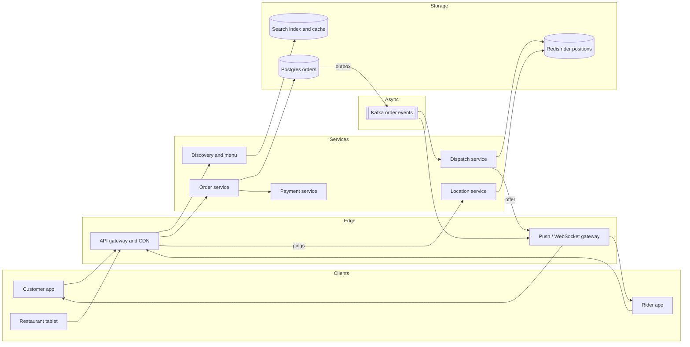
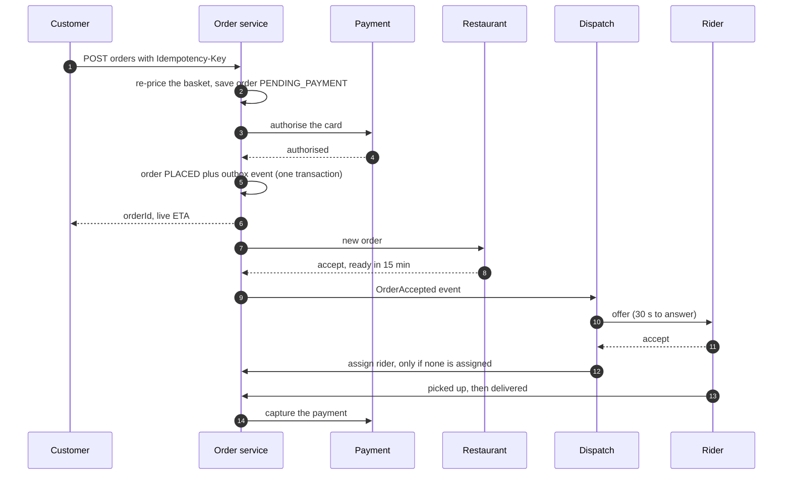
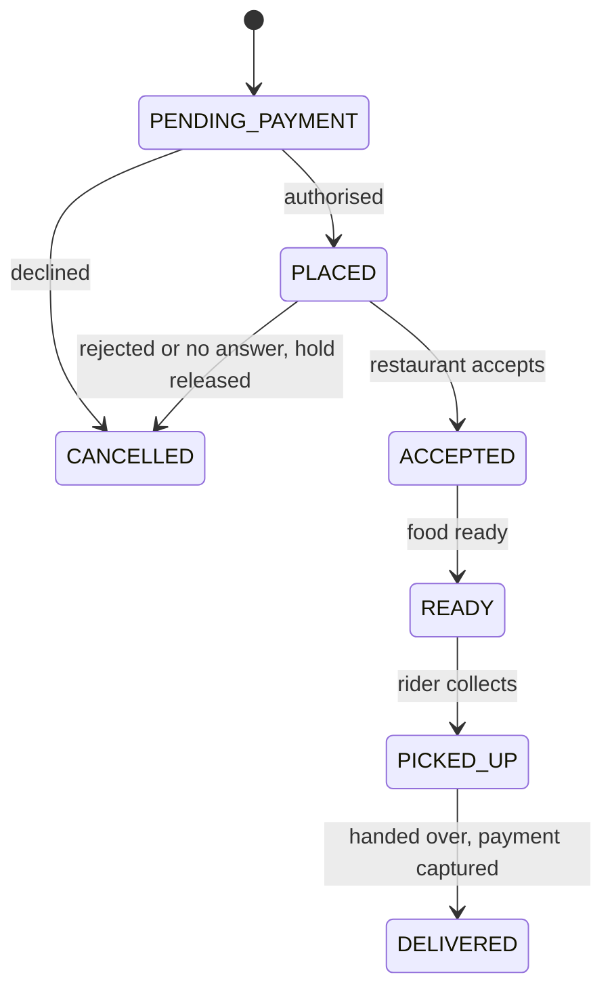

**Short answer:** I would split the app into a read-heavy side (find restaurants, menus) served from a geo search index and caches, and a write side (orders, payment, dispatch) built around one order state machine in Postgres. Every state change is a conditional update plus an outbox event, so retries and crashes never skip or repeat a step.

Rider positions are high-volume and short-lived, so they go to an in-memory geo store, not the order database. Dispatch matches riders to orders by estimated arrival time, and assigns with an atomic update so one order never gets two riders.

## Picture it







**How to read it:**
- Steps 1–6: the server recomputes the price, saves the order, authorises the card, then moves the order to `PLACED` with its event in one transaction. A retry with the same key returns the same order.
- Steps 7–9: the restaurant must accept before a rider is searched for, so no rider is sent to a closed kitchen.
- Steps 10–12: dispatch offers the job to one rider at a time, and the assignment only succeeds if the order has no rider yet.
- Steps 13–14: money is captured only when the food was delivered.
- The rider is a separate field, not a state: riders are matched while the food is cooking.

## Requirements

The reported wording is one line, so I assume this scope.

**Functional**
- Customer: find restaurants that deliver to me, see a menu, order, pay, track.
- Restaurant: accept or reject, mark items unavailable, mark ready.
- Rider: go online, get offers, accept, pick up, deliver.
- Out of scope: ratings, promotions, rider pay, support chat.

**Non-functional**
- Strong consistency for orders, payment and assignment; a few seconds of staleness for search and tracking.
- Discovery p99 under 300 ms; placing an order p99 under 2 s including payment.
- Highly available at dinner peak, and one city's problem must not take down the others.

## Estimates

Assumptions, for sizing only:
- 2M orders a day, about 23 per second on average; a 10× dinner peak gives about 230 orders/s.
- Each order has about 50 reads before it: 100M reads/day, about 12k reads/s at peak.
- 100k riders online at peak, one ping every 5 s: 20k location writes/s.
- Order row plus items about 2 KB: 4 GB/day, about 1.5 TB/year. Partition by month and archive.

The order rate is easy for one database. Reads and location pings are the real load.

## API

```text
GET  /restaurants?lat=..&lng=..&cuisine=..&cursor=..   -> deliverable, open now, ETA
GET  /restaurants/{id}/menu
POST /orders            Idempotency-Key  { restaurantId, items[], addressId, paymentToken } -> 201 { orderId, eta }
GET  /orders/{id}                        -> state, rider position, ETA (also pushed over WebSocket)
POST /orders/{id}/accept | reject | ready            (restaurant)
POST /offers/{id}/accept | decline                   (rider)
POST /orders/{id}/picked-up | delivered              (assigned rider only)
PUT  /riders/me/location  { lat, lng, at }           (every 5 s while online)
```

## Data model

```sql
restaurant(id PK, name, lat, lng, delivery_radius_m, opens, closes, paused)
menu_item(id PK, restaurant_id FK, name, price_pence, available)
orders(id PK, customer_id, restaurant_id, city_id, state, total_pence, rider_id NULL,
       payment_ref, version, created_at)
order_item(order_id FK, line_no, menu_item_id, name, unit_price_pence, qty, PRIMARY KEY (order_id, line_no))
order_event(id PK, order_id FK, from_state, to_state, actor, at)      -- audit trail
offer(id PK, order_id, rider_id, state, expires_at)                   -- OFFERED, ACCEPTED, DECLINED, EXPIRED
outbox(id PK, topic, key, payload, created_at, sent_at)
idempotency(key PK, customer_id, request_hash, response)
```

- `order_item` copies the name and price, because the menu can change after the order.
- Only one live offer per order: `CREATE UNIQUE INDEX ON offer(order_id) WHERE state = 'OFFERED'`.
- Shard by `city_id` when one database is not enough: an order, its restaurant and its rider are in the same city.

## Architecture

The diagrams in **Picture it** show the components.

- **Discovery** reads a search index and a menu cache, both refreshed from change events.
- **Order service** owns the state machine, and nobody else writes order state.
- **Dispatch** consumes `OrderAccepted`, reads rider positions and sends offers.
- **Push gateway** holds the WebSocket connections and forwards events to customers and riders.

## Deep dives

**1. Dispatch.** The goal is hot food and little idle time, not only the nearest rider.
- Candidates: Redis `GEOSEARCH` around the restaurant, then keep riders who are online and free.
- Score: travel time to the restaurant compared with the food-ready time, plus vehicle and recent declines.
- Offer to the best rider for 30 s. On decline or timeout, offer to the next and widen the radius.
- Batch mode at peak: collect a few seconds of orders and riders, then match them together. It usually beats greedy matching.
- The final assignment is one atomic statement, so two dispatch instances cannot both win:

```sql
UPDATE orders SET rider_id = :rider, version = version + 1
WHERE id = :order AND rider_id IS NULL AND state IN ('ACCEPTED', 'READY');
```

A rider must also have only one active job at a time. A row in `active_job(rider_id PRIMARY KEY, order_id)`, inserted in the same transaction, guarantees it.

**2. The order state machine.** Each transition is `UPDATE ... SET state = :to WHERE id = :id AND state = :from`, plus an event row and an outbox row in the same transaction.
- Zero rows updated means the step already happened or is illegal, so a repeated "accept" is harmless.
- Timers catch silence: no restaurant answer in 5 minutes cancels the order and releases the card authorisation.
- If the payment call times out, the order stays `PENDING_PAYMENT` until a reconciler asks the provider.

**3. Location and tracking.**
- Pings go to one Redis geo set per city, plus a "last seen" time. A position older than 30 s is ignored, because geo members have no TTL of their own.
- Losing Redis loses only positions, and the next pings refill it in seconds.
- Raw pings also go to Kafka for ETA models, with short retention because they are personal data.
- The customer sees *their* rider only, and only between pick-up and delivery.

## Trade-offs

- **Orchestrated order flow vs pure events:** one service owning the state machine is easier to reason about; side effects (push, analytics, dispatch) stay event-driven.
- **Authorise then capture vs charge at once:** more steps, but a rejected order needs no refund.
- **Offer one rider vs broadcast:** one at a time is fair and has no races; broadcast is faster and wastes riders' attention.
- **Per-city cells:** an outage stays in one city, at the cost of more deployments to run.

## Follow-ups

- *Dinner peak?* Pre-scale by schedule, serve discovery from cache, and shed low-priority calls first (recommendations before checkout).
- *Restaurant tablet goes offline?* Heartbeats; after a few misses, pause the restaurant in search and phone it about open orders.
- *Rider app dies after pick-up?* The assignment is in the database, so the app restores it at login; support gets an alert when pings stop.
- *ETA?* Prep time (restaurant history, current queue) plus travel time plus hand-over, recomputed on each event.
- *Two taps on "Pay"?* The same idempotency key returns the stored order.

Related lessons: [H4 · System design interview kit](../academy/lessons/H4.md), [F5 · Case studies: chat, news feed, collaborative editor](../academy/lessons/F5.md).
