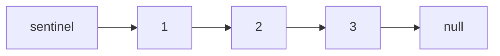

**Short answer:** Build a singly linked list from a private `Node` class, with a **sentinel (dummy) head** and a `size` field. The sentinel removes every "is this the first node?" special case: to insert or delete at index `i`, walk to the node before it (`i` steps from the sentinel) and relink two pointers. `get`, `addAtIndex` and `deleteAtIndex` are O(i); with a `tail` pointer, `addAtTail` becomes O(1).

## Picture it

The list after `addAtHead(1)`, `addAtTail(3)`, `addAtIndex(1, 2)`:



Trace of the LeetCode example (index is 0-based, the sentinel is not counted):

| Operation | Walk to (node before index) | Relink | List | size |
|---|---|---|---|---|
| `addAtHead(1)` | sentinel | `sentinel.next = 1` | 1 | 1 |
| `addAtTail(3)` | node 1 (index 0) | `1.next = 3` | 1 → 3 | 2 |
| `addAtIndex(1, 2)` | node 1 | `2.next = 3`, `1.next = 2` | 1 → 2 → 3 | 3 |
| `get(1)` | node 1, then one more | none | returns 2 | 3 |
| `deleteAtIndex(1)` | node 1 | `1.next = 1.next.next` (skips 2) | 1 → 3 | 2 |
| `get(1)` | | none | returns 3 | 2 |

**The picture in one sentence:** every operation is "walk to the node *before* index `i`, then change at most two `next` pointers", and the sentinel guarantees that node always exists.

## Approach

**Naive version.** Keep only `head`. Every method needs an `if (index == 0)` branch, plus `head == null` checks. It works but is where bugs come from.

**Key insight.** A sentinel node before the real head means "the node before index 0" exists too. `addAtHead(v)` is just `addAtIndex(0, v)` and `addAtTail(v)` is `addAtIndex(size, v)`. One helper, `nodeBefore(index)`, serves every method.

**Design points to mention in an LLD-focused round:**
- Encapsulation: `Node` is a private static nested class; callers see values, never nodes.
- Validate indexes in one place. LeetCode wants silent no-ops; a real API would throw `IndexOutOfBoundsException`, like `java.util.List`.
- Generics (`MyLinkedList<T>`) and implementing `Iterable<T>` make it usable with for-each.
- Doubly linked with head and tail sentinels lets you walk from whichever end is closer and gives O(1) removal at both ends. That is how `java.util.LinkedList` works.

## Solution

```java
class MyLinkedList {
    private static final class Node {
        int val;
        Node next;
        Node(int val, Node next) { this.val = val; this.next = next; }
    }

    private final Node sentinel = new Node(0, null);
    private int size;

    public int get(int index) {
        if (index < 0 || index >= size) return -1;
        return nodeBefore(index).next.val;
    }

    public void addAtHead(int val) { addAtIndex(0, val); }

    public void addAtTail(int val) { addAtIndex(size, val); }

    public void addAtIndex(int index, int val) {
        if (index < 0 || index > size) return;          // index == size means append
        Node prev = nodeBefore(index);
        prev.next = new Node(val, prev.next);
        size++;
    }

    public void deleteAtIndex(int index) {
        if (index < 0 || index >= size) return;
        Node prev = nodeBefore(index);
        prev.next = prev.next.next;                     // the removed node becomes garbage
        size--;
    }

    // Walks index steps from the sentinel: returns the node just before position index.
    private Node nodeBefore(int index) {
        Node cur = sentinel;
        for (int i = 0; i < index; i++) cur = cur.next;
        return cur;
    }
}
```

## Complexity

- **Time:** `get`, `addAtIndex`, `deleteAtIndex` are O(i) for the walk; `addAtHead` is O(1); `addAtTail` is O(n) here, O(1) with a `tail` pointer (which you must update on append and on deleting the last node).
- **Space:** O(n) for the nodes; each operation uses O(1) extra.

## Edge cases

- `addAtIndex(size, v)` appends; `addAtIndex(size + 1, v)` does nothing.
- Negative index: rejected (some older versions of the problem treated it as head; ask).
- Deleting the only element leaves `sentinel.next == null` and `size == 0`; no special code needed.
- `get` on an empty list returns -1.

## Variations

- **Doubly linked list:** add `prev`, use head and tail sentinels, walk from the tail when `index > size / 2`.
- **Thread safety:** wrap methods in a lock, or note that `ConcurrentLinkedQueue` uses lock-free CAS on `next` pointers.
- **Common follow-ups on the same class:** reverse it, find the middle, detect a cycle.

See [H1 · Java idioms for coding interviews](../academy/lessons/H1.md) and [E5 · The LLD interview method](../academy/lessons/E5.md).
