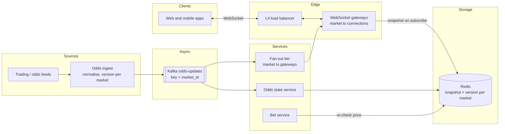
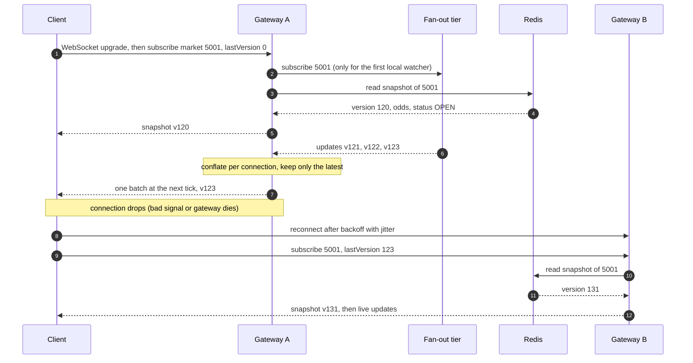
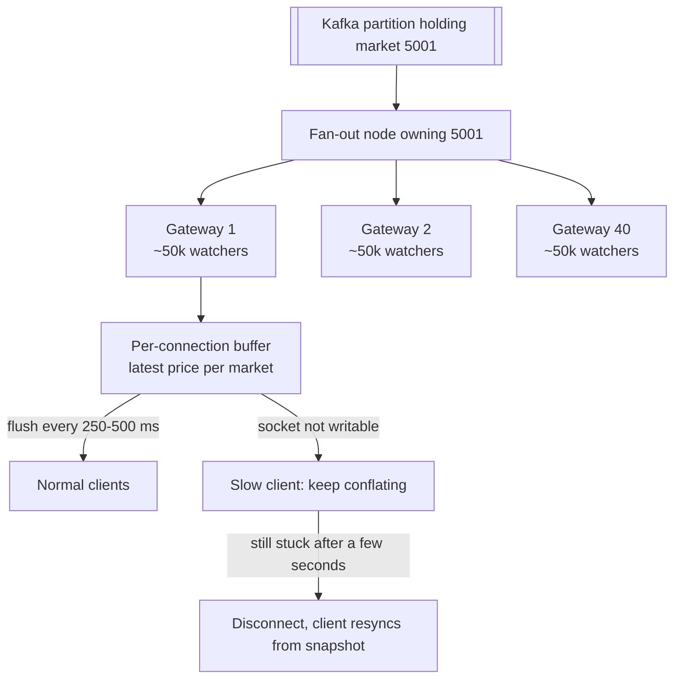

**Short answer:** The trading system publishes each price change to Kafka, keyed by market, so one market's changes stay in order, and each change carries a per-market version that only goes up. An odds state service keeps the **current snapshot** of every market in Redis. A fan-out tier forwards changes to a fleet of WebSocket gateways. Each gateway subscribes **once** per market and pushes to its own clients. Odds are state, so the latest price wins: gateways **conflate** (keep only the newest price per market and flush a batch every ~250–500 ms), and a reconnecting client sends its last version and gets a fresh snapshot, not a replay. The final with 2M watchers then costs one message per gateway plus a bounded number of messages per client.

## Picture it







**How to read it:**
- The first picture: prices flow left to right. Kafka keyed by `market_id` keeps one market's changes in order. Two consumers read it: the state service, which writes the current snapshot to Redis, and the fan-out tier, which forwards changes to gateways.
- Steps 1–5: a client subscribes. The gateway joins the market once, however many local clients watch it, then reads the snapshot from Redis and sends it.
- Steps 6–7: three quick updates turn into one message, because only the newest price matters.
- Steps 8–13: the connection dies. The client reconnects to another gateway with its last version (123). The snapshot is at 131, so it gets the snapshot, not the eight missed messages.
- The third picture: the final's fan-out is a tree (1 → 40 → 2M). Each level multiplies, and no single node sends 2M messages. Slow clients are conflated, then cut off.

## Requirements

Functional:
- Clients subscribe and unsubscribe to markets as the user scrolls or changes screens. They get a snapshot first, then live changes (odds and status: OPEN, SUSPENDED).
- A reconnecting client catches up to the current price.

Non-functional:
- Sub-second, end to end (target p99 under ~1 s from trading to screen).
- Millions of concurrent connections, with spikes at kick-off and after goals.
- A price never goes backwards on screen; a suspension shows up fast.
- Displayed odds may be slightly stale. That's safe because bet placement re-checks the price.

## Estimates

All numbers are assumptions to state out loud and check with the interviewer.

```text
Concurrent connections at a big final:   2,000,000 (one per open app)
Live markets in-play:                   ~2,000, each changing ~5 times/s (bursts after goals)
Upstream:  2,000 × 5 = 10k changes/s × ~200 B ≈ 2 MB/s   → tiny, Kafka barely notices

Fan-out
  Each client watches ~10 markets → ~50 changes/s reach it
  Naive:      2M × 50                       = 100M msgs/s   (impossible)
  Conflated:  2M × 2 batches/s (500 ms)     =   4M msgs/s
  Bytes:      4M × ~300 B per batch         ≈ 1.2 GB/s ≈ 10 Gbit/s total egress

Gateways
  ~50k connections per node (measure it)  → 40 nodes, run ~60 for headroom and node loss
  Per node: 50k × 2/s × 300 B             ≈ 30 MB/s ≈ 240 Mbit/s  → fine for one NIC
  The final: one change → 1 message to each of 40 gateways → 2M frames spread over 40 nodes
```

**So:** upstream volume is small, and fan-out is the whole problem. Conflation is the biggest lever: it caps messages per client no matter how fast prices move. And kick-off times are known days ahead, so scale up before the match. Don't count on autoscaling to catch a wall of connections.

## API

```text
WS /ws   (authenticated on upgrade)
  client → {"op":"subscribe",   "markets":[{"id":5001,"lastVersion":123}]}
  client → {"op":"unsubscribe", "markets":[5001]}
  server → {"type":"snapshot", "marketId":5001, "version":131, "status":"OPEN", "selections":[...]}
  server → {"type":"batch", "updates":[{"marketId":5001, "version":134, "changes":[...]}]}
  server → {"type":"reconnect", "afterMs":4200}        (sent while draining a node)
  ping / pong heartbeats

GET /events/{id}/markets   → snapshot with versions, for the first page render (briefly cacheable)
```

## Data model

```text
Kafka "odds-updates"   key = market_id
  {marketId, version, status, changes:[{selectionId, odds}], ts}

Redis  market:{id}  (hash)   version, status, sel:{selectionId} → odds
  written only if the incoming version > the stored one (a small Lua compare-and-set)

Gateway memory
  subscribers:  marketId → set of connections
  per connection: pending map marketId → latest update, lastSentVersion per market
```

The **version** is assigned by ingest, per market, and only goes up. It does three jobs: ordering (drop anything not newer than what you've sent), dedup (Kafka is at-least-once), and catch-up (the client says which version it has). Postgres keeps the audit history and the current price with conflated writes. It isn't on the push path. Academy [F8 · Design a sports betting platform](../academy/lessons/F8.md) keys by event. Keying by market spreads a big match's many markets over more partitions, and per-market order is all a screen needs.

## Architecture

The components are drawn in **Picture it** above. Gateways hold connections and subscriptions but no data that matters: everything they know can be rebuilt from Redis plus the live stream. That's why losing one is cheap.

**Fan-out tier.** A few nodes consume Kafka partitions. Each knows which gateways want which market, and forwards a change only to those gateways. Each gateway therefore sees one copy per market it serves, not the whole topic. A simpler start, which F8 describes: every gateway reads the entire topic with its own consumer group and filters locally. At 10k changes/s × 60 gateways that's still fine. Add the dedicated tier when gateways grow into the hundreds or upstream volume grows.

## Deep dives

**1. WebSockets vs SSE vs long polling.**

| Option | What it is | Verdict |
|---|---|---|
| [WebSocket](https://developer.mozilla.org/en-US/docs/Web/API/WebSockets_API) | One long-lived, two-way connection, opened by an HTTP upgrade | **Choice.** The client also sends: subscribe and unsubscribe as the user scrolls, on the same connection and the same gateway that holds its state |
| [Server-Sent Events](https://developer.mozilla.org/en-US/docs/Web/API/Server-sent_events) | One-way server → client stream over plain HTTP (`EventSource`) | A fine alternative for one-way data. It even has built-in reconnect with `Last-Event-ID`. But subscription changes need separate HTTP calls, which may land on a different node than the stream |
| Long polling | The client asks, the server holds the request until there's news, then the client asks again | **Fallback** for networks that block WebSockets. It costs a request per update and adds latency |

**2. Catch-up after reconnect.** The client stores `lastVersion` per market. On reconnect it resubscribes with those versions. The gateway compares each one with the snapshot: if it's equal, it sends nothing. If it's behind, it sends the **snapshot**. It never replays the missed changes, because a price is state, not a message. Nobody needs the eight prices in between, only the current one. To avoid a race, the gateway joins the live stream **first**, then reads the snapshot, and drops any live update whose version is not newer than the snapshot's. Usually the new gateway already holds the market in memory because other clients watch it, so Redis is read only for the first watcher on that node.

**3. The hot market (2M on the final).**
- **Fan-out tree:** Kafka → one fan-out owner → 40 gateways → 50k clients each. No node sends more than its share.
- **One subscription per gateway per market**, however many local watchers there are. The gateway serializes the update **once** and writes the same bytes to 50k sockets.
- **Conflation and batching per tick:** each connection's buffer keeps only the newest update per market and flushes every 250–500 ms. Exception: a **suspension** flushes immediately. Prices may lag a tick, but a suspended market must stop looking bettable fast.
- **Backpressure:** writes are non-blocking (Netty, for example under Spring WebFlux). If a socket isn't writable, the gateway doesn't queue more messages. It keeps overwriting the pending map, so memory stays bounded at one entry per market. If the socket stays stuck for a few seconds, the gateway closes it and the client resyncs from the snapshot. One slow phone must never stall the event loop that serves 50k others.
- **CDN/edge** helps with the initial snapshot `GET` (cache it for a second or so) and static assets. It doesn't help with push: these are personalised, long-lived streams.

**4. Scaling gateways and failure.**
- **L4 load balancer** (TCP pass-through) spreads millions of long-lived connections cheaply. An L7 balancer that supports the WebSocket upgrade also works. Stickiness is per connection, which TCP gives for free. No session affinity is needed, because any gateway can rebuild a client's state.
- **Scale out** by adding nodes. New connections go to them; existing ones stay put. Rebalance only on reconnects.
- **A gateway dies:** its clients notice the closed socket or missed pongs. They reconnect with **exponential backoff plus full jitter** (a random wait within a growing window). Without jitter, 50k clients reconnect in the same second, a **reconnect storm** that can knock over the next node too. They then resubscribe with their versions and get snapshots.
- **Deploys:** **drain** a node. Stop sending it new connections, then send its clients a `reconnect` frame with spread-out `afterMs` values over a few minutes. Roll a few nodes at a time.

## Trade-offs

- Conflation trades completeness for bounded load. That's fine for odds because the latest value wins. It would be wrong for chat, where every message matters.
- Snapshot catch-up is simple and constant-cost. You lose the price history on the client, which the UI doesn't need.
- The fan-out tier saves gateway bandwidth but adds a hop. Every-gateway-reads-everything is simpler until scale forces the change.
- WebSockets need a stateful connection tier and careful deploys. SSE is simpler but one-way.

## Follow-ups

- **WebSockets vs SSE vs long polling?** WebSockets, because clients also subscribe and unsubscribe on the same connection. SSE is a valid one-way alternative. Long polling is the fallback for hostile networks.
- **How does a reconnecting client catch up?** It sends its last version per market. If it's behind, it gets the current snapshot from Redis, never a replay. Version checks drop duplicates and stale updates.
- **2M watchers on the final?** Use a fan-out tree with one subscription per gateway, serialize once, conflate and batch per tick, flush suspensions immediately, and disconnect slow consumers. Pre-scale before kick-off.
- **Scaling gateways, and one dies?** Gateways are stateless-ish behind an L4 balancer. Scale out horizontally and drain nodes on deploy. On a crash, clients reconnect with jittered backoff and resync from snapshots, so nothing is lost.
- **Odds on screen are stale. Is that a problem?** No. Displayed odds can lag up to ~1 s. When a bet is placed, the bet service re-checks the price and market status in Redis against `oddsSeen` and returns `ODDS_CHANGED` if they differ. See [Design a sports betting platform](design-sports-betting-platform.md).

## Say it in 2 minutes

"Upstream is small: about ten thousand price changes a second. Fan-out is the problem: two million connections at a final. Trading publishes each change to Kafka keyed by market, with a per-market version that only goes up, so each market stays in order. One consumer keeps the current snapshot of every market in Redis. A fan-out tier forwards changes to WebSocket gateways. Each gateway holds about 50k connections and subscribes once per market. I pick WebSockets because clients subscribe and unsubscribe as they scroll. SSE would work for pure one-way data, and long polling is the fallback. Odds are state, so the latest price wins. Each connection buffer keeps only the newest price per market and flushes every 250 to 500 ms. That takes 100 million messages a second down to about 4 million, roughly 10 gigabits across 40 to 60 gateways. Suspensions flush immediately. A slow client keeps being conflated, and if it stays stuck I disconnect it. On reconnect the client sends its last version and gets the snapshot, not a replay. The final with 2 million watchers is a tree: one message per gateway, serialized once, written to 50k sockets. Gateways sit behind an L4 balancer and can rebuild everything from Redis. On a deploy I drain them, and after a crash clients reconnect with jittered backoff to avoid a reconnect storm. Displayed odds may be a second stale. That's fine because the bet service re-checks the price at placement."

Further reading: [F8 · Design a sports betting platform](../academy/lessons/F8.md), [F3 · The system design method and estimation](../academy/lessons/F3.md), [F5 · Case studies: chat, news feed, collaborative editor](../academy/lessons/F5.md).
