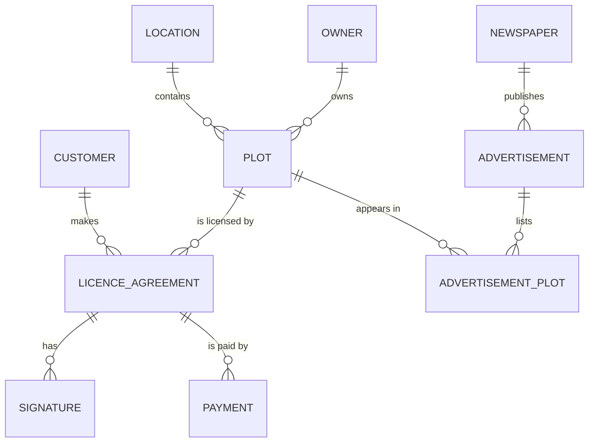
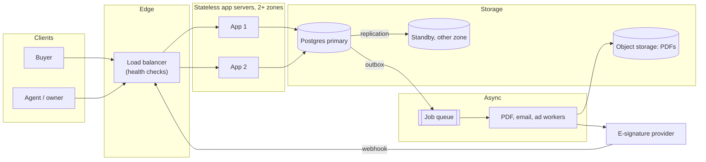
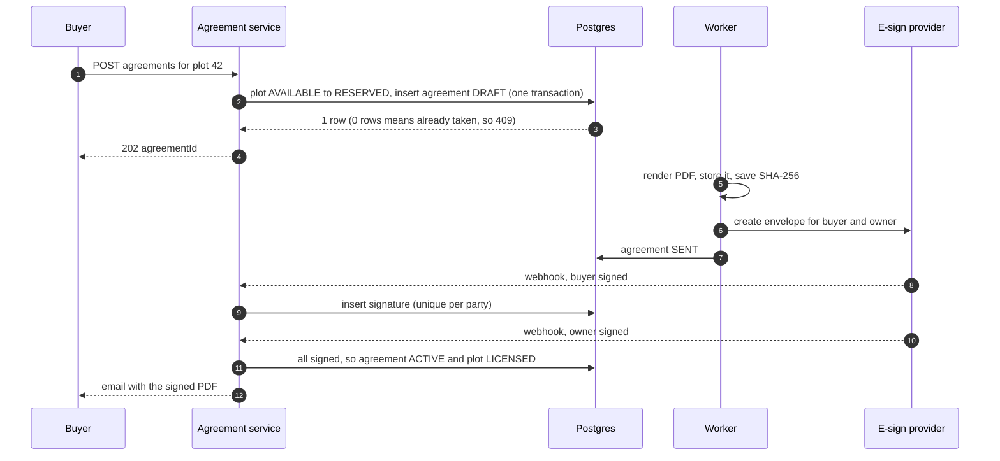

**Short answer:** I first pull the nouns and verbs out of the problem statement: the nouns become tables, the verbs become functions. Then I normalise to 3NF, with a join table for the many-to-many relationship (a plot can have several advertisements, an advertisement can list several plots).

The signing flow is a small state machine: draft, sent, signed by each party, active. The PDF is stored in object storage with a hash, and the plot is reserved with a conditional update so it cannot be licensed twice.

## Picture it







**How to read it:**
- The ER picture: a crow's foot is the "many" end. `ADVERTISEMENT_PLOT` is the join table that turns a many-to-many into two one-to-many links.
- Steps 1–4: the plot is reserved and the draft created in one transaction, so two buyers cannot both start an agreement.
- Steps 5–7: slow work (PDF, provider call) runs in a worker and can be retried.
- Steps 8–12: webhooks may arrive twice or out of order. The unique signature per party makes repeats harmless.

## Requirements

The real statement was long and is not public, so I state my reading of it.

**Functions extracted**
- Plots: add, edit, price, search, show status.
- People: register owners and customers.
- Agreements: create, send, sign, pay the deposit, cancel, expire.
- Advertising: book an advertisement in a newspaper for one or more plots, and track its cost.

**Non-functional**
- A plot is never licensed to two customers at once.
- A signed agreement can never be changed, and can be proved later (hash, audit trail).
- Modest traffic; correctness and availability matter more than throughput.

## Estimates

- 100k plots, 500 agreements a day, 50 reads per second at peak: one Postgres is plenty.
- 500 PDFs × 1 MB × 365 is about 180 GB a year, which belongs in object storage, not in the database.

## API

```text
GET  /plots?city=Pune&minArea=200&maxPrice=5000000&cursor=
POST /agreements            Idempotency-Key  { plotId, customerId, terms } -> 202 { agreementId, state }
GET  /agreements/{id}
POST /agreements/{id}/cancel
POST /webhooks/esign        (signed by the provider; idempotent)
POST /advertisements        { newspaperId, runDate, plotIds[] }
```

## Data model

```sql
CREATE TABLE location (
  id bigint GENERATED ALWAYS AS IDENTITY PRIMARY KEY, city text NOT NULL, region text NOT NULL,
  UNIQUE (city, region));
CREATE TABLE owner (
  id bigint GENERATED ALWAYS AS IDENTITY PRIMARY KEY, name text NOT NULL, email text NOT NULL UNIQUE);
CREATE TABLE customer (
  id bigint GENERATED ALWAYS AS IDENTITY PRIMARY KEY, name text NOT NULL, email text NOT NULL UNIQUE);
CREATE TABLE plot (
  id bigint GENERATED ALWAYS AS IDENTITY PRIMARY KEY,
  owner_id bigint NOT NULL REFERENCES owner(id),
  location_id bigint NOT NULL REFERENCES location(id),
  survey_no text NOT NULL, area_sqm numeric(12,2) NOT NULL CHECK (area_sqm > 0),
  price numeric(14,2) NOT NULL CHECK (price > 0),
  status text NOT NULL CHECK (status IN ('AVAILABLE', 'RESERVED', 'LICENSED')),
  UNIQUE (location_id, survey_no));
CREATE TABLE licence_agreement (
  id bigint GENERATED ALWAYS AS IDENTITY PRIMARY KEY,
  plot_id bigint NOT NULL REFERENCES plot(id),
  customer_id bigint NOT NULL REFERENCES customer(id),
  state text NOT NULL CHECK (state IN ('DRAFT', 'SENT', 'ACTIVE', 'CANCELLED', 'EXPIRED')),
  agreed_price numeric(14,2) NOT NULL, pdf_key text, pdf_sha256 text,
  starts_on date, ends_on date, created_at timestamptz NOT NULL DEFAULT now());
CREATE UNIQUE INDEX one_open_agreement_per_plot ON licence_agreement (plot_id)
  WHERE state IN ('DRAFT', 'SENT', 'ACTIVE');
CREATE TABLE signature (
  agreement_id bigint REFERENCES licence_agreement(id),
  party text CHECK (party IN ('OWNER', 'CUSTOMER')),
  signed_at timestamptz NOT NULL, provider_ref text NOT NULL, PRIMARY KEY (agreement_id, party));
CREATE TABLE payment (
  id bigint GENERATED ALWAYS AS IDENTITY PRIMARY KEY,
  agreement_id bigint NOT NULL REFERENCES licence_agreement(id),
  amount numeric(14,2) NOT NULL, provider_ref text NOT NULL UNIQUE);
CREATE TABLE newspaper (
  id bigint GENERATED ALWAYS AS IDENTITY PRIMARY KEY, name text NOT NULL UNIQUE);
CREATE TABLE advertisement (
  id bigint GENERATED ALWAYS AS IDENTITY PRIMARY KEY,
  newspaper_id bigint NOT NULL REFERENCES newspaper(id), run_date date NOT NULL, cost numeric(12,2) NOT NULL);
CREATE TABLE advertisement_plot (
  advertisement_id bigint REFERENCES advertisement(id), plot_id bigint REFERENCES plot(id),
  headline text, PRIMARY KEY (advertisement_id, plot_id));
```

Why this is in 3NF:
- **1NF:** one value per column. Plots in an advertisement are rows, not a comma-separated list.
- **2NF:** in `advertisement_plot`, `headline` depends on the whole key. The run date depends on the advertisement alone, so it lives there.
- **3NF:** the city is in `location`, not repeated per plot; the newspaper's name is in `newspaper`.
- `agreed_price` is not duplication: it is the price on the day of signing, which must not move with `plot.price`.

## Architecture

The flowchart in **Picture it** shows the components: stateless servers behind a load balancer, one Postgres with a standby, workers for slow jobs.

## Deep dives

**1. Never license a plot twice.** Two guards:
- The app: `UPDATE plot SET status = 'RESERVED' WHERE id = :id AND status = 'AVAILABLE'`. Zero rows means 409.
- The database: the partial unique index allows one open agreement per plot, even if a bug skips the update.

**2. Signing safely.**
- Freeze the PDF before sending it, and store its SHA-256. A change of terms makes a new agreement.
- Verify the webhook signature, lock the agreement row (`SELECT ... FOR UPDATE`), insert into `signature` with `ON CONFLICT DO NOTHING`, then check whether both parties are in.
- The lock matters: without it, two webhooks at once could each see only their own signature, and the agreement would never become active.
- A daily job cancels agreements unsigned after 7 days and frees the plot, after checking with the provider that they really are unsigned.

## Trade-offs

- **Status on `plot` and state on the agreement:** slight duplication, but search needs the status without a join. Both change in one transaction.
- **E-signature provider vs our own:** buying gives legal proof and identity checks; the cost is a dependency and webhooks.
- **Monolith vs services:** one Spring Boot app with modules fits this traffic.

## Follow-ups

**Explain the relationships between the tables.**
- *One-to-many:* owner to plots, location to plots, customer to agreements, agreement to payments, newspaper to advertisements. The foreign key sits on the "many" side.
- *One-to-many over time:* a plot has many agreements in its history, but at most one open.
- *Many-to-many:* advertisements and plots, through `advertisement_plot` with a composite key.
- *One-to-one (none here):* it would be a foreign key with a `UNIQUE` constraint.

**Write a medium-level query with subqueries.** Available plots priced below the average of their city that were never advertised:

```sql
SELECT p.id, l.city, p.price
FROM plot p
JOIN location l ON l.id = p.location_id
WHERE p.status = 'AVAILABLE'
  AND p.price < (SELECT avg(p2.price)                       -- correlated subquery
                 FROM plot p2 JOIN location l2 ON l2.id = p2.location_id
                 WHERE l2.city = l.city)
  AND NOT EXISTS (SELECT 1 FROM advertisement_plot ap WHERE ap.plot_id = p.id)
ORDER BY l.city, p.price;
```

- `NOT EXISTS` is safe with nulls; `NOT IN` returns no rows if the subquery yields a null.
- A window function (`avg(price) OVER (PARTITION BY city)`) in a derived table computes each city's average once.

**How do load balancing and several servers give fault tolerance?**
- The balancer sends requests only to servers that pass health checks, so a dead one stops getting traffic in seconds.
- Servers are stateless (session in a token or Redis), so any server can serve the next request.
- Keep N+1 capacity in two zones: losing one server still leaves enough.
- The balancer and the database must not be single points either: a managed multi-zone balancer, and a standby with automatic failover.
- Clients retry with an idempotency key, so a request cut off half-way is not done twice.

Related lessons: [Q10 · Data modeling](../academy/lessons/Q10.md), [H4 · System design interview kit](../academy/lessons/H4.md).
