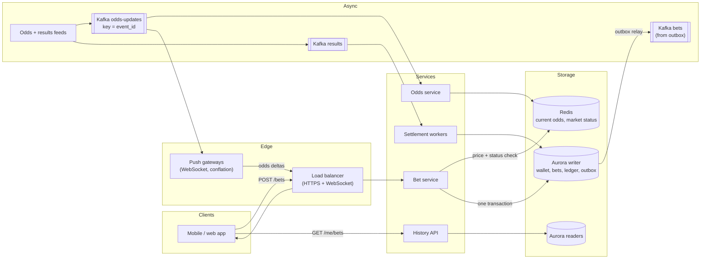
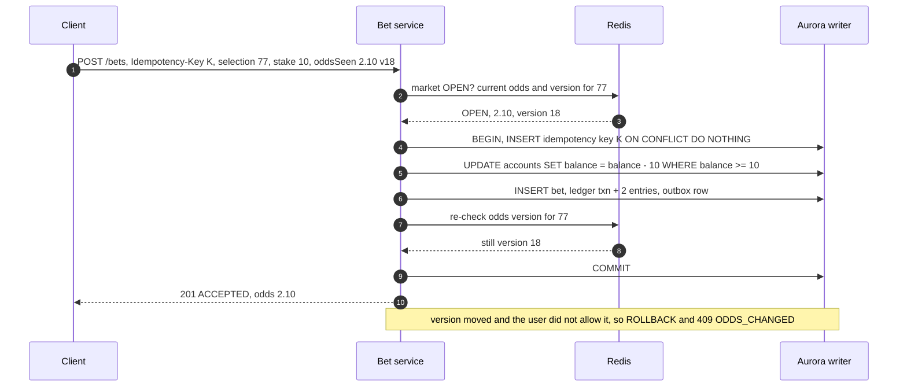
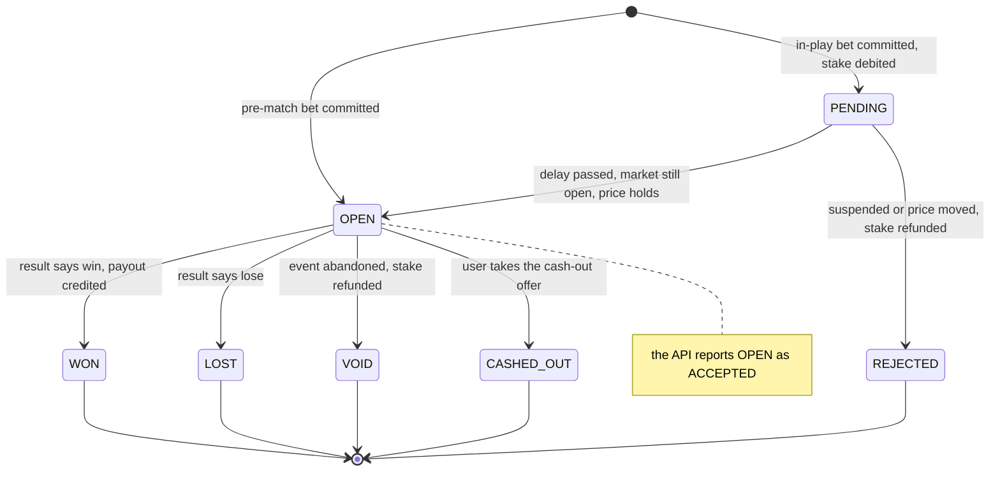

**Short answer:** Split the system by what each part can tolerate. **Odds can be eventually consistent; money can't.** Odds are read-heavy: a feed goes into Kafka, the current price sits in Redis, and WebSocket gateways push it to clients. Bets are write-critical. Each bet is **one Postgres (Aurora) transaction**: claim the idempotency key, debit the wallet with a conditional update, insert the bet, the double-entry ledger rows and an outbox row, re-check the odds version, commit. Settlement is a batched, idempotent job driven by a result event. I scale reads with Redis and replicas, partition `bets` by time, and keep sharding by user as a last step.

## Picture it







**How to read it:**
- Steps 1–3: odds and market status are read from Redis. A suspended market or a price the user did not agree to is rejected here, before any row is touched.
- Steps 4–6: one database transaction. The idempotency key is claimed first, so a retry stops before the money moves. The conditional `UPDATE` is the double-spend guard. The bet, the ledger entries and the outbox row commit together or not at all.
- Steps 7–9: a last look at the odds version just before `COMMIT`. If the price moved and the user did not accept changes, roll back and return the new price.
- The state picture: only `OPEN` bets are settled. Every move out of `OPEN` is guarded by `WHERE status = 'OPEN'`, which is what makes settlement and cash-out safe to retry. Cash-out is an extension; it is out of the core scope in [F8](../academy/lessons/F8.md).

## Requirements

Functional: browse events, markets and selections with live odds; place a single bet at the current price; wallet balance, deposits and withdrawals; bet history; automatic settlement and payout; responsible-gambling limits and self-exclusion.

Out of scope (say it): accumulators, in-house pricing, KYC, payment-provider internals.

Non-functional:
- An accepted bet is never lost; no double debit; money is never created or destroyed.
- Bet placement p99 under ~300 ms (excluding any in-play delay), ~99.95% available during events.
- Odds on screen at most ~1 s behind the source.
- A full audit trail of every money movement.

## Estimates

All numbers are assumptions to state and check with the interviewer.

```text
Normal busy evening:  ~100k concurrent users, ~400 bets/s peak
Big final (~10x):     ~1M concurrent users = ~1M WebSocket connections
  Odds:  ~20 selections watched per client, ~5 changes/s in-play
         naive 5M msgs/s, conflated to 2 msgs/s/client = 2M msgs/s, ~400 MB/s egress
  Bets:  ~330 bets/s before kick-off, bursts of 3,000-5,000 bets/s after a goal
         ~7 row writes per bet = ~35,000 row writes/s at the burst
  Settlement: 200k-2M open bets on one market, all decided at the final whistle
Storage: ~10M bets/day x ~1 KB (bet + ledger + indexes) = ~10 GB/day
```

The conclusion: **reads (odds fan-out) are the scaling problem; writes (bets) are the correctness problem** at a rate one well-sized writer can handle if each transaction is tiny. And the spike is scheduled: kick-off times are known, so pre-scale gateways, pods and connection pools before the match instead of waiting for autoscaling.

## API

```text
GET  /events/{id}/markets        -> markets, selections, odds, odds version (cacheable)
WS   /ws                         -> subscribe by event, receive {eventId, seq, changes[]}
POST /bets   Idempotency-Key: <uuid>
     {selectionId, stake, oddsSeen, oddsVersion, acceptOddsChange: NONE | HIGHER | ANY}
     -> 201 {betId, status: ACCEPTED | PENDING, odds}
     -> 409 ODDS_CHANGED {currentOdds} | 409 MARKET_SUSPENDED
     -> 402 INSUFFICIENT_FUNDS | 422 LIMIT_EXCEEDED
GET  /me/bets?status=OPEN|SETTLED&cursor=...   (keyset pagination)
GET  /me/wallet
```

## Data model

The full schema is in [F8](../academy/lessons/F8.md). The parts that matter:

```sql
-- odds: the current price lives in Redis; Postgres keeps a conflated copy for audit
selections (id, market_id, name, odds NUMERIC(8,2), odds_version BIGINT, result TEXT)
markets    (id, event_id, status TEXT)                 -- OPEN, SUSPENDED, RESULTED

accounts   (id, user_id, kind, balance NUMERIC(14,2),  -- USER_CASH, HOUSE_STAKES, HOUSE_PNL ...
            CHECK (user_id IS NULL OR balance >= 0))   -- backstop: a user can't go negative
ledger_txns    (id UUID, type, bet_id, created_at)     -- BET_STAKE, BET_PAYOUT, BET_REFUND ...
ledger_entries (id, txn_id, account_id, amount)        -- signed; each txn sums to zero; append-only
bets (id, user_id, selection_id, stake, odds_at_placement, status, payout, placed_at, settled_at)
     PARTITION BY RANGE (placed_at)                    -- monthly partitions
idempotency_keys (user_id, idem_key UUID, bet_id, created_at, PRIMARY KEY (user_id, idem_key))
outbox (id, topic, msg_key, payload, created_at)

CREATE INDEX bets_user_time ON bets (user_id, placed_at DESC, id DESC);          -- my bets
CREATE INDEX bets_open_by_selection ON bets (selection_id) WHERE status = 'OPEN'; -- settlement
```

Two choices to defend. **Double-entry:** a £10 stake is two entries, user cash −10 and `HOUSE_STAKES` +10. Entries are never updated; a mistake is fixed with a reversing transaction. `accounts.balance` is a cached sum, updated in the same transaction and reconciled against the entries continuously. **Idempotency keys in their own table:** Postgres requires a unique constraint on a partitioned table to include the partition key, so a unique key column on `bets` would not work.

## Architecture

The components are in **Picture it** above. Bet service, settlement and history are stateless Spring Boot services. Money lives in one relational database so the debit, the bet and the ledger commit together. Odds live in Redis and Kafka. The outbox relay publishes `BetPlaced` and `BetSettled` to Kafka for liability views, notifications and read models.

## Deep dives

### 1. Bet placement in one transaction

Before the transaction: authenticate, check self-exclusion, check the market is `OPEN` and compare the current odds with `oddsSeen` under `acceptOddsChange` (all from Redis). Then:

```sql
BEGIN;  -- READ COMMITTED

-- a. claim the idempotency key: a retry stops here
INSERT INTO idempotency_keys (user_id, idem_key, created_at)
VALUES (:userId, :key, now())
ON CONFLICT DO NOTHING;
-- 0 rows -> ROLLBACK, then SELECT bet_id FROM idempotency_keys ... and return the original result

-- b. responsible-gambling stake limit, conditional
UPDATE rg_usage SET used = used + :stake
WHERE user_id = :userId AND kind = 'STAKE_DAY' AND period_start = current_date
  AND used + :stake <= :dailyLimit;                    -- 0 rows -> 422 LIMIT_EXCEEDED
-- (the day's rg_usage row must exist first: INSERT ... ON CONFLICT DO NOTHING with used = 0 just before,
--  otherwise the first bet of the day would look like a limit breach)

-- c. debit the wallet, conditional
UPDATE accounts SET balance = balance - :stake
WHERE user_id = :userId AND kind = 'USER_CASH' AND balance >= :stake;   -- 0 rows -> 402

-- d. the bet, at the price validated above
INSERT INTO bets (id, user_id, selection_id, stake, odds_at_placement, status, placed_at)
VALUES (:betId, :userId, :selectionId, :stake, :odds, 'OPEN', now());

-- e. ledger: one txn, two entries that sum to zero
INSERT INTO ledger_txns (id, type, bet_id, created_at) VALUES (:txnId, 'BET_STAKE', :betId, now());
INSERT INTO ledger_entries (txn_id, account_id, amount) VALUES
  (:txnId, :userCashAccount, -:stake),
  (:txnId, :houseStakesAccount, :stake);

-- f. remember the result for retries, g. the event to publish
UPDATE idempotency_keys SET bet_id = :betId WHERE user_id = :userId AND idem_key = :key;
INSERT INTO outbox (topic, msg_key, payload, created_at)
VALUES ('bets', :userId, '{"type":"BetPlaced","betId":...}', now());

-- h. in the service: re-read odds_version for the selection from Redis
--    changed and acceptOddsChange does not allow it -> ROLLBACK, 409 ODDS_CHANGED {currentOdds}
COMMIT;
```

The pessimistic alternative to step c is `SELECT balance FROM accounts WHERE user_id = :userId AND kind = 'USER_CASH' FOR UPDATE`, check in Java, then `UPDATE`. It is equally correct. The conditional update does it in one round trip.

Why this is safe:
- **Lock order is fixed** (key, limit row, wallet), so two bets for one user queue rather than deadlock. Different users never share a row.
- **The house account balance is not updated here.** That would be one row locked by every bet on the platform. Its entries are written; its balance is derived asynchronously.
- **Bet ids come from an ID generator** (UUIDv7 or Snowflake-style), so the id is known before the insert and survives sharding.

### 2. Settlement: batched, idempotent, resumable

A result arrives on Kafka `results`. The settlement service marks the market `RESULTED` and the selection `result`, then several workers drain the open bets in batches:

```sql
BEGIN;
WITH batch AS (
  SELECT id FROM bets
  WHERE selection_id IN (77, 78, 79) AND status = 'OPEN'
  ORDER BY id LIMIT 1000
  FOR UPDATE SKIP LOCKED
)
UPDATE bets b
SET status = CASE WHEN b.selection_id = 77 THEN 'WON' ELSE 'LOST' END,
    payout = CASE WHEN b.selection_id = 77 THEN b.stake * b.odds_at_placement ELSE 0 END,
    settled_at = now()
FROM batch
WHERE b.id = batch.id AND b.status = 'OPEN'
RETURNING b.id, b.user_id, b.stake, b.payout;
-- then, same transaction: a BET_PAYOUT ledger txn per winner (HOUSE_STAKES and HOUSE_PNL to USER_CASH),
-- a stake-to-HOUSE_PNL txn per loser, and one balance credit per user, in ascending account id order
COMMIT;
```

`SKIP LOCKED` gives each worker a different batch without coordination. Short transactions keep locks and table bloat small. 200k bets is 200 batches; with a handful of workers that is seconds to a minute (measure it).

**A crash halfway** loses nothing. The uncommitted batch rolls back and its locks are released, so another worker claims it. Committed batches are already `WON` or `LOST`, so `status = 'OPEN'` skips them. The Kafka offset for the result is committed only after the market has no open bets left, so a restart replays the result and simply finds less to do. Kafka delivers at least once, which is exactly why every step is guarded. A unique key on `(bet_id, type)` for payout ledger transactions is a second backstop against a double payout.

A changed result (a goal awarded on review) is **resettled**: reverse the original ledger transactions with new, opposite ones, then settle again. An abandoned event voids the bets with `BET_REFUND` through the same batch machinery.

### 3. Live odds (brief)

Feed → odds ingest (normalise, add a per-event sequence number) → Kafka `odds-updates` keyed by `event_id`, so every change for one match is in order on one partition → the odds service keeps the current state in Redis → push gateways hold the WebSockets, keep `eventId → connections`, and send each client only the **latest** price per selection every ~250–500 ms (conflation). On reconnect the client gets a snapshot plus deltas after its last `seq`. Full design: [design-live-odds-streaming](design-live-odds-streaming.md).

## Trade-offs

**Where stale data is fine and where it is not:**

| Data | Source | Staleness |
|---|---|---|
| Odds on screen | Redis via gateways | Fine, ~1 s. Odds are eventually consistent. |
| Odds used to accept a bet | Redis, re-checked by version | Not stale: compared with what the user saw, inside the request |
| Wallet balance (for a debit) | Aurora writer only | Never from a cache or a replica. The conditional `UPDATE` reads the live row. |
| Balance shown on screen | Writer, or the value returned by the last bet | A replica could show a balance that was already spent |
| Bet history, statements | Aurora readers / read models | Fine, milliseconds of lag. Show the just-placed bet from the `201` response so the user does not miss it. |
| Catalogue (events, markets) | Redis / CDN cache | Fine, seconds |
| Self-exclusion flag | Redis cache, writer as the truth | Cache for speed; on start, publish an event so every service drops sessions at once |

**Accept at the validated price vs lock the price.** I re-check the version just before `COMMIT` instead of locking the selection row (`FOR SHARE`). Locking would make every bet on the final's favourite contend with the odds writer. The sub-millisecond window that remains is accepted, because **market suspension** on a goal is the real protection.

**The scaling ladder** ([Q8](../academy/lessons/Q8.md)), in order:
1. A bigger writer and small connection pools (sized by Little's law).
2. **Partition `bets` by month on `placed_at`.** Settlement and history only touch recent partitions; old ones are detached and archived.
3. **Read replicas** for history, statements and reports; Redis for odds and the catalogue.
4. **Read models (CQRS)** fed from the outbox: my-bets view, liability per market.
5. **Shard by `user_id`** (wallet and bets together) only when one writer cannot keep up after all of that. Every money transaction touches one user plus append-only house entries, so it stays single-shard. The cost: per-market work (settlement, liability) fans out to every shard, resharding is a project, cross-user queries need a read model, and operations get harder.

**Hot spots at the final.** *Hot Kafka partition:* keying by `event_id` puts the whole final on one partition. Upstream odds volume is small next to the fan-out, so one partition usually copes. If it does not, key by `market_id` and keep the per-selection `seq` for ordering. *Hot rows:* the house account (never updated per bet), a liability counter per market (compute it from the `bets` topic, or split it into buckets), and the selection row (odds written to Postgres conflated, not per tick). Bets themselves are per user, so they never share a row.

**In-play delay.** In-play bets are stored as `PENDING` with the stake already debited. After a few seconds a worker checks the market was not suspended and the price holds, then moves the bet to `OPEN`, or to `REJECTED` with a reversing refund.

**Responsible gambling.** Limits are enforced by conditional updates inside the same transaction (a check before it is write skew). Fail closed: if a limit cannot be checked, refuse the bet. Decreases apply at once; increases wait for a cooling-off period. See [F8](../academy/lessons/F8.md) deep dive 5.

## Follow-ups

- **£100 in the wallet, two £100 bets from two devices at once?** They carry different idempotency keys, so the key does not help; the **row lock** does. Both run `UPDATE accounts SET balance = balance - 100 WHERE ... AND balance >= 100`. The first locks the row and debits to 0. The second waits for that lock. In Postgres under read committed, once the first commits, the second re-evaluates its `WHERE` on the new row version, sees `balance = 0`, updates 0 rows and returns `402`. `CHECK (balance >= 0)` is the backstop. A read-then-write without a lock (`SELECT balance`, check in Java, `UPDATE`) would let both pass. See [Q6](../academy/lessons/Q6.md).
- **Client retries after a timeout?** It resends with the same `Idempotency-Key`. The key is inserted first, in the same transaction as the debit. If the first attempt committed, the retry gets 0 rows and returns the stored `bet_id` and result. If the first is still running, the retry waits on the uncommitted key and then finds it taken. If the first rolled back, the retry proceeds as a new bet. The key and the bet commit together, so there is never one without the other. See [F2](../academy/lessons/F2.md) and [design-idempotent-api](design-idempotent-api.md).
- **Odds changed between seeing and placing?** The client sends `oddsSeen`, `oddsVersion` and `acceptOddsChange`. The server compares with Redis before the transaction and re-checks the version before `COMMIT`. `NONE` rejects any change with `409 ODDS_CHANGED` and the new price, so the client can ask the user to accept it. `HIGHER` accepts only a better price. `ANY` accepts the current price. The accepted price is stored in `odds_at_placement`, and settlement only ever uses that. A suspended market is always rejected.
- **200k bets to settle, and the job crashes halfway?** Parallel workers, batches of ~1000 claimed with `FOR UPDATE SKIP LOCKED`, one short transaction per batch. Uncommitted batches roll back and are picked up again; committed ones are skipped by `status = 'OPEN'`; the Kafka offset is committed only when the market is done, so the job resumes by replaying the result.
- **Where is stale data acceptable?** Odds on screen, the catalogue and bet history: yes. The balance used for a debit, the limit counters and the price used to accept a bet: never. See the table above.

Related: [design-payment-system](design-payment-system.md) and [idempotency-in-payment-systems](idempotency-in-payment-systems.md) for the wallet and deposit flows, and [rdbms-scaling-vs-nosql](rdbms-scaling-vs-nosql.md) for defending Postgres for bets.

## Say it in 2 minutes

"I split the platform by what each part can tolerate: odds can be eventually consistent, money can't. Odds come from feeds into Kafka keyed by event, the current price sits in Redis, and WebSocket gateways push only the latest price per selection a few times a second, so a million clients is a fan-out problem, not a database problem. A bet is one Postgres transaction: claim the idempotency key so retries return the original bet, debit the wallet with `UPDATE ... WHERE balance >= stake` so two devices can't spend the same money, insert the bet, two ledger entries that sum to zero, and an outbox row, then re-check the odds version and commit, or roll back and offer the new price. The wallet balance is only ever read from the primary; history comes from replicas. Settlement listens for the result and drains open bets in batches with `SKIP LOCKED`, guarded by `status = 'OPEN'`, so a crash or a redelivered event never pays twice. For a big final I pre-scale, keep the house account out of the hot path, partition bets by month, add replicas and read models, and shard by user only if one writer can't keep up, because then per-market settlement has to fan out to every shard."

Go deeper: [F8 · Design a sports betting platform](../academy/lessons/F8.md), [Q6 · Transactions, isolation, locking and MVCC](../academy/lessons/Q6.md), [Q8 · Scaling databases](../academy/lessons/Q8.md), [F2 · Distributed theory: CAP, consistency, consensus](../academy/lessons/F2.md).
