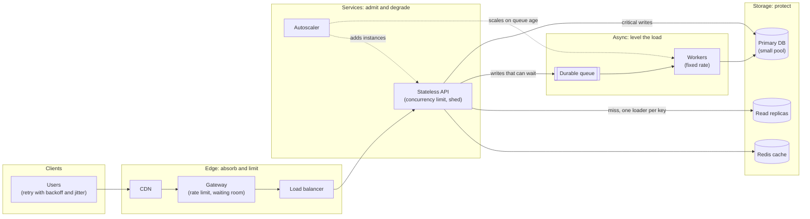
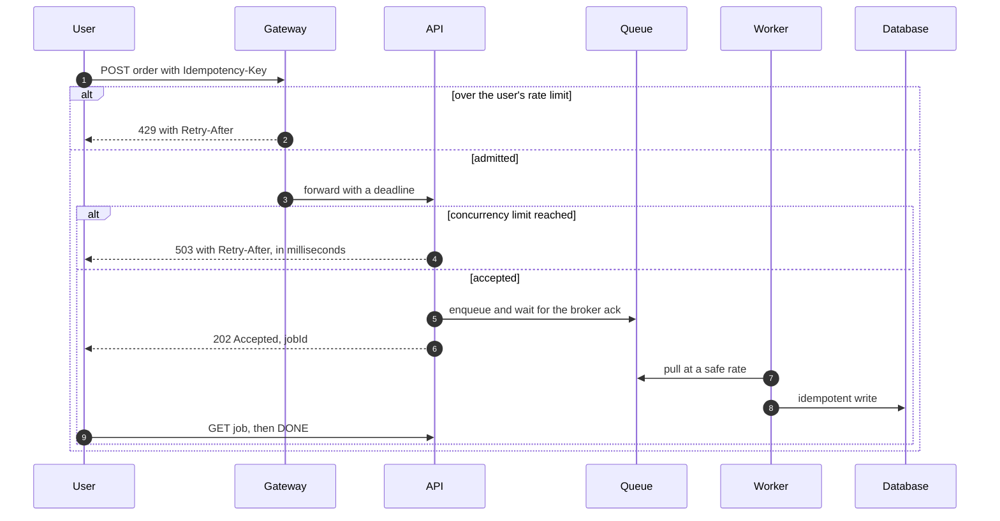
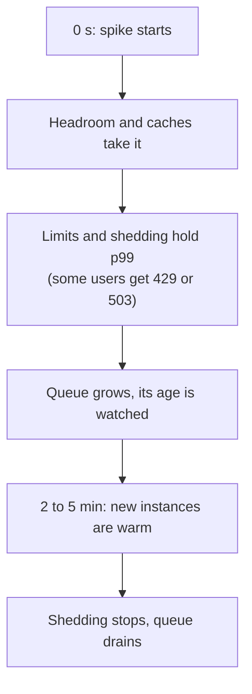

**Short answer:** Autoscaling alone does not survive a sudden spike, because new instances take minutes and the spike takes seconds. So I use layers: absorb what I can (CDN, caches), limit what enters (rate limits, load shedding), queue what can wait, and only then scale out.

I protect the database above all, keep headroom for the first minutes, and degrade on purpose: drop recommendations before checkout. I prove it with a load test before the event.

## Picture it







**How to read it:**
- Follow the first picture left to right: every layer removes some load so the next one sees less.
- In the sequence, a request is refused early and cheaply, or accepted and durable. It never waits in a hidden queue until it times out.
- The third picture is the timeline: headroom and shedding buy the minutes that autoscaling needs.

## Requirements

The reported wording gives no domain. I assume an ordering-type API that normally does 1,000 requests/s and can jump 20× within a minute (a TV advert, a push notification, dinner time).

**Functional**
- Browse (reads) and submit (writes) keep working through the spike.

**Non-functional**
- Accepted requests: p99 under 500 ms, and no accepted write is lost.
- Requests beyond capacity get a fast, clear refusal; the system never collapses.
- Recovery is automatic: after the spike, no human has to restart anything.

## Estimates

Assumptions: 90% reads, and one instance handles 400 requests/s.

| | Normal | Spike |
|---|---|---|
| Total | 1,000/s | 20,000/s |
| Reads (90%) | 900/s | 18,000/s |
| Reads left after a 95% cache hit | 45/s | 900/s |
| Writes (10%) | 100/s | 2,000/s |
| Instances, if no request stops at the CDN | 3 | 50 |

- **Queue maths:** writes arrive at 2,000/s for 5 minutes and workers do 800/s. Backlog = 1,200 × 300 = 360,000.
- After the spike, spare capacity is 800 − 100 = 700/s, so it drains in about 8.5 minutes. If users cannot wait that long, add workers or shed earlier.

## API

```text
GET  /items/{id}              Cache-Control: max-age=30, stale-while-revalidate=300
POST /orders  Idempotency-Key -> 202 { jobId }
                              -> 429 Retry-After    (your limit)
                              -> 503 Retry-After    (our limit)
GET  /jobs/{jobId}            -> QUEUED | DONE | FAILED
```

## Data model

```sql
job(id PK, idempotency_key UNIQUE, user_id, payload, state, attempts, created_at)
orders(id PK, job_id UNIQUE, ...)        -- a redelivered message cannot create a second order
```

- The queue message carries the job id and the key. The worker inserts the `job` row, so accepting a request needs no database write.
- `GET /jobs/{id}` answers `QUEUED` when the row is not there yet.

## Architecture

See **Picture it**. Each layer has one job:

- **CDN and cache:** answer repeat reads.
- **Gateway:** token-bucket limit per user or IP; a waiting room for known events.
- **API:** stateless, with a cap on in-flight requests.
- **Queue:** turns a burst into a steady flow.
- **Database:** sees only a fixed number of connections, whatever happens above.

## Deep dives

**1. Load shedding: say no early.** Little's law: in-flight = arrival rate × latency.

When latency rises, in-flight rises, threads and memory run out, and every request fails, not only the extra ones.
- Cap in-flight requests per instance (a semaphore, or an adaptive limit that shrinks when latency grows). Over the cap, return 503 at once.
- Shed by priority: health checks and checkout are kept longest, search next, recommendations go first.
- Carry a deadline with each request and drop work whose caller has already given up.
- Keep in-process queues short. A long queue gives everyone an answer that is already too late.

**2. Scaling fast enough.**
- Scale on requests per instance or queue age, not only CPU, which lags.
- Keep headroom (run at about 50–60% of capacity) and schedule scaling before known peaks.
- Cut start-up time: small images, class data sharing, and readiness only after caches and pools are ready.
- Scale out quickly and in slowly, or the fleet flaps.
- Check the ceiling: 50 instances × 10 connections = 500 database connections. Use a pooler such as PgBouncer.

**3. Stop the spike from feeding itself.**
- *Retry storm:* clients use exponential backoff with jitter, and a retry budget (for example at most 10% extra traffic). Retry at one layer only.
- *Cache stampede:* one loader per key (single-flight), jittered TTLs, serve stale while refreshing.
- *Slow dependency:* timeout, circuit breaker, and a bulkhead so its threads are separate.
- *Hot key:* a small in-process cache in front of Redis.

**4. Balancing.** Use least-outstanding-requests with slow start, so a cold instance is not flooded the moment it joins.

## Trade-offs

- **Shed vs queue:** queue work that is still useful later (emails, order processing); shed work that is useless late (a page load).
- **202 vs a direct answer:** smooths writes, but the client needs a status page and you must handle a later failure.
- **Headroom vs cost:** idle capacity costs money every day. Pay for the first few minutes only and let autoscaling do the rest.
- **Stale data vs availability:** a menu that is 30 s old is fine; a stock count at checkout is not.

## Follow-ups

- *The spike is an attack?* Filter at the CDN/WAF, per-IP and per-account limits, bot challenges.
- *Writes cannot be queued?* Partition by key, keep transactions short, use conditional updates, and put a waiting room in front.
- *Redis dies in the spike?* At a 95% hit ratio the database would get 20× the reads. Limit loader concurrency, serve stale in-process data, shed the rest.
- *How do you know it works?* Step and spike load tests in production-like conditions, plus killing an instance and the cache during the test.
- *What do you alert on?* p99 latency, shed rate, queue age, connection-pool wait time and error rate.

Related lessons: [I3 · Resilience patterns](../academy/lessons/I3.md), [H4 · System design interview kit](../academy/lessons/H4.md).
