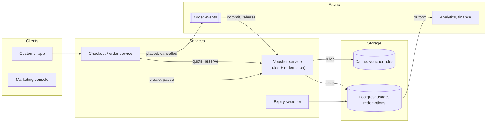
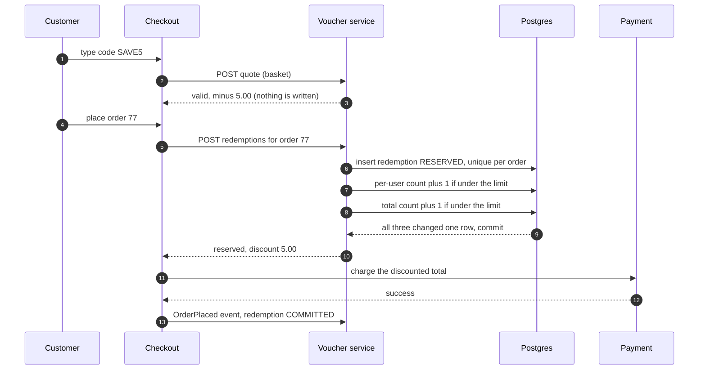
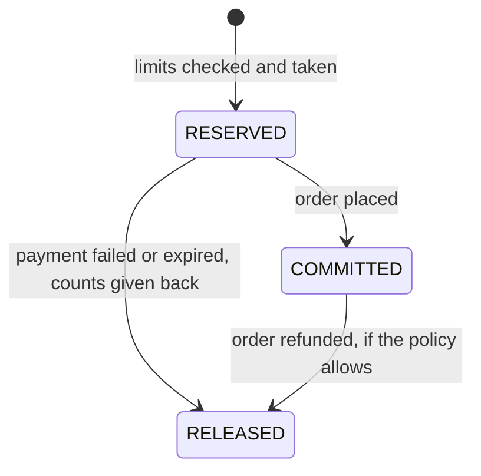

**Short answer:** I separate *quoting* a voucher (read-only, shows the discount) from *redeeming* it (a write). Redeeming is a reservation tied to the order: reserve at checkout, commit when the order is placed, release if payment fails or times out.

Limits are enforced by conditional updates in Postgres (`WHERE used < max_uses`), so two requests can never take the last use. Every redeem is idempotent on the order id, so a retry never uses a voucher twice.

## Picture it







**How to read it:**
- Steps 1–3: the quote is only advice. It can be wrong a second later, and that is fine.
- Steps 4–10: the reservation is authoritative. If any of the three statements changes no row, the whole transaction rolls back.
- Steps 11–13: payment happens with no database lock held, and the outcome commits or releases the reservation.
- A lost "release" is covered by the sweeper, which expires old reservations.

## Requirements

The reported wording is one line, so I assume this scope.

**Functional**
- Apply a code to a basket: see the discount or a clear reason for refusal.
- Rules: date window, minimum basket, percentage or fixed amount with a cap, first order only, chosen restaurants.
- Limits: total uses, uses per user, total budget.
- One voucher per order (no stacking). Marketing can create and pause vouchers.

**Non-functional**
- Never exceed a limit; never use a voucher twice for one order.
- Quote p99 under 50 ms, reserve p99 under 150 ms.
- If the voucher service is down, customers can still order without a voucher.

## Estimates

Assumptions:
- 2M orders a day, 20% with a voucher: 400k redemptions/day, about 5/s average, 50/s at peak.
- Quotes are 10× that: about 500/s at peak, mostly from cache.
- A viral code can send 2,000 reserve attempts/s to *one* row. That is the hard case.
- A redemption row of 200 bytes × 400k is 80 MB a day.

## API

```text
POST /vouchers/{code}/quote      { userId, basket }          -> { valid, discountPence, reason }
POST /redemptions                { code, userId, orderId, basket }
     -> 201 { redemptionId, discountPence, expiresAt }       (same orderId again: same answer)
     -> 409 LIMIT_REACHED | ALREADY_USED | EXPIRED | OTHER_VOUCHER_ON_ORDER
     -> 422 NOT_ELIGIBLE
POST /redemptions/{id}/commit | release                      (idempotent)
POST /vouchers , PATCH /vouchers/{id}                        (marketing)
```

## Data model

```sql
CREATE TABLE voucher (
  id bigint PRIMARY KEY, code text NOT NULL UNIQUE,           -- stored upper-case
  kind text NOT NULL, value int NOT NULL, max_discount_pence int,
  min_basket_pence int NOT NULL DEFAULT 0, rules jsonb NOT NULL DEFAULT '{}',
  starts_at timestamptz NOT NULL, ends_at timestamptz NOT NULL, active boolean NOT NULL,
  max_uses int NOT NULL, max_uses_per_user int NOT NULL CHECK (max_uses_per_user > 0));
CREATE TABLE voucher_usage (
  voucher_id bigint PRIMARY KEY REFERENCES voucher(id), used int NOT NULL DEFAULT 0);
CREATE TABLE voucher_user_usage (
  voucher_id bigint, user_id bigint, used int NOT NULL, PRIMARY KEY (voucher_id, user_id));
CREATE TABLE redemption (
  id uuid PRIMARY KEY, voucher_id bigint NOT NULL REFERENCES voucher(id),
  user_id bigint NOT NULL, order_id bigint NOT NULL, discount_pence int NOT NULL,
  state text NOT NULL, expires_at timestamptz NOT NULL);
CREATE UNIQUE INDEX one_live_per_order ON redemption (order_id) WHERE state <> 'RELEASED';
```

- Rules change rarely and are cached; counters change often and are not. That is why they are separate tables.
- Money is stored in whole pence, never in floating point.

## Architecture

The picture above shows the components. The voucher service is one Spring Boot app over one Postgres: the traffic does not need more.

## Deep dives

**1. The reserve transaction.** Four statements, and any zero-row result means roll back and explain why.

```sql
-- 1. idempotency: one live redemption per order
INSERT INTO redemption (id, voucher_id, user_id, order_id, discount_pence, state, expires_at)
VALUES (:id, :voucher, :user, :order, :discount, 'RESERVED', now() + interval '15 minutes')
ON CONFLICT (order_id) WHERE state <> 'RELEASED' DO NOTHING;   -- 0 rows: read and return the existing one

-- 2. per-user limit
INSERT INTO voucher_user_usage AS u (voucher_id, user_id, used) VALUES (:voucher, :user, 1)
ON CONFLICT (voucher_id, user_id) DO UPDATE SET used = u.used + 1 WHERE u.used < :maxPerUser;

-- 3. total limit, last because this row is the busiest
UPDATE voucher_usage SET used = used + 1 WHERE voucher_id = :voucher AND used < :maxUses;
```

The fourth is the commit. The second concurrent caller waits on the row lock, sees the new count, and changes no row when the limit is reached.

On a zero-row step 1, compare the stored voucher and user with the request: equal means a retry, different means 409.

**2. Commit, release and crashes.** Each is a conditional update, so duplicates are harmless.

```sql
UPDATE redemption SET state = 'RELEASED' WHERE id = :id AND state = 'RESERVED';
-- 1 row: also give back both counters in the same transaction; 0 rows: someone already decided
```

- The reservation lives longer (15 min) than the longest payment wait, so it does not expire during payment.
- If commit still arrives after expiry, honour the discount the customer saw, count it as used and raise a metric.
- Before releasing, the sweeper asks the order service; "unknown" means try again later.

**3. The hot code.** One row serialises all its updates, so throughput is about 1 / (time the lock is held).
- Do the counter update last and keep no network call inside the transaction.
- Reject early from cache once the code is exhausted; most of a viral rush is refusals.
- If that is not enough, split the counter into N slices of `max_uses / N`, try a random slice, then the others. The sum can never exceed the limit.
- Or admit through a Redis counter first, with Postgres still the final check.

**4. Rules.**
- Each rule is a small class with one method, `check(voucher, basket, user)`, run in order (Chain of Responsibility).
- A new rule is a new class, and each returns a reason code the app can translate.

## Trade-offs

- **Reserve and commit vs use at once:** more states, but a failed payment gives the voucher back.
- **Postgres vs Redis counters:** Redis is faster, but counter and redemption could disagree after a crash. Start with Postgres.
- **Fail open or closed:** quote failing means "try without a voucher". Reserve failing must never mean a free discount.
- **Counters vs `COUNT(*)` of redemptions:** counting reads many rows and races; counters need care on release, so a nightly job compares the two.

## Follow-ups

- *Total budget instead of uses?* The same conditional update on `spent_pence + :discount <= budget_pence`.
- *Unique single-use codes?* One row per code and `UPDATE ... SET state = 'RESERVED' WHERE code = :c AND state = 'NEW'`. Use long random codes.
- *Guessing codes?* Rate limit by user and IP, and give the same error for "unknown" and "not for you".
- *Many accounts by one person?* Limit by payment card fingerprint or address too; fraud scoring can refuse.
- *Basket changes after the quote?* Reserve recomputes everything from the basket sent by checkout.
- *Stacking vouchers?* Make the unique index `(order_id, voucher_id)` and define the order of application.

Related lessons: [Q6 · Transactions, isolation, locking and MVCC](../academy/lessons/Q6.md), [H4 · System design interview kit](../academy/lessons/H4.md).
