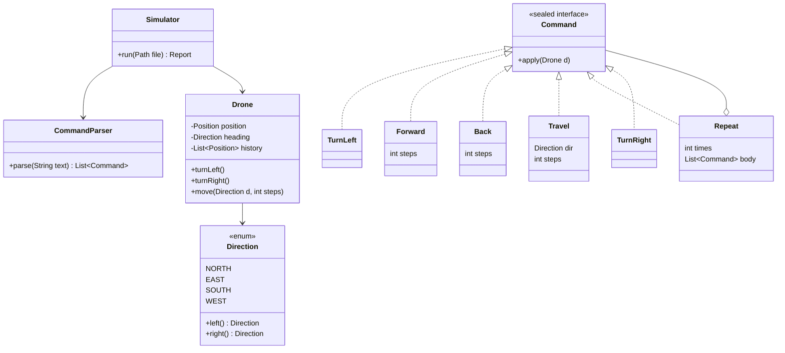
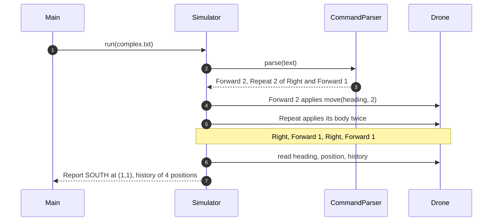

**Short answer:** Separate **parsing** from **moving**. A `CommandParser` turns the input file into a list of `Command` objects (`TurnLeft`, `TurnRight`, `Forward(n)`, `Back(n)`, `Travel(direction, n)`, and for the complex file `Repeat(n, body)`). A `Drone` holds its `Position`, its `Direction` heading and its coordinate history, and knows only how to turn and move. A `Simulator` applies each command to the drone and returns a `Report` (heading, final coordinates, history). `Direction` is an enum with `left()`, `right()` and a unit vector, so turning is arithmetic, not a chain of `if`s. This is the Command pattern, plus Composite for `Repeat`, and every rule is unit-testable without files.

## Picture it





**How to read it:**
- The parser knows text, the drone knows geometry, and `Command` is the only thing they share. A new input format changes only the parser; a new move changes only a command.
- `Repeat o-- Command` is the Composite: a repeat block is itself a command that holds other commands, so nesting works for free.
- Trace: start at (0,0) facing NORTH. `Forward 2` gives (0,2). Right, so EAST, `Forward 1` gives (1,2). Right, so SOUTH, `Forward 1` gives (1,1). Final heading SOUTH.

## Requirements

Assumptions I would state and confirm:

- The city is a grid. `x` grows east, `y` grows north. Start at (0,0) facing NORTH.
- Commands: `LEFT`/`L` and `RIGHT`/`R` turn 90 degrees without moving. `FORWARD n`/`F n` moves along the heading; `BACK n`/`B n` moves opposite to it without turning. `NORTH n`, `SOUTH n`, `EAST n`, `WEST n` move in that absolute direction **without changing the heading** (a drone can strafe). If they want "turn to face north, then fly", it is a one-line change in `Travel`.
- The basic file has one command per line. The complex file allows several per line, separated by spaces or commas, and `REPEAT n [ ... ]` blocks, which may nest.
- Output: final heading, final coordinates, and the position after every command (the history).
- Bad input fails with a clear message naming the token, never with a stack trace.

## Classes

- `Direction` (enum): `NORTH, EAST, SOUTH, WEST` in clockwise order with `dx`, `dy`. `right()` is the next constant, `left()` the previous one, using modulo 4.
- `Position` (record): immutable `x`, `y` and `move(direction, steps)`.
- `Drone`: mutable state (position, heading, history), with small methods only. It does not know about text.
- `Command` (sealed interface) and its records: each implements `apply(Drone)`.
- `CommandParser`: tokenizer plus a small recursive-descent parser for `REPEAT` blocks.
- `Simulator`: reads the file, parses, applies, builds the `Report` record.

## Patterns used

- **Command:** each instruction is an object with `apply`. This lets you log, validate, count, replay or undo instructions, and keeps the drone free of parsing.
- **Composite:** `Repeat` holds a list of commands and is a command itself.
- **Interpreter (light):** the parser defines a tiny grammar (`program := command*`, `command := word number? | REPEAT number [ program ]`) and the command objects are its syntax tree.
- **Enum with behaviour** for directions instead of `switch` statements spread across the code.

## Code

```java
public enum Direction {
    NORTH(0, 1), EAST(1, 0), SOUTH(0, -1), WEST(-1, 0);

    final int dx, dy;
    Direction(int dx, int dy) { this.dx = dx; this.dy = dy; }

    public Direction right()    { return values()[(ordinal() + 1) % 4]; }
    public Direction left()     { return values()[(ordinal() + 3) % 4]; }
    public Direction opposite() { return values()[(ordinal() + 2) % 4]; }
}

public record Position(int x, int y) {
    public Position move(Direction d, int steps) {
        return new Position(Math.addExact(x, d.dx * steps), Math.addExact(y, d.dy * steps));
    }
}

public final class Drone {
    private Position position = new Position(0, 0);
    private Direction heading = Direction.NORTH;
    private final List<Position> history = new ArrayList<>(List.of(position));

    public void turnLeft()  { heading = heading.left(); }
    public void turnRight() { heading = heading.right(); }

    public void move(Direction d, int steps) {
        position = position.move(d, steps);
        history.add(position);
    }

    public Direction heading()     { return heading; }
    public Position position()     { return position; }
    public List<Position> history() { return List.copyOf(history); }
}
```

```java
public sealed interface Command permits TurnLeft, TurnRight, Forward, Back, Travel, Repeat {
    void apply(Drone d);
}
record TurnLeft()  implements Command { public void apply(Drone d) { d.turnLeft(); } }
record TurnRight() implements Command { public void apply(Drone d) { d.turnRight(); } }
record Forward(int steps) implements Command { public void apply(Drone d) { d.move(d.heading(), steps); } }
record Back(int steps)    implements Command { public void apply(Drone d) { d.move(d.heading().opposite(), steps); } }
record Travel(Direction dir, int steps) implements Command { public void apply(Drone d) { d.move(dir, steps); } }
record Repeat(int times, List<Command> body) implements Command {
    public void apply(Drone d) {
        for (int i = 0; i < times; i++) body.forEach(c -> c.apply(d));
    }
}
```

The parser:

```java
public final class CommandParser {
    private List<String> tokens;
    private int pos;

    public List<Command> parse(String text) {
        tokens = Arrays.stream(text.replace("[", " [ ").replace("]", " ] ").split("[\\s,]+"))
                       .filter(t -> !t.isBlank()).toList();
        pos = 0;
        return parseBlock(false);
    }

    private List<Command> parseBlock(boolean insideRepeat) {
        List<Command> out = new ArrayList<>();
        while (pos < tokens.size()) {
            String t = tokens.get(pos++).toUpperCase(Locale.ROOT);
            if (t.equals("]")) {
                if (!insideRepeat) throw error("unexpected ]");
                return out;
            }
            out.add(switch (t) {
                case "L", "LEFT"     -> new TurnLeft();
                case "R", "RIGHT"    -> new TurnRight();
                case "F", "FORWARD"  -> new Forward(number());
                case "B", "BACK"     -> new Back(number());
                case "N", "NORTH"    -> new Travel(Direction.NORTH, number());
                case "S", "SOUTH"    -> new Travel(Direction.SOUTH, number());
                case "E", "EAST"     -> new Travel(Direction.EAST, number());
                case "W", "WEST"     -> new Travel(Direction.WEST, number());
                case "REPEAT" -> {
                    int n = number();
                    expect("[");
                    yield new Repeat(n, parseBlock(true));
                }
                default -> throw error("unknown command '" + t + "'");
            });
        }
        if (insideRepeat) throw error("missing ]");
        return out;
    }

    private int number() {
        if (pos >= tokens.size()) throw error("expected a number");
        try {
            int n = Integer.parseInt(tokens.get(pos++));
            if (n < 0) throw error("negative count");
            return n;
        } catch (NumberFormatException e) {
            throw error("expected a number, got '" + tokens.get(pos - 1) + "'");
        }
    }

    private void expect(String s) {
        if (pos >= tokens.size() || !tokens.get(pos++).equals(s)) throw error("expected " + s);
    }

    private CommandSyntaxException error(String msg) {
        return new CommandSyntaxException(msg + " at token " + pos);
    }
}
```

The simulator and report:

```java
public record Report(Direction heading, Position finalPosition, List<Position> history) {}

public final class Simulator {
    private final CommandParser parser = new CommandParser();

    public Report run(Path file) throws IOException {
        List<Command> commands = parser.parse(Files.readString(file));
        Drone drone = new Drone();
        commands.forEach(c -> c.apply(drone));
        return new Report(drone.heading(), drone.position(), drone.history());
    }
}
```

`Main` prints the report: `Heading: SOUTH`, `Position: (1, 1)`, then one history line per position.

## Extensions

- **City bounds and obstacles.** Add a `City` with `width`, `height` and blocked cells. `Drone.move` steps one cell at a time and asks `city.isFree(next)`; the policy (stop at the wall, ignore the command, or fail) is a strategy you choose with the interviewer. Record every unit step in the history if they want the full path.
- **Undo and replay.** Each command gets an `undo(Drone)` (turn the other way, move back), or the drone saves a snapshot (Memento) before each command. Replay is re-applying the list to a fresh drone.
- **Very large or endless input.** Parse line by line with `Files.lines` and apply as you go instead of building the full list, and cap the history (or write it to a file). Guard `REPEAT` bombs: limit the total expanded steps. `Math.addExact` already turns coordinate overflow into an error.
- **Several drones.** One `Drone` per thread is safe because nothing is shared. A shared `City` with collision checks needs a lock or a `ConcurrentHashMap` of occupied cells.
- **Testing.** `Direction`: four lefts or four rights return to the start. `Position.move` for each direction. Parser: valid basic and complex samples, nested `REPEAT`, unknown word, missing number, missing `]`, lowercase input. Simulator: the two sample files give the expected heading, position and history (golden-file tests).

Go deeper: [E4 · Behavioural patterns](../academy/lessons/E4.md), [E5 · The LLD interview method](../academy/lessons/E5.md), [E1 · SOLID, by violation and refactor](../academy/lessons/E1.md).
