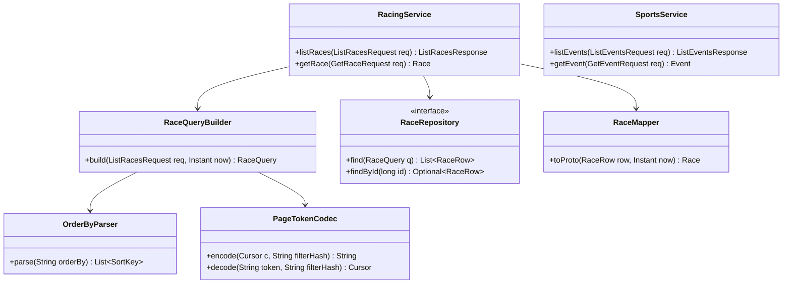
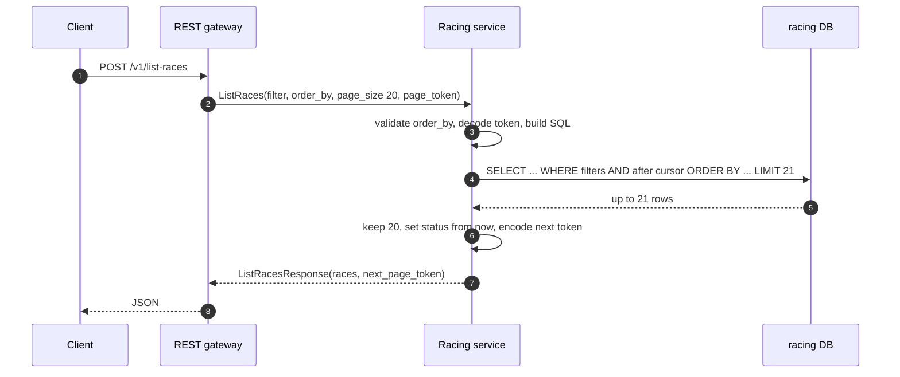

**Short answer:** The test is five or six small PRs on a gRPC `Racing` service behind a REST gateway. My decisions: an **`optional` visibility filter** whose default returns everything, so old callers are unaffected; **`order_by`** as a string such as `"advertised_start_time desc"`, checked against a whitelist and always ending with `id` as a tie-breaker; **`status` (OPEN/CLOSED) computed at read time** from `advertised_start_time` and the current time, never stored; **`GetRace`** that returns the `Race` itself or gRPC `NOT_FOUND` (Google API "Get"); **sports as a separate service** with its own proto, process and database; and **`page_size` / `page_token` / `next_page_token`** pagination with an opaque keyset token. The original is Go with SQLite; I explain it in language-neutral terms and show Java (grpc-java) where code helps.

## Picture it





**How to read it:**
- The gateway (grpc-gateway in the original) only translates HTTP/JSON to gRPC; all rules live in the service.
- `SportsService` sits apart in the class diagram on purpose: it is a separate deployable, not a method on `RacingService`.
- Step 4 asks for one row more than the page. If it comes back, there is a next page and the last kept row becomes the cursor.
- Step 6: status is set on the way out, from the clock, so it is never stale.

## Requirements

The original repo has `ListRaces` with a `meeting_ids` filter over a `races` table (`id, meeting_id, name, number, visible, advertised_start_time`). The tasks:

1. Filter by visibility, without breaking callers who want all races.
2. Order by `advertised_start_time`; bonus: let the caller choose field and direction.
3. Add `status` OPEN/CLOSED: CLOSED once `advertised_start_time` has passed.
4. Add `GetRace` by id.
5. Add a `Sports` service for sports events.
6. Add pagination to both list calls.

All of it must be production quality: documented proto, comments, tests.

## Classes

- `RacingService`: the gRPC endpoint. Maps validation errors to `INVALID_ARGUMENT`, missing rows to `NOT_FOUND`.
- `RaceQueryBuilder`: turns a request into a parameterised SQL query. Builds `WHERE` clauses from the filter, `ORDER BY` from `OrderByParser`, and the cursor condition from `PageTokenCodec`.
- `OrderByParser`: parses `"field [asc|desc], ..."` and maps only known proto field names to columns.
- `PageTokenCodec`: base64url of a small JSON or protobuf cursor plus a hash of the filter and order.
- `RaceRepository`: data access. SQLite in the test, Postgres in my version; only parameter syntax differs.
- `RaceMapper`: row to proto, including the derived `status`.
- `SportsService`: same shape, separate package `sports.v1`, separate binary and database.

## Patterns used

- **Google API Improvement Proposals (AIPs)** as the house style: AIP-131 Get, AIP-132 List with `order_by`, AIP-158 pagination, AIP-126 enums start with `..._UNSPECIFIED = 0`. Following a published standard is the point the reviewers are looking for.
- **Builder** for the SQL query, with every value as a bind parameter. Column names come only from the whitelist, never from the request.
- **Derived attribute** for status, computed in one mapper from an injected clock.
- **Service per bounded context.** Racing and sports change for different reasons and teams, so they get separate services.

## Code

The proto (racing):

```protobuf
service Racing {
  // Lists races, filtered, ordered and paginated.
  rpc ListRaces(ListRacesRequest) returns (ListRacesResponse) {
    option (google.api.http) = { post: "/v1/list-races", body: "*" };
  }
  // Returns one race, or NOT_FOUND.
  rpc GetRace(GetRaceRequest) returns (Race) {
    option (google.api.http) = { get: "/v1/races/{id}" };
  }
}

message ListRacesRequest {
  ListRacesRequestFilter filter = 1;
  // Comma-separated fields, each optionally followed by "desc".
  // Allowed: advertised_start_time, name, number, meeting_id. Default: advertised_start_time.
  string order_by = 2;
  int32 page_size = 3;     // default 50, max 1000
  string page_token = 4;   // from a previous next_page_token
}

message ListRacesRequestFilter {
  repeated int64 meeting_ids = 1;
  // When true, only visible races. Unset or false: all races (backward compatible).
  optional bool visible_only = 2;
}

message ListRacesResponse {
  repeated Race races = 1;
  string next_page_token = 2;   // empty on the last page
}

message GetRaceRequest { int64 id = 1; }

message Race {
  int64 id = 1;
  int64 meeting_id = 2;
  string name = 3;
  int64 number = 4;
  bool visible = 5;
  google.protobuf.Timestamp advertised_start_time = 6;
  Status status = 7;   // derived, read-only
  enum Status { STATUS_UNSPECIFIED = 0; OPEN = 1; CLOSED = 2; }
}
```

The order-by whitelist (Java):

```java
final class OrderByParser {
    private static final Map<String, String> COLUMNS = Map.of(
            "advertised_start_time", "advertised_start_time",
            "name", "name",
            "number", "number",
            "meeting_id", "meeting_id");

    List<SortKey> parse(String orderBy) {
        if (orderBy == null || orderBy.isBlank()) {
            return List.of(new SortKey("advertised_start_time", false), new SortKey("id", false));
        }
        List<SortKey> keys = new ArrayList<>();
        for (String part : orderBy.split(",")) {
            String[] tokens = part.trim().split("\\s+");
            String column = COLUMNS.get(tokens[0]);
            if (column == null || tokens.length > 2
                    || (tokens.length == 2 && !tokens[1].equalsIgnoreCase("desc")
                                           && !tokens[1].equalsIgnoreCase("asc"))) {
                throw new InvalidArgumentException("unsupported order_by: " + part.trim());
            }
            keys.add(new SortKey(column, tokens.length == 2 && tokens[1].equalsIgnoreCase("desc")));
        }
        keys.add(new SortKey("id", false));          // tie-breaker: stable order for paging
        return keys;
    }
}
```

The derived status and the gRPC methods:

```java
Race toProto(RaceRow r, Instant now) {
    var status = r.advertisedStartTime().isAfter(now) ? Race.Status.OPEN : Race.Status.CLOSED;
    return Race.newBuilder().setId(r.id()).setName(r.name()) /* ... */ .setStatus(status).build();
}

@Override
public void getRace(GetRaceRequest req, StreamObserver<Race> out) {
    if (req.getId() <= 0) {
        out.onError(Status.INVALID_ARGUMENT.withDescription("id must be positive").asRuntimeException());
        return;
    }
    repo.findById(req.getId()).ifPresentOrElse(
        row -> { out.onNext(mapper.toProto(row, clock.instant())); out.onCompleted(); },
        () -> out.onError(Status.NOT_FOUND.withDescription("race " + req.getId()).asRuntimeException()));
}
```

The generated SQL for "visible only, meetings 1 and 5, start time ascending, page 2":

```sql
SELECT id, meeting_id, name, number, visible, advertised_start_time
FROM races
WHERE visible = TRUE
  AND meeting_id IN (?, ?)
  AND (advertised_start_time, id) > (?, ?)       -- cursor from the page token
ORDER BY advertised_start_time, id
LIMIT 21;                                         -- page_size + 1
```

Index for it: `CREATE INDEX races_start_id ON races (advertised_start_time, id);` and, if most calls filter by meeting, `(meeting_id, advertised_start_time, id)`.

## Extensions

- **Mixed directions in keyset paging.** `(a, id) > (?, ?)` works only when every key has the same direction. For `name asc, advertised_start_time desc` expand it: `name > ? OR (name = ? AND advertised_start_time < ?) OR (... AND id > ?)`. If that is too much for the take-home, an offset token is acceptable; say that it gets slower deep in the list and can skip or repeat rows when data changes.
- **A real filter language.** AIP-160 defines a `filter` string (`visible = true AND meeting_id = 5`). Typed fields are simpler to validate and enough here; I would move to a filter string only when filters multiply.
- **Status as a filter.** "Only OPEN races" becomes `advertised_start_time > now` in SQL, so the derived field can still be filtered and paged.
- **Shared code between services.** Order-by parsing and token encoding move into a small shared library. The protos, data and deployments stay separate.
- **Tests.** Table-driven tests for `OrderByParser` (valid, unknown field, bad direction, injection attempt like `name; DROP TABLE`), mapper tests with a fixed clock either side of the start time, repository tests on a real database file, and a gRPC in-process server test for `NOT_FOUND` and `INVALID_ARGUMENT`.

## Follow-ups

- **Naming the visibility filter?** `optional bool visible_only`. The default (unset or false) keeps the old behaviour, all races, so the change is backward compatible. A plain `bool visible` is ambiguous: does `false` mean "hidden only" or "no filter"? If you really need three states, use `optional bool visible`, where unset means "do not filter".
- **Order by field and direction?** One `order_by` string per AIP-132, parsed against a whitelist (no SQL injection, `INVALID_ARGUMENT` on unknown fields), default `advertised_start_time`, and always `id` last so the order is total.
- **Compute status or store it?** Compute. A stored status is wrong the second a race starts unless a job updates it, and that job can lag or fail. Computing it is one comparison per row. Use one injected clock per request so all rows in a response agree. Store it only if status starts depending on more than time (abandoned, resulted), and then store those events, not "OPEN".
- **GetRace per Google API?** `rpc GetRace(GetRaceRequest) returns (Race)`, mapped to `GET /v1/races/{id}`. Return the resource itself, not a wrapper. Unknown id: `NOT_FOUND`. Invalid id: `INVALID_ARGUMENT`. Strictly, AIP-131 uses a resource `name` such as `races/123`; with the existing int64 ids, `id` is a reasonable choice, and you should say so.
- **Sports as its own service; what is an event?** Separate `sports.v1` proto, binary and database, registered in the same gateway. A minimal `Event`: `id`, `name`, `advertised_start_time`, `visible`, derived `status`, plus `sport` (or `sport_id`), `competition` and the competitors (home and away). It mirrors races only where the concepts match; it does not reuse the races table.
- **Production quality?** Comments on every proto field (they become API docs), README with how to run and test, `make test` in CI, error codes documented, no panics or stack traces to clients.
- **Pagination per Google API?** AIP-158: `page_size` (default 50, values above 1000 coerced to 1000, negative is `INVALID_ARGUMENT`), opaque `page_token`, `next_page_token` empty on the last page. The token encodes the last row's sort values and id plus a hash of filter and order; reusing it with a different filter is `INVALID_ARGUMENT`. Keyset, not offset, so page 500 costs the same as page 1. More in [Q7](../academy/lessons/Q7.md).

Related: [microservices-communication-grpc-vs-rest-eda](microservices-communication-grpc-vs-rest-eda.md) for when to choose gRPC, and [design-betting-database-schema](design-betting-database-schema.md) for how events fit the wider catalogue.

Go deeper: [Q7 · Query performance in practice: N+1, pagination, batching, pooling](../academy/lessons/Q7.md), [Q5 · Indexes and reading EXPLAIN](../academy/lessons/Q5.md), [E5 · The LLD interview method](../academy/lessons/E5.md).

## Say it in 2 minutes

"I treat Google's API guidelines as the spec. The visibility filter is `optional bool visible_only`, so callers that do not set it still get every race. Ordering is one `order_by` string like `advertised_start_time desc`, parsed against a whitelist of columns so nothing from the request reaches SQL, with `id` appended as a tie-breaker. Status is derived at read time: CLOSED if the start time is not in the future, OPEN otherwise, using one injected clock. Storing it would need a job and could go stale. `GetRace` returns the race itself and `NOT_FOUND` for an unknown id. Sports is its own service with its own proto, database and process behind the same gateway; an event has an id, name, start time, sport, competition, competitors and visibility. Lists get `page_size`, `page_token` and `next_page_token`; the token is an opaque keyset cursor, I fetch one extra row to know if there is a next page, and an index on start time and id makes every page equally cheap."
