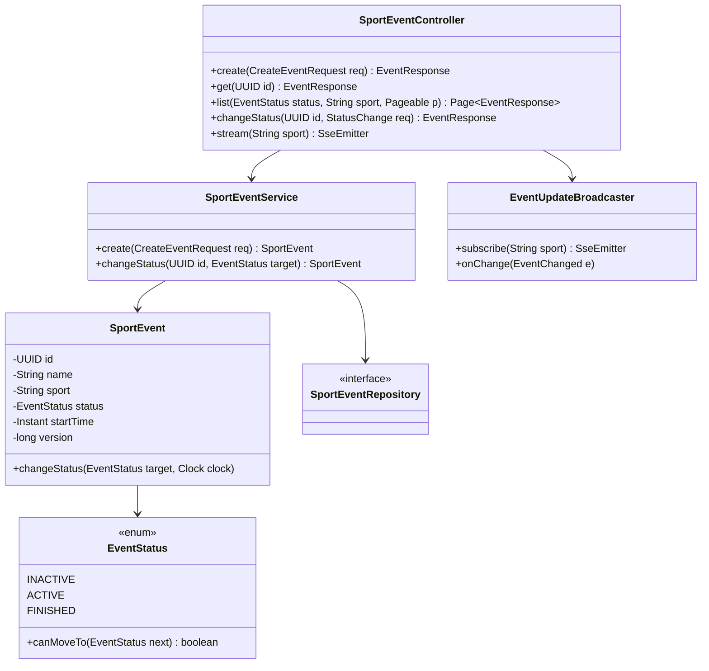
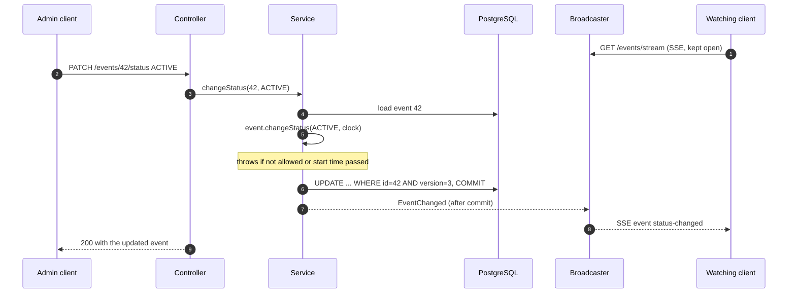

**Short answer:** A layered Spring Boot app: `SportEventController` → `SportEventService` → `SportEventRepository` (Spring Data JPA on PostgreSQL). The rules live in the domain, not the controller: `EventStatus` is an enum with a transition table (`INACTIVE → ACTIVE → FINISHED`, `FINISHED` terminal), and `SportEvent.changeStatus(target, clock)` also refuses to activate an event whose `start_time` is in the past. Concurrent edits are caught with `@Version`. Every change publishes an `EventChanged` Spring event; after commit, an `@TransactionalEventListener` pushes it to subscribers over **Server-Sent Events** (`GET /events/stream`). SSE fits because updates flow one way, from server to client. With several instances, the change goes through Redis pub/sub or Kafka so every instance can push to its own connected clients.

## Picture it





**How to read it:**
- Step 1: a client opens one long-lived HTTP response and the server writes events into it.
- Steps 5–6: the rule check is in the entity, so every path that changes status (REST, a scheduler, a feed consumer) goes through the same code.
- Step 7: `@Version` makes the update conditional; a concurrent edit fails with `409` instead of overwriting.
- Step 8: the listener runs only after commit, so subscribers never see a change that was rolled back.

## Requirements

- `POST /events` (name, sport, start_time; status starts `INACTIVE`), `GET /events/{id}`, `GET /events?status=&sport=` (both optional, paged), `PUT /events/{id}` for name, sport and start time, `PATCH /events/{id}/status`.
- Transitions: `INACTIVE → ACTIVE`, `ACTIVE → FINISHED`. Nothing leaves `FINISHED`. No skipping (`INACTIVE → FINISHED` is refused); I would confirm that with the interviewer.
- Activation is refused if `start_time` is in the past.
- Clients can subscribe and receive changes as they happen.
- Errors: `400` validation, `404` unknown id, `409` illegal transition or concurrent edit, `422` business rule (start time passed). I return them as `ProblemDetail` (RFC 9457, built into Spring 6).

## Classes

- `SportEvent` (JPA entity): owns its state. No public `setStatus`; only `changeStatus`.
- `EventStatus`: the state machine as a transition table.
- `SportEventService`: transactions, loading, saving, publishing `EventChanged`.
- `SportEventController`: DTO mapping (`CreateEventRequest`, `EventResponse` records), validation (`@Valid`), status codes.
- `EventUpdateBroadcaster`: keeps the open `SseEmitter`s and sends them changes.
- `GlobalExceptionHandler` (`@RestControllerAdvice`): maps domain exceptions to `ProblemDetail`.

## Patterns used

- **State machine as an enum** with the allowed moves in one table. Adding `CANCELLED` is one line, and an exhaustive `switch` shows every place to update.
- **Rich domain model.** The rule "cannot activate in the past" sits next to the data it checks, so it cannot be bypassed.
- **Observer / publish-subscribe** via Spring's `ApplicationEventPublisher`. The service does not know SSE exists; tomorrow a Kafka publisher can listen to the same event.
- **Injected `Clock`.** "Is the start time in the past?" depends on now. Injecting `Clock` makes it testable with `Clock.fixed(...)`.

## Code

```java
public enum EventStatus {
    INACTIVE, ACTIVE, FINISHED;

    private static final Map<EventStatus, Set<EventStatus>> NEXT = Map.of(
            INACTIVE, Set.of(ACTIVE),
            ACTIVE,   Set.of(FINISHED),
            FINISHED, Set.of());

    public boolean canMoveTo(EventStatus next) { return NEXT.get(this).contains(next); }
}
```

```java
@Entity
@Table(name = "sport_events")
public class SportEvent {
    @Id private UUID id;
    private String name;
    private String sport;
    @Enumerated(EnumType.STRING) private EventStatus status;
    private Instant startTime;
    @Version private long version;

    protected SportEvent() {}                                   // for JPA

    public SportEvent(UUID id, String name, String sport, Instant startTime) {
        this.id = id; this.name = name; this.sport = sport;
        this.startTime = startTime; this.status = EventStatus.INACTIVE;
    }

    public void changeStatus(EventStatus target, Clock clock) {
        if (!status.canMoveTo(target)) {
            throw new IllegalTransitionException(id, status, target);         // 409
        }
        if (target == EventStatus.ACTIVE && startTime.isBefore(clock.instant())) {
            throw new StartTimeInPastException(id, startTime);                // 422
        }
        status = target;
    }
}
```

```java
@Service
public class SportEventService {
    private final SportEventRepository repo;
    private final ApplicationEventPublisher events;
    private final Clock clock;

    public SportEventService(SportEventRepository repo, ApplicationEventPublisher events, Clock clock) {
        this.repo = repo; this.events = events; this.clock = clock;
    }

    @Transactional
    public SportEvent changeStatus(UUID id, EventStatus target) {
        SportEvent e = repo.findById(id).orElseThrow(() -> new EventNotFoundException(id));
        e.changeStatus(target, clock);
        events.publishEvent(new EventChanged(e.getId(), e.getSport(), e.getStatus()));
        return e;                         // dirty checking flushes the UPDATE at commit
    }

    @Transactional(readOnly = true)
    public Page<SportEvent> list(EventStatus status, String sport, Pageable page) {
        return repo.search(status, sport, page);
    }
}
```

```java
public interface SportEventRepository extends JpaRepository<SportEvent, UUID> {
    @Query("""
           select e from SportEvent e
           where (:status is null or e.status = :status)
             and (:sport  is null or e.sport  = :sport)
           """)
    Page<SportEvent> search(EventStatus status, String sport, Pageable page);
}
```

The broadcaster (one instance; see Extensions for many):

```java
@Component
public class EventUpdateBroadcaster {
    private final Set<Subscription> subs = ConcurrentHashMap.newKeySet();

    public SseEmitter subscribe(String sport) {
        SseEmitter emitter = new SseEmitter(Duration.ofMinutes(30).toMillis());
        Subscription s = new Subscription(emitter, sport);
        subs.add(s);
        emitter.onCompletion(() -> subs.remove(s));
        emitter.onTimeout(() -> subs.remove(s));
        emitter.onError(ex -> subs.remove(s));
        return emitter;
    }

    @TransactionalEventListener(phase = TransactionPhase.AFTER_COMMIT)
    public void onChange(EventChanged e) {
        for (Subscription s : subs) {
            if (s.sport() != null && !s.sport().equals(e.sport())) continue;
            try {
                s.emitter().send(SseEmitter.event().name("event-changed").id(e.eventId().toString()).data(e));
            } catch (IOException ex) {
                subs.remove(s);                                   // client went away
            }
        }
    }

    record Subscription(SseEmitter emitter, String sport) {}
}
```

Controller method: `@GetMapping(path = "/events/stream", produces = MediaType.TEXT_EVENT_STREAM_VALUE) SseEmitter stream(@RequestParam(required = false) String sport)`.

Schema (Flyway):

```sql
CREATE TABLE sport_events (
  id          UUID        PRIMARY KEY,
  name        TEXT        NOT NULL CHECK (length(name) BETWEEN 1 AND 200),
  sport       TEXT        NOT NULL,
  status      TEXT        NOT NULL DEFAULT 'INACTIVE'
              CHECK (status IN ('INACTIVE','ACTIVE','FINISHED')),
  start_time  TIMESTAMPTZ NOT NULL,
  version     BIGINT      NOT NULL DEFAULT 0,
  created_at  TIMESTAMPTZ NOT NULL DEFAULT now(),
  updated_at  TIMESTAMPTZ NOT NULL DEFAULT now()
);
CREATE INDEX sport_events_sport_status_start ON sport_events (sport, status, start_time);
CREATE INDEX sport_events_status_start       ON sport_events (status, start_time);
```

The two indexes cover "filter by sport (and status)" and "filter by status only", both ordered by start time. In a real catalogue `sport` would be a foreign key to a `sports` table, as in [the betting schema](design-betting-database-schema.md).

## Extensions

- **Many instances.** An SSE connection lives on one instance, but the change may commit on another. After commit, publish `EventChanged` to Redis pub/sub or a Kafka topic; every instance subscribes and pushes to its local emitters. If losing a message is not acceptable, write it to an outbox table in the same transaction and relay it to Kafka.
- **Reconnects.** Browsers' `EventSource` reconnects automatically and sends `Last-Event-ID`. Store a per-event sequence and replay what the client missed, or tell it to refetch.
- **Thread usage.** Each SSE client holds a connection, not a thread, with `SseEmitter`. With Spring MVC and many thousands of clients, enable virtual threads (`spring.threads.virtual.enabled=true`, Boot 3.2+) or use WebFlux `Flux<ServerSentEvent<...>>`.
- **Automatic finishing.** A scheduler that moves `ACTIVE` events to `FINISHED` calls the same `changeStatus`, so the rules and notifications come for free.
- **Concurrency.** Two admins activate and finish at the same moment: one commit wins; the other gets `ObjectOptimisticLockingFailureException`, mapped to `409`. A plain `UPDATE ... WHERE id = ? AND status = :from` is the non-JPA alternative.

## Follow-ups

- **Transition rules?** The enum table above. `FINISHED` maps to an empty set, so it is terminal by data, not by an `if`. Same-state requests (`ACTIVE → ACTIVE`) I treat as `409`; returning `200` (idempotent no-op) is also defensible, so say which you chose.
- **Cannot activate if start time passed?** Checked in `changeStatus` against an injected `Clock`, in UTC (`Instant`, `TIMESTAMPTZ`). Validation at create time (`@Future` on the DTO) is not enough because time moves on between create and activate.
- **SSE, WebSocket or Kafka?** SSE: one-way server to client, plain HTTP, auto-reconnect, easy through proxies; the right fit here. WebSocket: when clients also send messages (live betting slips, chat). Kafka: between services, not to browsers; it is how instances learn about changes, then SSE or WebSocket delivers to clients. Polling with `ETag` is the simplest fallback.
- **Persistence and tests?** JPA entity with `@Version`, Flyway migrations, the composite indexes above. Unit tests: every pair of `EventStatus` values (parameterised), `changeStatus` with `Clock.fixed`. Controller tests: `@WebMvcTest` with a mocked service for status codes and `ProblemDetail` bodies. Integration: `@SpringBootTest` with Testcontainers PostgreSQL for the repository query and optimistic locking, plus one test that opens the stream and asserts an event arrives after a status change.

Related: [design-betting-bet-placement-lld](design-betting-bet-placement-lld.md) uses the same enum transition-table idea for bet status.

Go deeper: [D5 · Spring MVC: the request pipeline](../academy/lessons/D5.md), [D6 · Data: JPA, Hibernate and @Transactional](../academy/lessons/D6.md), [D8 · Production readiness: Actuator, metrics, testing](../academy/lessons/D8.md), [E4 · Behavioural patterns](../academy/lessons/E4.md).

## Say it in 2 minutes

"Controller, service, JPA repository on Postgres. The status rules are in the domain: `EventStatus` is an enum with a transition table, inactive to active to finished, finished maps to nothing so it is terminal. The entity has no status setter, only `changeStatus(target, clock)`, which also refuses to activate an event whose start time has passed; the clock is injected so tests can fix the time. `@Version` turns a concurrent edit into a 409. List supports optional status and sport filters, paged, with a composite index on sport, status and start time. For subscriptions, the service publishes an `EventChanged` Spring event; an `AFTER_COMMIT` listener sends it to clients over Server-Sent Events, because updates are one-way and SSE reconnects by itself. With several instances, the change goes through Redis or Kafka so each instance can push to its own clients. Tests at three levels: enum and entity unit tests, `@WebMvcTest` for the HTTP contract, Testcontainers for the database."
