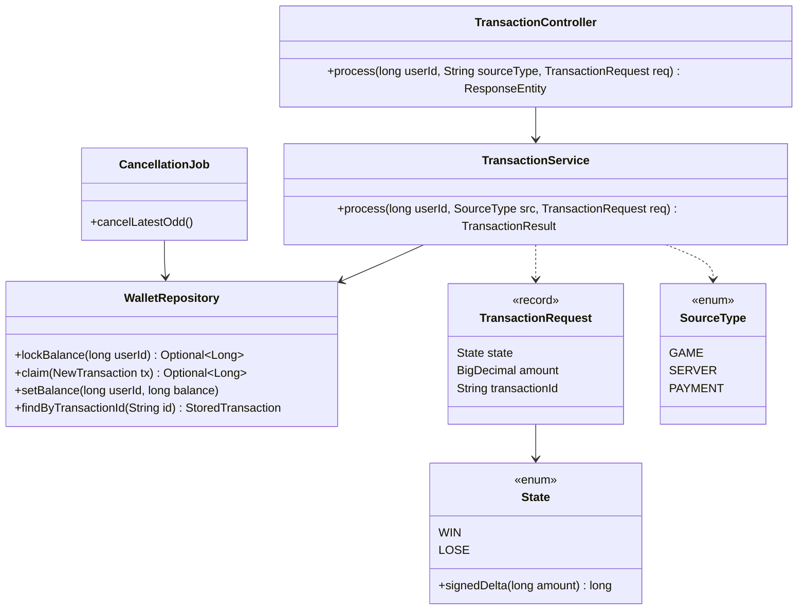
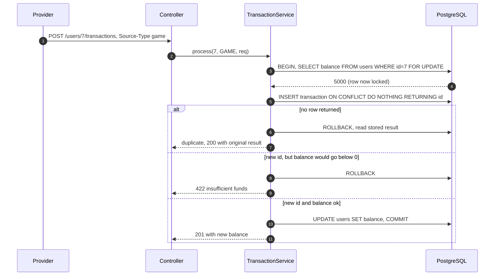

**Short answer:** One endpoint, `POST /users/{userId}/transactions`, and one database transaction per request. It locks the user row (`SELECT ... FOR UPDATE`), claims the `transactionId` with `INSERT ... ON CONFLICT (transaction_id) DO NOTHING`, computes the new balance, rejects it if it would go below zero, and updates the balance. The `UNIQUE` constraint makes every `transactionId` count once; the row lock plus `CHECK (balance_minor >= 0)` make a negative balance impossible even with many requests and many app instances. Money is a `BIGINT` in minor units (cents), parsed from `BigDecimal`, never `double`. A `@Scheduled` job cancels the 10 latest odd `PROCESSED` records under a Postgres advisory lock, reverses their effect on the balance and marks them `CANCELLED`, so they are never picked again.

The original take-home is Go; I answer in Java 21, Spring Boot 3 and PostgreSQL. The design is the same in any language because the guarantees live in the database.

## Picture it





**How to read it:**
- Steps 3–4: the `FOR UPDATE` lock queues every other request for user 7 behind this one, across all app instances. It is held until commit.
- Step 5: the unique index on `transaction_id` is the idempotency check. If the id was already used, `DO NOTHING` returns no row and nothing changes.
- The negative-balance check runs in Java on a value nobody else can change, because of the lock. `CHECK (balance_minor >= 0)` is the backstop if a future code path forgets.
- Any exception rolls back the insert, so a rejected request does not burn its `transactionId` (see the follow-ups for the other choice).

## Requirements

- `POST /users/{userId}/transactions`, header `Source-Type: game | server | payment`, body `{"state":"win","amount":"10.15","transactionId":"abc-1"}`. `win` adds `amount`, `lose` subtracts it.
- Each `transactionId` is processed exactly once. A retry returns the original result, not an error and not a second change.
- The balance can never be negative, under any concurrency and on any number of instances.
- Every N minutes, cancel the 10 latest odd records and correct the balance. A cancelled record is never processed again.
- Assumptions to say out loud: users already exist (seeded by a migration), one currency, amounts have at most 2 decimals, "odd" means an odd row `id`.

## Classes

- `TransactionController`: HTTP only. Parses and validates the header and body, maps exceptions to status codes (`400` bad input, `404` unknown user, `422` insufficient funds, `200` duplicate, `201` new).
- `TransactionService`: the one `@Transactional` method that does lock, claim, check, update.
- `WalletRepository`: plain SQL through `JdbcClient` (Spring Framework 6.1+, Boot 3.2+). I keep JPA out of the hot path because I want to see the exact `FOR UPDATE` and `ON CONFLICT` statements.
- `CancellationJob`: the scheduled post-processing.
- `State`, `SourceType`: enums. `State.signedDelta` turns an amount into `+amount` or `-amount`, so the sign rule lives in one place.

## Patterns used

- **Idempotent receiver** via a unique constraint. The database, not a cache or a `Set` in memory, decides whether an id is new. A cache check before the insert is only an optimisation.
- **Pessimistic lock per aggregate.** The user row is the aggregate root for the balance. Lock it, then do everything in one short transaction.
- **Value object for money.** Amounts become `long` minor units at the edge and stay that way.
- **Scheduled job with a cluster lock**, so only one instance runs the cancellation at a time.

## Code

Schema (Flyway `V1__init.sql`):

```sql
CREATE TABLE users (
  id             BIGINT GENERATED ALWAYS AS IDENTITY PRIMARY KEY,
  balance_minor  BIGINT      NOT NULL DEFAULT 0 CHECK (balance_minor >= 0),
  updated_at     TIMESTAMPTZ NOT NULL DEFAULT now()
);

CREATE TABLE transactions (
  id              BIGINT GENERATED ALWAYS AS IDENTITY PRIMARY KEY,
  transaction_id  TEXT        NOT NULL UNIQUE,          -- the provider's id: idempotency key
  user_id         BIGINT      NOT NULL REFERENCES users,
  state           TEXT        NOT NULL CHECK (state IN ('WIN','LOSE')),
  amount_minor    BIGINT      NOT NULL CHECK (amount_minor > 0),
  source_type     TEXT        NOT NULL CHECK (source_type IN ('GAME','SERVER','PAYMENT')),
  balance_after   BIGINT      NOT NULL,
  status          TEXT        NOT NULL DEFAULT 'PROCESSED'
                  CHECK (status IN ('PROCESSED','CANCELLED','CANCEL_SKIPPED')),
  created_at      TIMESTAMPTZ NOT NULL DEFAULT now(),
  cancelled_at    TIMESTAMPTZ
);
CREATE INDEX transactions_user_created ON transactions (user_id, created_at DESC);
-- exactly the rows the cancellation job looks for, newest first
CREATE INDEX transactions_odd_processed ON transactions (id DESC)
  WHERE status = 'PROCESSED' AND id % 2 = 1;

INSERT INTO users (balance_minor)
SELECT 0 FROM generate_series(1, 3);                     -- seed users 1..3
```

Request and money parsing:

```java
public record TransactionRequest(
        @NotNull State state,
        @NotNull @Positive @Digits(integer = 15, fraction = 2) BigDecimal amount,
        @NotBlank @Size(max = 64) String transactionId) {

    long amountMinor() {                       // "10.15" -> 1015, exact
        return amount.setScale(2, RoundingMode.UNNECESSARY).unscaledValue().longValueExact();
    }
}

public enum State {
    @JsonProperty("win") WIN, @JsonProperty("lose") LOSE;
    long signedDelta(long amount) { return this == WIN ? amount : -amount; }
}
```

Jackson reads a JSON number straight into `BigDecimal` from its text, so `10.15` stays exact. `@Digits(fraction = 2)` turns `10.155` into a `400` before any arithmetic.

The core method:

```java
@Service
@RequiredArgsConstructor
public class TransactionService {
    private final WalletRepository repo;

    @Transactional
    public TransactionResult process(long userId, SourceType source, TransactionRequest req) {
        long balance = repo.lockBalance(userId)                     // SELECT ... FOR UPDATE
                .orElseThrow(() -> new UserNotFoundException(userId));

        long newBalance = Math.addExact(balance, req.state().signedDelta(req.amountMinor()));

        Optional<Long> rowId = repo.claim(new NewTransaction(        // INSERT ... ON CONFLICT DO NOTHING
                req.transactionId(), userId, req.state(), req.amountMinor(), source, newBalance));
        if (rowId.isEmpty()) {
            throw new DuplicateTransactionException(req.transactionId());  // rollback, read outside
        }
        if (newBalance < 0) {
            throw new InsufficientFundsException(userId);                   // rolls back the insert
        }
        repo.setBalance(userId, newBalance);
        return new TransactionResult(req.transactionId(), rowId.get(), newBalance, false);
    }
}
```

```java
public Optional<Long> lockBalance(long userId) {
    return jdbc.sql("SELECT balance_minor FROM users WHERE id = :id FOR UPDATE")
            .param("id", userId).query(Long.class).optional();
}

public Optional<Long> claim(NewTransaction t) {
    return jdbc.sql("""
            INSERT INTO transactions
              (transaction_id, user_id, state, amount_minor, source_type, balance_after)
            VALUES (:tid, :uid, :state, :amount, :source, :after)
            ON CONFLICT (transaction_id) DO NOTHING
            RETURNING id""")
        .param("tid", t.transactionId()).param("uid", t.userId())
        .param("state", t.state().name()).param("amount", t.amountMinor())
        .param("source", t.source().name()).param("after", t.balanceAfter())
        .query(Long.class).optional();
}
```

The controller catches `DuplicateTransactionException` (after the rollback), reads the stored row with `findByTransactionId` and returns `200` with the original `balance_after`. If the stored row has a different user, amount or state, it returns `409`: same key, different payload is a client bug, not a retry.

The cancellation job:

```java
@Scheduled(fixedDelayString = "${wallet.cancel-interval:PT5M}")
@Transactional
public void cancelLatestOdd() {
    if (!jdbc.sql("SELECT pg_try_advisory_xact_lock(4242)").query(Boolean.class).single()) {
        return;                                   // another instance is running it
    }
    List<Picked> picked = jdbc.sql("""
            SELECT id, user_id, state, amount_minor FROM transactions
            WHERE status = 'PROCESSED' AND id % 2 = 1
            ORDER BY id DESC
            LIMIT 10
            FOR UPDATE""").query(Picked.class).list();

    picked.stream()
          .sorted(Comparator.comparingLong(Picked::userId))          // fixed lock order
          .forEach(p -> {
              long correction = -State.valueOf(p.state()).signedDelta(p.amountMinor());
              int changed = jdbc.sql("""
                      UPDATE users SET balance_minor = balance_minor + :c, updated_at = now()
                      WHERE id = :uid AND balance_minor + :c >= 0""")
                  .param("c", correction).param("uid", p.userId()).update();
              jdbc.sql("""
                      UPDATE transactions SET status = :s, cancelled_at = now()
                      WHERE id = :id AND status = 'PROCESSED'""")
                  .param("s", changed == 1 ? "CANCELLED" : "CANCEL_SKIPPED")
                  .param("id", p.id()).update();
          });
}
```

Cancelling a `win` takes money back, cancelling a `lose` gives it back. The conditional `UPDATE ... WHERE balance_minor + :c >= 0` keeps the "never negative" rule: if the user already spent the win, the record is marked `CANCEL_SKIPPED` (and alerted on) instead of breaking the invariant. Both statuses leave `PROCESSED`, so neither is ever picked again. `@Scheduled` needs `@EnableScheduling`; the advisory lock is released automatically at commit.

## Extensions

- **Optimistic alternative.** `UPDATE users SET balance_minor = balance_minor + :d WHERE id = :id AND balance_minor + :d >= 0 RETURNING balance_minor` does check and write in one statement and one round trip. Under read committed the second concurrent update waits for the row lock, re-reads the committed row and re-checks the `WHERE`. This is what [bet placement](design-betting-bet-placement-lld.md) uses. I chose `FOR UPDATE` here because the follow-up asks for it and because I need the old balance before inserting `balance_after`. Both are correct; `@Version` with retries is the third option.
- **Why not `synchronized` or a `ConcurrentHashMap` of locks?** Two instances behind a load balancer do not share JVM locks, and Spring commits after the method returns, so the lock is released before the data is visible.
- **Scale.** The lock is per user, so different users never wait for each other. A very hot user (a provider settling thousands of spins a second) serialises on one row; batch them, or move to an append-only ledger with periodic balance snapshots as in [the betting schema](design-betting-database-schema.md).
- **Audit and history.** `transactions` is already an append-only journal with `balance_after`. Cancellation never deletes a row; it changes status and writes the correction as a balance change. A stricter version writes the correction as its own `CANCEL` row linked to the original.
- **Testing.** Testcontainers PostgreSQL: 50 threads sending `lose 10` to a user with `100` give exactly 10 successes and a final balance of `0`; the same `transactionId` sent from 10 threads gives one row and one balance change; the job twice in a row never cancels the same row.

## Follow-ups

- **Each `transactionId` only once?** `UNIQUE (transaction_id)` plus `ON CONFLICT DO NOTHING`. If two requests with the same id race, the second insert waits on the first one's uncommitted index entry and then sees the conflict. The retry gets the stored result with `200`. Whether a rejected (insufficient funds) id may be retried later is a product decision: I roll it back so the provider can retry; the alternative is to store it as `REJECTED` and return that forever. See [design-idempotent-api](design-idempotent-api.md).
- **Never negative under concurrency?** Three layers: the row lock serialises requests per user, the Java check rejects, and `CHECK (balance_minor >= 0)` makes the database refuse any write that slips through. Without the lock, two `lose 80` on a balance of `100` both read `100` and both succeed (a lost update).
- **The cancellation job?** Run it with a fixed delay, not a fixed rate, so runs never overlap on one instance; take `pg_try_advisory_xact_lock` (or ShedLock) so only one instance runs. Lock picked rows with `FOR UPDATE` and update users in `user_id` order to avoid deadlocks. Ask what "odd" means: identity ids have gaps after rollbacks, so an odd `id` is not "every second record". If they mean position, number the rows with `ROW_NUMBER() OVER (ORDER BY id)` first.
- **Money: decimal or integer?** `BIGINT` minor units is fast, exact and maps to `long`. `NUMERIC(19,4)` with `BigDecimal` is fine too when you need sub-cent precision or several currencies with different scales. Never `double`: `0.1 + 0.2 != 0.3`.
- **Schema, migrations, indexes?** Flyway versioned migrations run on startup. `transaction_id` unique (that is the idempotency index), `(user_id, created_at DESC)` for a user's history, and a partial index for exactly the rows the job scans. The users primary key covers the lock.

Go deeper: [Q6 · Transactions, isolation, locking and MVCC](../academy/lessons/Q6.md), [D6 · Data: JPA, Hibernate and @Transactional](../academy/lessons/D6.md), [Q5 · Indexes and reading EXPLAIN](../academy/lessons/Q5.md), [F8 · Design a sports betting platform](../academy/lessons/F8.md).

## Say it in 2 minutes

"One endpoint per user. The header becomes an enum, the body a record with a `BigDecimal` amount that I turn into `long` cents at the edge. The service runs one transaction: lock the user row with `SELECT ... FOR UPDATE`, compute the new balance, insert the transaction with `ON CONFLICT (transaction_id) DO NOTHING`. No row back means a duplicate: roll back and return the original result. A negative new balance means roll back and return 422. Otherwise update the balance and commit. The unique index gives idempotency, the row lock gives per-user serialisation across all instances, and `CHECK (balance >= 0)` is the safety net. Every N minutes a scheduled job takes a Postgres advisory lock so it runs once, picks the 10 latest odd `PROCESSED` rows `FOR UPDATE`, reverses each one's effect with a conditional update, and marks it `CANCELLED`, or `CANCEL_SKIPPED` if reversing would make the balance negative. Changing the status means it is never picked again."
