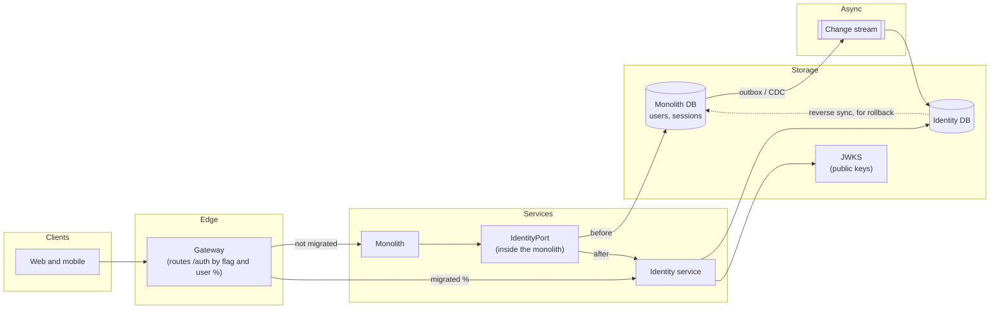
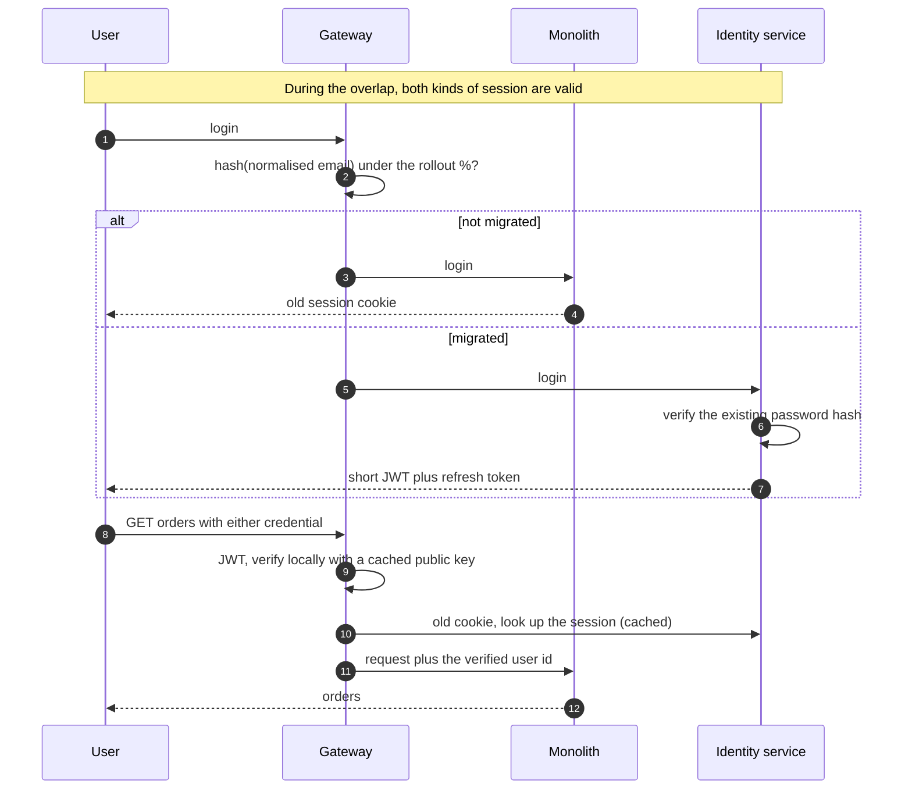
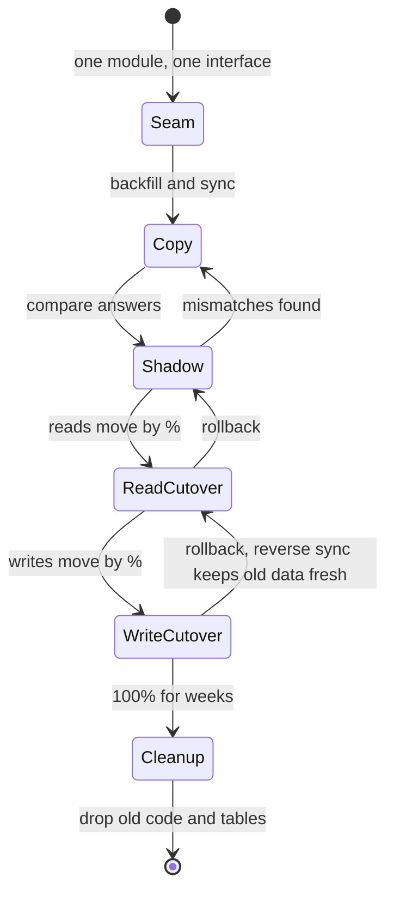

**Short answer:** Not with a big-bang rewrite. I use the strangler approach: first draw the boundary *inside* the monolith, then put a routing layer in front, copy and sync the data, compare both systems on real traffic, and move users over in small percentages.

Every step can be rolled back, and at any moment exactly one side owns each write. For identity I keep old sessions working during the move, so nobody is logged out, and I treat the new service as tier-0: if login is down, everything is down.

## Picture it







**How to read it:**
- The first picture: the gateway and the `IdentityPort` are the two places where traffic can be turned. Everything else stays still.
- Steps 1–7: new logins go to one side or the other by a stable hash, so a user does not bounce between them.
- Steps 8–12: both credentials are accepted, so moving the login does not log anyone out.
- The last picture is the plan. Each arrow back is a tested rollback, not a hope.

## Requirements

The reported wording is one line. I assume "identity" means users, credentials, login, sessions and tokens; profile data and permissions stay behind at first.

**Functional**
- Login, logout, refresh, password reset, session check; same behaviour as today.

**Non-functional**
- No downtime, no forced logout, no password resets.
- Auth check p99 under 10 ms added; login p99 under 500 ms (password hashing is slow on purpose).
- 99.99% availability, higher than the monolith needs today.
- A full audit trail, and no passwords or tokens in logs.

First ask *why*:
- Good reasons: several apps need login, a security boundary, independent releases.
- "Microservices are modern" is not one.

## Estimates

Assumptions:
- 10M users, 1M logins a day: 12/s average, about 150/s at peak.
- Auth checks on every request: 20,000/s at peak. These must be local (JWT) or cached.
- Password hash at about 100 ms of CPU: 150 logins/s needs about 15 cores, plus headroom.
- Users table about 10 GB: the backfill takes hours, not days.

## API

```text
POST /auth/login          { email, password }  -> { accessToken (10 min), refreshToken }
POST /auth/refresh        { refreshToken }     -> rotated tokens
POST /auth/logout         -> revokes the refresh token
POST /internal/sessions/introspect             -> { userId, expiresAt }   (old cookies)
GET  /.well-known/jwks.json                    -> public keys
Events: UserRegistered, CredentialsChanged, SessionsRevoked
```

## Data model

```sql
users(id PK, email UNIQUE, status, version, updated_at)      -- the SAME ids as the monolith
credential(user_id PK, algo, hash, updated_at)               -- hashes are copied, never recomputed
refresh_token(id PK, user_id, token_hash UNIQUE, family_id, expires_at, revoked_at)
outbox(id PK, aggregate_id, type, payload, created_at)
```

Keep the same user ids. Every table in the monolith refers to them, and an id mapping would live forever.

## Architecture

The picture above shows it. The monolith talks to identity only through `IdentityPort`, with two implementations chosen by a flag: local (today's tables) and remote (the new service).

## Deep dives

**1. Make the seam first.**
- Find every reader and writer of the identity tables: code search, database grants, query logs. Include reports and cron jobs.
- Move them all behind `IdentityPort`, still in the monolith. Joins to `users` become calls or a small local copy of the few fields needed.
- Prove it: remove database permissions on those tables from every other module's role.
- This step is most of the work, and it is worth doing even if you stop here.

**2. Move the data with one writer at a time.** Never write to both databases from application code: one of the two writes will fail some day, and they drift.
- *Backfill:* take the change-stream position first, copy in chunks by primary key, then replay changes. Apply with `WHERE excluded.version > users.version`, so replays and old events are harmless.
- *Verify:* compare counts and per-chunk checksums until the difference stays at zero, apart from lag.
- *Switch the writer:* per cohort. For those users, block identity writes for a second or two, wait for lag to reach zero, flip the flag, continue.
- *Enforce it:* the flag is stored and checked in both writers (`owner = 'IDENTITY'`), not only in the gateway.
- *Reverse sync:* after the flip, changes flow back to the old tables, so a rollback loses nothing. Tag each change with its origin so it does not loop.

**3. Shadow before you trust.**
- Copy real session checks to the new service, answer from the old one, and compare status and user id.
- Do not log passwords or tokens to compare; log only match or mismatch and a reason code.
- For logins, verify in the new service too, but with side effects off (no emails, no lockout counters).
- Go on when mismatches are explained and under an agreed threshold for a week including a peak.

**4. Tokens and availability.**
- Short JWTs (10 min) verified locally mean most requests do not need the service. Cached public keys survive an outage.
- The cost is slow revocation: up to 10 minutes. Push `SessionsRevoked` to a small deny-list for "log out everywhere".
- Key rotation: publish the new key, wait for caches to refresh, sign with it, then remove the old one.
- Run it in several zones, with rate limits on login, and timeouts plus a circuit breaker in callers.

## Trade-offs

- **Strangler vs rewrite:** slower and you run two systems for months, but the risk of each step is small.
- **JWT vs opaque session:** local checks and independence, against instant revocation.
- **CDC vs outbox:** CDC needs no code change in an old monolith but exposes raw rows; an outbox gives clean events but every writer must use it.
- **Pause writes for 2 s vs no pause:** a tiny pause for one cohort is far simpler than merging conflicts.

## Follow-ups

- *How do you roll back?* Flip the flag to the old side; reverse sync kept its data fresh. Practise it at 1%.
- *Rollout order?* Employees, 1%, 10%, 50%, 100%, with a wait of at least a day, watching login success rate, latency and support tickets.
- *When do you stop?* Delete old code, tables and sync jobs. A migration left at 90% is the worst place to be.
- *Distributed transactions, e.g. register plus create profile?* One local transaction and a `UserRegistered` event; the profile side is idempotent.
- *Password algorithm upgrade?* Rehash at the next successful login, not in bulk.
- *What if the service is down?* Logged-in users continue on valid JWTs; new logins fail with a clear message.

Related lessons: [S8 · Microservices: why, how, and what it costs](../academy/lessons/S8.md), [I3 · Resilience patterns](../academy/lessons/I3.md).
