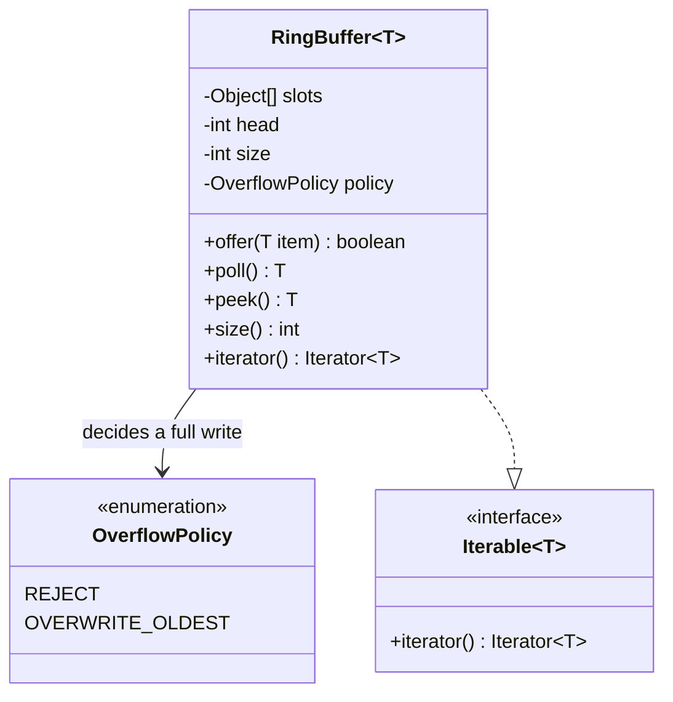
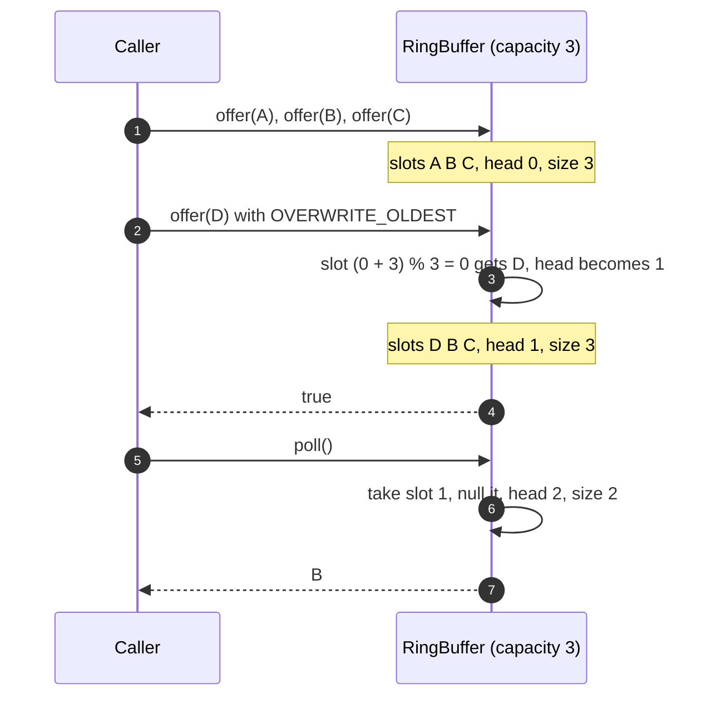

**Short answer:** Use a fixed array plus `head` (the oldest item) and `size`; the next write slot is `(head + size) % capacity`. Writing and reading are O(1) with no shifting, and the one design decision is what a write does when the buffer is full: reject it or overwrite the oldest.

## Picture it





| after | slots | head | size | next write slot |
|---|---|---|---|---|
| start | _ _ _ | 0 | 0 | 0 |
| offer A, B, C | A B C | 0 | 3 | 0 |
| offer D (overwrite) | D B C | 1 | 3 | 1 |
| poll returns B | D _ C | 2 | 2 | 1 |
| offer E | D E C | 2 | 3 | 2 |

**How to read it:**
- `head` points at the oldest item and `size` says how many items there are, wrapping past the end of the array.
- When full, the next write slot **is** the head slot. Overwriting there and moving `head` forward drops the oldest item.
- `poll` clears its slot, so the buffer does not keep dead objects alive.
- The order is always oldest first: after the last row the items are C, D, E.

## Requirements

The prompt is one line, so I assume:

- Fixed capacity, set at construction and never resized. FIFO order.
- O(1) `offer`, `poll`, `peek` and `size`, with no allocation per call.
- When full, the policy is chosen at construction: **reject** (return `false`) or **overwrite the oldest**.
- `poll` and `peek` return `null` when empty, like `java.util.Queue`, so null items are not allowed.
- Single-threaded first. Concurrency is an extension.

## Classes

- `RingBuffer<T>`: owns the array and the index arithmetic. Iterable from oldest to newest.
- `OverflowPolicy`: an enum with the two full-buffer rules.

**Why `head` + `size` and not `head` + `tail`:** with two wrapped indices, `head == tail` means both empty and full. You would need a spare slot, a flag or a counter to tell them apart.

## Patterns used

- **Iterator:** callers walk the items without seeing the wrap-around. It is fail-fast, like `ArrayList`.
- **Strategy, kept small:** the full-buffer rule is a value passed in. An enum is enough for two rules; make it an interface only when a rule needs its own state.

## Code

```java
import java.util.*;

enum OverflowPolicy { REJECT, OVERWRITE_OLDEST }

final class RingBuffer<T> implements Iterable<T> {
    private final Object[] slots;
    private final OverflowPolicy policy;
    private int head;        // index of the oldest item
    private int size;
    private int modCount;    // lets iterators fail fast

    RingBuffer(int capacity, OverflowPolicy policy) {
        if (capacity <= 0) throw new IllegalArgumentException("capacity must be > 0");
        this.slots = new Object[capacity];
        this.policy = Objects.requireNonNull(policy);
    }

    /** Adds the newest item. Returns false only when full under REJECT. */
    boolean offer(T item) {
        Objects.requireNonNull(item);
        if (isFull()) {
            if (policy == OverflowPolicy.REJECT) return false;
            slots[head] = item;              // the write slot of a full buffer is the head slot
            head = index(1);                 // the second oldest is now the oldest
        } else {
            slots[index(size)] = item;
            size++;
        }
        modCount++;
        return true;
    }

    /** Removes and returns the oldest item, or null when empty. */
    T poll() {
        if (size == 0) return null;
        T item = at(0);
        slots[head] = null;                  // let GC reclaim it
        head = index(1);
        size--;
        modCount++;
        return item;
    }

    T peek() { return size == 0 ? null : at(0); }
    int size() { return size; }
    int capacity() { return slots.length; }
    boolean isEmpty() { return size == 0; }
    boolean isFull() { return size == slots.length; }

    @Override
    public Iterator<T> iterator() {
        return new Iterator<>() {
            private final int expected = modCount;
            private int offset;

            @Override public boolean hasNext() { return offset < size; }

            @Override public T next() {
                if (expected != modCount) throw new ConcurrentModificationException();
                if (!hasNext()) throw new NoSuchElementException();
                return at(offset++);
            }
        };
    }

    /** Array index of the item `offset` places after the oldest: (head + offset) % capacity, overflow-safe. */
    private int index(int offset) {
        int i = head - slots.length + offset;
        return i < 0 ? i + slots.length : i;
    }

    @SuppressWarnings("unchecked")
    private T at(int offset) { return (T) slots[index(offset)]; }
}
```

**What interviewers probe:**

- **`head + offset` can overflow** `int` for a huge capacity, so `index` subtracts the capacity first.
- **Generic array:** Java cannot create `new T[n]`. Use `Object[]` with one unchecked cast in one place.
- **Capacity 1:** every overwrite replaces the single item, and `head` stays 0.
- **Cost:** O(1) per operation and O(capacity) memory, allocated once.
- **Which policy:** overwrite for the latest logs, metrics or frames. Reject for work that must not be lost.

## Extensions

- **Many threads:** guard every method with one lock. To wait instead of rejecting, add `notFull` and `notEmpty` conditions, as in [Bounded Blocking Queue](design-bounded-blocking-queue.md); the JDK version is `ArrayBlockingQueue`.
- **One producer, one consumer, no lock:** each thread writes only its own counter. The `volatile` counter write publishes the slot to the other thread.

```java
final class SpscRingBuffer<T> {
    private final Object[] slots;
    private final int mask;
    private volatile long head;      // next to read; written only by the consumer
    private volatile long tail;      // next to write; written only by the producer

    SpscRingBuffer(int capacity) {
        if (Integer.bitCount(capacity) != 1 || capacity < 0) throw new IllegalArgumentException("need a power of two");
        slots = new Object[capacity];
        mask = capacity - 1;
    }

    boolean offer(T item) {                        // producer thread only; item is not null
        long t = tail;
        if (t - head == slots.length) return false;
        slots[(int) (t & mask)] = item;
        tail = t + 1;                              // volatile write: publishes the slot
        return true;
    }

    @SuppressWarnings("unchecked")
    T poll() {                                     // consumer thread only
        long h = head;
        if (h == tail) return null;                // volatile read: sees the published slot
        int i = (int) (h & mask);
        T item = (T) slots[i];
        slots[i] = null;
        head = h + 1;                              // volatile write: frees the slot
        return item;
    }
}
```

- **Power-of-two capacity:** `& mask` replaces `%`, and free-running counters make `tail - head` the size.
- **Overwrite is not safe in that lock-free version,** because the producer would have to move the consumer's `head`.
- **Return the evicted item:** change `offer` to return it, so callers can count or persist what was dropped.
- **Batch operations:** at most two `System.arraycopy` calls per batch, before and after the wrap.
- **Primitive data:** use `int[]` or `byte[]` to avoid boxing.

Related: [B7 · Classic problems](../academy/lessons/B7.md), [A6 · The Java Memory Model](../academy/lessons/A6.md), [B3 · Atomics, CAS and concurrent collections](../academy/lessons/B3.md).
