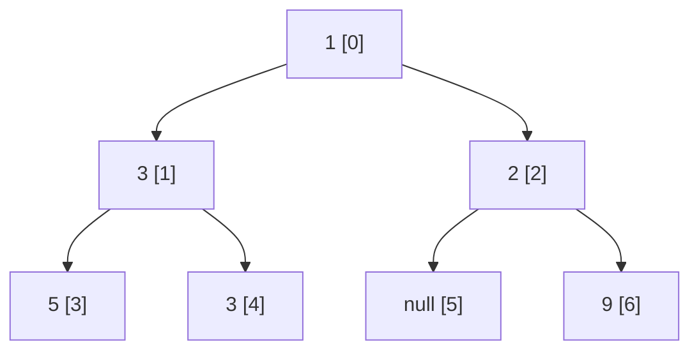

**Short answer:** Give every node a position as if the tree were a complete binary tree: root `0`, left child `2i + 1`, right child `2i + 2`. Do a BFS level by level; the width of a level is `lastIndex − firstIndex + 1`, which counts the `null` gaps between the end nodes. Take the maximum. To stop indexes from overflowing on deep trees, subtract the level's first index before computing children. O(n) time, O(w) space. If the interviewer means "the most nodes on any level", it is the same BFS returning `queue.size()`.

## Picture it

`root = [1, 3, 2, 5, 3, null, 9]`, positions in brackets:



| Level | Nodes (value, position) | First | Last | Width | Max so far |
|---|---|---|---|---|---|
| 0 | (1, 0) | 0 | 0 | 1 | 1 |
| 1 | (3, 1), (2, 2) | 1 | 2 | 2 | 2 |
| 2 | (5, 3), (3, 4), (9, 6) | 3 | 6 | 4 | **4** |

Level 2 has three nodes but width 4, because the missing child at position 5 sits between them.

**The picture in one sentence:** number the nodes like an array-backed heap, and a level's width is just the distance between its first and last numbers.

## Approach

**Naive.** Put `null` placeholders into the BFS queue so gaps are counted. The queue can grow exponentially on a sparse, deep tree.

**Key insight.** You do not need the gaps, only their count. Heap-style indexes encode exactly where a node would sit in a full level, so the gap count falls out of `last − first`.

**Overflow fix.** Indexes double every level; after about 63 levels a `long` overflows. Re-base at each level: store `index − firstIndexOfLevel`, so each level starts again at 0. Widths stay correct because only differences matter.

**DFS alternative.** Record the first index seen at each depth in a list; for every node, width = `index − first[depth] + 1`. Same complexity, uses recursion.

## Solution

```java
import java.util.ArrayDeque;
import java.util.Deque;

class Solution {
    private record Item(TreeNode node, long index) {}

    public int widthOfBinaryTree(TreeNode root) {
        if (root == null) return 0;
        Deque<Item> queue = new ArrayDeque<>();
        queue.add(new Item(root, 0));
        long max = 0;

        while (!queue.isEmpty()) {
            int size = queue.size();
            long first = queue.peekFirst().index();
            long last = first;
            for (int i = 0; i < size; i++) {
                Item it = queue.poll();
                long idx = it.index() - first;        // re-base: this level starts at 0
                last = idx;
                if (it.node().left != null)  queue.add(new Item(it.node().left,  2 * idx + 1));
                if (it.node().right != null) queue.add(new Item(it.node().right, 2 * idx + 2));
            }
            max = Math.max(max, last + 1);            // last is already relative to first
        }
        return (int) max;
    }

    // If "width" means the largest number of nodes on one level.
    public int maxNodesOnALevel(TreeNode root) {
        if (root == null) return 0;
        Deque<TreeNode> queue = new ArrayDeque<>();
        queue.add(root);
        int max = 0;
        while (!queue.isEmpty()) {
            int size = queue.size();
            max = Math.max(max, size);
            for (int i = 0; i < size; i++) {
                TreeNode n = queue.poll();
                if (n.left != null) queue.add(n.left);
                if (n.right != null) queue.add(n.right);
            }
        }
        return max;
    }
}
```

## Complexity

- **Time:** O(n). Each node enters and leaves the queue once.
- **Space:** O(w), the most nodes on one level (up to about n/2 for a full tree).

## Edge cases

- Empty tree: 0. Single node: 1.
- A long left chain followed by a split at the bottom: the re-basing keeps indexes small; without it, positions reach 2^depth.
- A "zig-zag" tree where one end node is the far left and the other the far right of a deep level: the width can be huge even with two nodes. That is correct by the definition; LeetCode guarantees it fits in a 32-bit int.

## Variations

- **Ask first which width is meant.** Campus rounds (and GfG) often mean the maximum count of nodes on a level; LeetCode 662 means the span including gaps. Code the one asked, mention the other.
- **Vertical width** (number of distinct columns): track a horizontal distance (`left: hd − 1`, `right: hd + 1`) and return `maxHd − minHd + 1`.
- **Return the level** with the maximum width: remember the depth when `max` improves.

See [C4 · The optimisation playbook](../academy/lessons/C4.md) and [H1 · Java idioms for coding interviews](../academy/lessons/H1.md).
