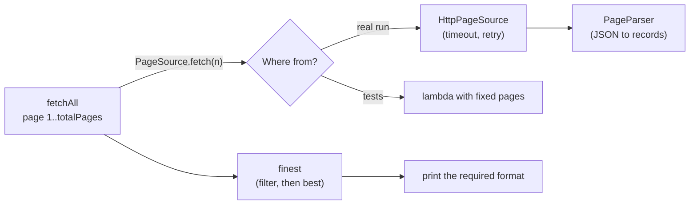

**Short answer:** Split it in three: fetch one page, loop over pages, pick the answer. Read `total_pages` from the first response and loop to it, collect the items, filter them, and take the best with a comparator that states every tie-break. Set timeouts, retry only 429, 5xx and network errors a few times, and fail loudly on anything else, because a missing page gives a wrong answer that looks right.

## Picture it



Three pages, `minVotes = 100`, best rating wins, then more votes, then name:

| Step | Page | Items (rating, votes) | Best so far |
|---|---|---|---|
| 1 | 1 of 3 | Ok (4.1, 900), Few (5.0, 3) | Ok: "Few" is filtered out |
| 2 | 2 of 3 | Good (4.7, 500) | Good |
| 3 | 3 of 3 | Same (4.7, 800) | Same: tie on rating, more votes |

**The picture in one sentence:** hide the network behind one method, so that everything that can be wrong in the logic can be tested with no network.

## Approach

- **Read the prompt for four things:** parameter names, response shape, filter rule, tie-break. The fields on this page are an **example**.
- **What was reported:** "finest hotel by rating" and "results about restaurants"; the exact contract is not known.
- **Naive:** one method that calls, parses and compares. It passes the sample and cannot be tested.
- **Better:** `PageSource` (one page), `fetchAll` (the loop), `finest` (pure). This is a small Ports and Adapters split.
- **Do not trust the order of the data,** and do not stop at the first match unless the API promises a sort.
- **One pass, not a sort:** `min(comparator)` is O(n). Sort only when the output is a list.

## Solution

Example response:

```json
{"page": 1, "total_pages": 3, "data": [{"name": "Roo Cafe", "user_rating": {"average_rating": 4.6, "votes": 120}}]}
```

The logic, with no HTTP and no JSON in it:

```java
import java.io.IOException;
import java.util.*;
import java.util.List;

public record Outlet(String name, double rating, int votes) {}

public record Page(int totalPages, List<Outlet> items) {}

/** The seam: tests pass a lambda, production passes HttpPageSource. */
@FunctionalInterface
public interface PageSource {
    Page fetch(int page) throws IOException;
}

public final class TopOutlet {
    private static final Comparator<Outlet> BEST_FIRST = Comparator.comparingDouble(Outlet::rating).reversed()
            .thenComparing(Comparator.comparingInt(Outlet::votes).reversed())
            .thenComparing(Outlet::name);

    private TopOutlet() {}

    static List<Outlet> fetchAll(PageSource source) throws IOException {
        List<Outlet> all = new ArrayList<>();
        int totalPages = 1;                                   // unknown until page 1 answers
        for (int page = 1; page <= totalPages; page++) {
            Page result = source.fetch(page);
            totalPages = result.totalPages();
            all.addAll(result.items());
        }
        return all;
    }

    static Optional<Outlet> finest(Collection<Outlet> outlets, int minVotes) {
        return outlets.stream().filter(o -> o.votes() >= minVotes).min(BEST_FIRST);
    }
}
```

Parsing with Jackson 2 (in Spring Boot 4 the package is `tools.jackson`, Jackson 3):

```java
import com.fasterxml.jackson.databind.JsonNode;
import com.fasterxml.jackson.databind.ObjectMapper;
import java.io.IOException;
import java.util.ArrayList;
import java.util.List;

final class PageParser {
    private static final ObjectMapper JSON = new ObjectMapper();

    private PageParser() {}

    static Page parse(String body) throws IOException {
        JsonNode root = JSON.readTree(body);
        if (!root.path("total_pages").isInt() || !root.path("data").isArray()) {
            throw new IOException("unexpected response: no total_pages or data");
        }
        List<Outlet> items = new ArrayList<>();
        for (JsonNode node : root.path("data")) {
            JsonNode rating = node.path("user_rating").path("average_rating");
            if (!node.path("name").isTextual() || !rating.isNumber()) continue;      // one bad record must not end the run
            items.add(new Outlet(node.path("name").asText(), rating.asDouble(),
                    node.path("user_rating").path("votes").asInt(0)));
        }
        return new Page(root.path("total_pages").asInt(), items);
    }
}
```

Fetching with the JDK client:

```java
import java.io.IOException;
import java.net.URI;
import java.net.URLEncoder;
import java.net.http.HttpClient;
import java.net.http.HttpRequest;
import java.net.http.HttpResponse;
import java.nio.charset.StandardCharsets;
import java.time.Duration;

final class HttpPageSource implements PageSource {
    private static final int MAX_ATTEMPTS = 3;

    private final HttpClient client;        // HttpClient.newBuilder().connectTimeout(Duration.ofSeconds(5)).build()
    private final String baseUrl;
    private final String city;

    HttpPageSource(HttpClient client, String baseUrl, String city) {
        this.client = client;
        this.baseUrl = baseUrl;
        this.city = city;
    }

    @Override
    public Page fetch(int page) throws IOException {
        URI uri = URI.create(baseUrl + "?city=" + URLEncoder.encode(city, StandardCharsets.UTF_8) + "&page=" + page);
        HttpRequest request = HttpRequest.newBuilder(uri).timeout(Duration.ofSeconds(10))
                .header("Accept", "application/json").GET().build();
        return PageParser.parse(getWithRetry(request));       // outside the retry: bad JSON will not get better
    }

    private String getWithRetry(HttpRequest request) throws IOException {
        for (int attempt = 1; ; attempt++) {
            String failure;
            IOException cause = null;
            try {
                HttpResponse<String> response = client.send(request, HttpResponse.BodyHandlers.ofString());
                int status = response.statusCode();
                if (status == 200) return response.body();
                if (status != 429 && status < 500) throw new BadRequest("HTTP " + status + " for " + request.uri());
                failure = "HTTP " + status;
            } catch (BadRequest e) {
                throw e;                                                   // a 4xx will not get better
            } catch (InterruptedException e) {
                Thread.currentThread().interrupt();
                throw new IOException("interrupted while calling " + request.uri(), e);
            } catch (IOException e) {
                failure = e.toString();
                cause = e;
            }
            if (attempt == MAX_ATTEMPTS) {
                throw new IOException(failure + " after " + attempt + " attempts: " + request.uri(), cause);
            }
            pause(200L << (attempt - 1));
        }
    }

    private static void pause(long millis) throws IOException {
        try {
            Thread.sleep(millis);
        } catch (InterruptedException e) {
            Thread.currentThread().interrupt();
            throw new IOException("interrupted during backoff", e);
        }
    }

    private static final class BadRequest extends IOException {
        BadRequest(String message) { super(message); }
    }
}
```

```java
public static void main(String[] args) throws IOException {
    HttpClient client = HttpClient.newBuilder().connectTimeout(Duration.ofSeconds(5)).build();
    PageSource source = new HttpPageSource(client, "https://example.test/api/outlets", args[0]);
    System.out.println(TopOutlet.finest(TopOutlet.fetchAll(source), 100).map(Outlet::name).orElse("NONE"));
}
```

**If HackerRank has no Jackson:** look at the imports in the stub first, because the allowed library is usually already there. If there is none, this is enough JSON, JDK only:

```java
import java.util.*;

/** Enough JSON for an assessment: object -> Map, array -> List, then String, Double, Boolean, null. */
final class MiniJson {
    private final String s;
    private int i;

    private MiniJson(String s) { this.s = s; }

    static Object parse(String text) {
        MiniJson json = new MiniJson(text);
        Object value = json.value();
        json.skipSpace();
        if (json.i != text.length()) throw json.error();
        return value;
    }

    private Object value() {
        skipSpace();
        if (i >= s.length()) throw error();
        return switch (s.charAt(i)) {
            case '{' -> object();
            case '[' -> array();
            case '"' -> string();
            case 't' -> literal("true", true);
            case 'f' -> literal("false", false);
            case 'n' -> literal("null", null);
            default -> number();
        };
    }

    private Map<String, Object> object() {
        Map<String, Object> map = new LinkedHashMap<>();
        i++;
        if (accept('}')) return map;
        do {
            skipSpace();
            String key = string();
            if (!accept(':')) throw error();
            map.put(key, value());
        } while (accept(','));
        if (!accept('}')) throw error();
        return map;
    }

    private List<Object> array() {
        List<Object> list = new ArrayList<>();
        i++;
        if (accept(']')) return list;
        do list.add(value()); while (accept(','));
        if (!accept(']')) throw error();
        return list;
    }

    private String string() {
        if (i >= s.length() || s.charAt(i) != '"') throw error();
        StringBuilder out = new StringBuilder();
        for (i++; i < s.length() && s.charAt(i) != '"'; i++) {
            char c = s.charAt(i);
            if (c == '\\') {
                c = s.charAt(++i);
                switch (c) {
                    case 'n' -> c = '\n';
                    case 't' -> c = '\t';
                    case 'r' -> c = '\r';
                    case 'b' -> c = '\b';
                    case 'f' -> c = '\f';
                    case 'u' -> { c = (char) Integer.parseInt(s.substring(i + 1, i + 5), 16); i += 4; }
                    default -> { }                        // \" \\ \/ stand for themselves
                }
            }
            out.append(c);
        }
        if (i >= s.length()) throw error();
        i++;
        return out.toString();
    }

    private Object literal(String word, Object value) {
        if (!s.startsWith(word, i)) throw error();
        i += word.length();
        return value;
    }

    private Double number() {
        int start = i;
        while (i < s.length() && "+-.eE0123456789".indexOf(s.charAt(i)) >= 0) i++;
        if (start == i) throw error();
        return Double.valueOf(s.substring(start, i));
    }

    private boolean accept(char c) {
        skipSpace();
        if (i >= s.length() || s.charAt(i) != c) return false;
        i++;
        return true;
    }

    private void skipSpace() { while (i < s.length() && Character.isWhitespace(s.charAt(i))) i++; }

    private IllegalArgumentException error() { return new IllegalArgumentException("bad JSON at position " + i); }
}
```

- Read with casts: `((Double) root.get("total_pages")).intValue()`.
- Do not pull JSON apart with regex. Nested objects and escaped quotes break it.
- On Java 8 there is no `java.net.http`; use `HttpURLConnection` with both timeouts set.

## Tests

```java
@Test
void readsEveryPageAndStops() throws IOException {
    List<Integer> asked = new ArrayList<>();
    PageSource source = page -> {
        asked.add(page);
        return new Page(3, List.of(new Outlet("o" + page, page, 100)));
    };
    assertEquals(3, TopOutlet.fetchAll(source).size());
    assertEquals(List.of(1, 2, 3), asked);
}

@Test
void tieIsBrokenByVotesThenName() {
    var outlets = List.of(new Outlet("B", 4.7, 10), new Outlet("C", 4.7, 20), new Outlet("A", 4.7, 20));
    assertEquals("A", TopOutlet.finest(outlets, 0).orElseThrow().name());
}
```

Also: no results, the filter removes everything, a failure on page 2, a record with a null rating, 503 then 200, and 404 not retried.

## Complexity

- **Time:** O(n) over all items, plus one HTTP call per page. The calls dominate.
- **Space:** O(n) because it keeps all items. Fold page by page for O(1) if pages are many.

## Edge cases

- `total_pages` is 0, or the first page is empty: answer "none", do not crash.
- City with a space or `&`: use `URLEncoder`.
- Rating missing or null: skip that record and log it. Rating equal as text but not as a number (`4.50`): compare numbers.
- Data changes while you page: an item can move and be seen twice or missed. De-duplicate by id, and say a cursor API is the real fix.
- The server ignores `page` and always returns page 1: the loop still ends, because it counts to `totalPages`.

## Follow-ups

- **Handle pagination, other styles.** Offset: add `limit` until a short page. Cursor or `Link: rel="next"`: follow until it is absent, and stop if a cursor repeats.
- **Faster?** After page 1, fetch the rest in parallel with virtual threads behind a `Semaphore` of about 5. Any failure must fail the whole run.
- **Why not retry 400 or 404?** The same request gives the same answer. Retry only what can change.
- **429?** Respect `Retry-After` when it is there.
- **Partial answer if one page fails?** Not for "best of all". If partial is acceptable, the output must say it is partial.

**Time plan for the assessment:** 5 min reading, 10 min logic with fake pages, 10 min HTTP and JSON, 5 min edge cases. Print the raw first response once before writing the parser.

Go deeper: [W2 · REST API design](../academy/lessons/W2.md), [W7 · Calling other services](../academy/lessons/W7.md), [J8 · I/O, NIO and JSON with Jackson](../academy/lessons/J8.md).
