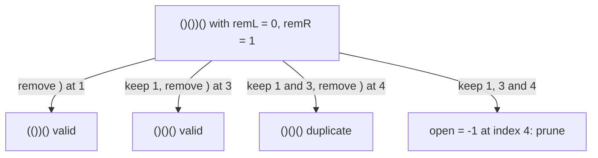

**Short answer:** First count how many `(` and `)` must go: an unmatched `)` adds one to `remR`, and the `(` left open at the end are `remL`. Then backtrack over the string, keeping or removing each bracket within those budgets and never letting `)` outnumber `(`, with a set to drop duplicates.

## Picture it

`s = "()())()"`. Step 1 counts the removals.

| char | `(` | `)` | `(` | `)` | `)` | `(` | `)` |
|---|---|---|---|---|---|---|---|
| remL (open so far) | 1 | 0 | 1 | 0 | 0 | 1 | 0 |
| remR (unmatched) | 0 | 0 | 0 | 0 | 1 | 1 | 1 |

So `remL = 0` and `remR = 1`: remove exactly one `)`. Step 2 tries each `)`:



Result: `["(())()", "()()()"]`. Removing the `)` at 3 or at 4 gives the same string, which is why a set is needed.

**The picture in one sentence:** the counts tell you exactly how much to delete, so backtracking only chooses where.

## Approach

- **Brute force:** try all subsets of brackets to delete and keep the longest valid strings. O(2ⁿ · n).
- **BFS alternative:** remove one bracket at a time, level by level, with a visited set. The first level with a valid string is the answer, but a level can hold many strings.
- **Key insight:** the minimum number of removals of each kind is fixed and found in one pass. Every optimal answer removes exactly `remL` opening and `remR` closing brackets.
- **Pruning while building:**
  - Remove a bracket only if its budget is positive.
  - Keep a `)` only if `open > 0`.
  - Accept only if both budgets and `open` end at 0.
- **Letters** are always kept.

## Solution

```java
import java.util.*;

class Solution {
    public List<String> removeInvalidParentheses(String s) {
        int remL = 0, remR = 0;
        for (char c : s.toCharArray()) {
            if (c == '(') remL++;
            else if (c == ')') {
                if (remL > 0) remL--;            // matches an earlier '('
                else remR++;                     // nothing to match: must be removed
            }
        }
        Set<String> out = new HashSet<>();
        dfs(s, 0, 0, remL, remR, new StringBuilder(), out);
        return new ArrayList<>(out);
    }

    private void dfs(String s, int i, int open, int remL, int remR, StringBuilder cur, Set<String> out) {
        if (remL + remR > s.length() - i) return;            // not enough characters left to remove
        if (i == s.length()) {
            if (open == 0) out.add(cur.toString());          // the budgets are 0 here, by the check above
            return;
        }
        char c = s.charAt(i);
        if (c == '(' && remL > 0) dfs(s, i + 1, open, remL - 1, remR, cur, out);     // remove
        if (c == ')' && remR > 0) dfs(s, i + 1, open, remL, remR - 1, cur, out);

        if (c == ')' && open == 0) return;                   // keeping it would be invalid
        int nextOpen = c == '(' ? open + 1 : c == ')' ? open - 1 : open;
        cur.append(c);                                       // keep
        dfs(s, i + 1, nextOpen, remL, remR, cur, out);
        cur.setLength(cur.length() - 1);                     // undo
    }
}
```

## Complexity

- **Time:** O(n · 2ᵇ) worst case, where `b` is the number of brackets: two choices per bracket and O(n) to copy a result. The budgets prune most of it.
- **Space:** O(n) recursion depth and builder, plus the output set.

## Edge cases

- Already valid: both budgets are 0, so the only result is the string itself.
- All brackets invalid, such as `")("`: the result is `[""]`, not an empty list.
- Letters only: unchanged.
- A run such as `"(()"`: removing either `(` gives the same `"()"`, and the set keeps one.
- Order of results does not matter on LeetCode; sort if the interviewer wants a fixed order.

## Variations

- **Return just one valid string (LC 1249):** greedy with a stack or counters, O(n).
- **Only the number of removals:** `remL + remR` from the counting pass, O(n) time and O(1) space. It is the same number as LC 921.
- **No set:** remove only the first bracket of each run of equal brackets, and remember the last removal index so removals go left to right.
- **Several bracket types:** counters are no longer enough for validity; keep a stack, or use BFS with a full check.

Related: [Valid Parentheses](valid-parentheses.md), [Generate Parentheses](generate-parentheses.md), [T5 · Backtracking, tries and analysing recursion](../academy/lessons/T5.md).
