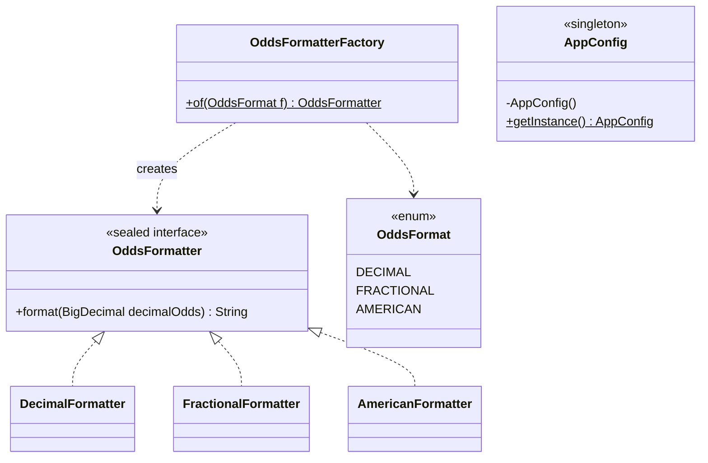
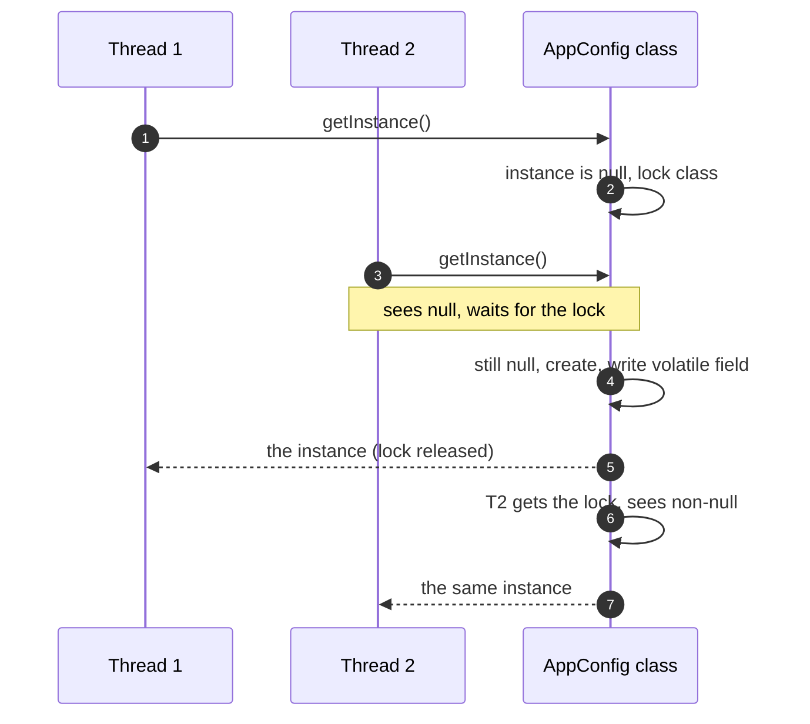

**Short answer:** **Singleton** guarantees one instance of a class and a global way to reach it. In Java the safe ways are an `enum` with one constant, the holder-class idiom, or double-checked locking with a `volatile` field; a plain lazy `if (instance == null)` is broken under threads. **Factory** puts the decision "which concrete class do I create?" in one place, so callers depend on an interface and adding a type does not touch them. *Simple factory* is one method with a `switch`; *Factory Method* lets subclasses decide; *Abstract Factory* creates a family of related objects. In Spring, beans are already singletons per container and a factory is often just a `Map` of beans injected by type, so I rarely hand-roll either in application code.

## Picture it





**How to read it:**
- The class diagram shows the factory's whole point: callers know only `OddsFormatter` and `OddsFormat`. The three implementations are hidden behind `of(...)`.
- `AppConfig` has a private constructor and a static accessor; `$` marks static members.
- The sequence is double-checked locking: check, lock, check again. The second check (step 7) is why T2 does not create a second instance; `volatile` is why T2 never sees a half-built one.

## Requirements

- Explain both patterns, when to use them and when not to.
- Implement a factory (a betting example: format odds as decimal `2.50`, fractional `3/2` or American `+150` from the user's preference).
- Implement a singleton and make it thread-safe; know the ways it can be broken.

## Classes

- `OddsFormatter`: the product interface. Implementations are stateless, so one instance of each can be shared.
- `OddsFormatterFactory`: the creator. Maps an `OddsFormat` to a formatter.
- `AppConfig`: a classic singleton holding settings loaded once (stand-in for anything expensive and truly unique in the process).
- In Spring: `NotificationSenderFactory` that receives all `NotificationSender` beans and picks one by channel.

## Patterns used

- **Simple factory:** one static method with a `switch`. Not in the GoF book, but the most common form. With a `sealed` interface and an exhaustive `switch` on an enum, the compiler reports a missing case.
- **Factory Method (GoF):** an abstract class declares `createSender()` and each subclass returns its own type, for example `EmailCampaign.createSender()` vs `SmsCampaign.createSender()`. The base class runs the shared algorithm and calls the factory method for the varying part. JDK: `Collection.iterator()`.
- **Abstract Factory (GoF):** one interface creates several related products that must match, for example a `PaymentProviderFactory` that creates the `Authoriser`, `Refunder` and `WebhookVerifier` for the same provider. JDK: `DocumentBuilderFactory`.
- **Singleton (GoF):** one instance, global access. JDK: `Runtime.getRuntime()`.

## Code

The factory:

```java
public enum OddsFormat { DECIMAL, FRACTIONAL, AMERICAN }

public sealed interface OddsFormatter permits DecimalFormatter, FractionalFormatter, AmericanFormatter {
    String format(BigDecimal decimalOdds);
}

final class DecimalFormatter implements OddsFormatter {
    public String format(BigDecimal d) { return d.setScale(2, RoundingMode.HALF_UP).toPlainString(); }
}

final class FractionalFormatter implements OddsFormatter {
    public String format(BigDecimal d) {                       // 2.50 -> profit 1.50 -> 150/100 -> 3/2
        BigInteger num = d.subtract(BigDecimal.ONE).movePointRight(2)
                          .setScale(0, RoundingMode.HALF_UP).toBigIntegerExact();
        BigInteger den = BigInteger.valueOf(100);
        BigInteger gcd = num.gcd(den);
        return num.divide(gcd) + "/" + den.divide(gcd);
    }
}

final class AmericanFormatter implements OddsFormatter {
    public String format(BigDecimal d) {
        BigDecimal profit = d.subtract(BigDecimal.ONE);
        return d.compareTo(BigDecimal.TWO) >= 0
                ? "+" + profit.movePointRight(2).setScale(0, RoundingMode.HALF_UP)          // 2.50 -> +150
                : "-" + BigDecimal.valueOf(100).divide(profit, 0, RoundingMode.HALF_UP);   // 1.50 -> -200
    }
}

public final class OddsFormatterFactory {
    private static final OddsFormatter DECIMAL = new DecimalFormatter();
    private static final OddsFormatter FRACTIONAL = new FractionalFormatter();
    private static final OddsFormatter AMERICAN = new AmericanFormatter();

    private OddsFormatterFactory() {}

    public static OddsFormatter of(OddsFormat format) {
        return switch (format) {                 // exhaustive: a new enum constant will not compile
            case DECIMAL -> DECIMAL;
            case FRACTIONAL -> FRACTIONAL;
            case AMERICAN -> AMERICAN;
        };
    }
}
```

A factory does not have to return a **new** object; it decides **which** object. Here the products are stateless, so each is created once and shared.

The same idea in Spring, with no `switch` at all:

```java
public interface NotificationSender {
    Channel channel();
    void send(Notification n);
}

@Component
public class NotificationSenderFactory {
    private final Map<Channel, NotificationSender> byChannel;

    public NotificationSenderFactory(List<NotificationSender> senders) {   // every sender bean
        this.byChannel = senders.stream().collect(
                Collectors.toUnmodifiableMap(NotificationSender::channel, Function.identity()));
    }

    public NotificationSender forChannel(Channel channel) {
        NotificationSender s = byChannel.get(channel);
        if (s == null) throw new IllegalArgumentException("no sender for " + channel);
        return s;
    }
}
```

A new channel is a new `@Component`; the factory never changes (open/closed principle). `toUnmodifiableMap` throws at startup if two beans claim the same channel, which is the failure you want early.

Thread-safe singletons, best first:

```java
// 1. Enum: thread-safe, serialization-safe, reflection-safe (Effective Java, Item 3)
public enum AppConfig {
    INSTANCE;
    private final Properties props = load();
    public String get(String key) { return props.getProperty(key); }
    private static Properties load() { /* read file once */ return new Properties(); }
}

// 2. Holder idiom: lazy, no locking; the JVM initialises Holder once, on first use
public final class Registry {
    private Registry() {}
    private static final class Holder { static final Registry INSTANCE = new Registry(); }
    public static Registry getInstance() { return Holder.INSTANCE; }
}

// 3. Double-checked locking: lazy; volatile is mandatory
public final class Cache {
    private static volatile Cache instance;
    private Cache() {}
    public static Cache getInstance() {
        Cache local = instance;                  // one volatile read on the fast path
        if (local == null) {
            synchronized (Cache.class) {
                local = instance;
                if (local == null) {
                    instance = local = new Cache();
                }
            }
        }
        return local;
    }
}
```

Two simpler forms also work: **eager** (`private static final X INSTANCE = new X();`, thread-safe because class initialisation is, but created even if unused) and a **`synchronized` getInstance** (correct, but every call takes a lock).

Why `volatile` in version 3: `instance = new Cache()` is allocate, construct, assign. Without `volatile` the JIT or CPU may publish the reference before the constructor has finished. Another thread then skips the `synchronized` block and uses a half-built object. `volatile` creates a happens-before edge between the write and every later read (Java memory model, Java 5+).

## Extensions

- **Ways to break a singleton.** *Reflection:* `setAccessible(true)` on the private constructor; defend by throwing from the constructor if an instance exists, or use an enum (reflection cannot create enum instances). *Serialization:* deserialising creates a new object; add `private Object readResolve() { return getInstance(); }`, or use an enum. *Cloning:* do not implement `Cloneable`. *Class loaders:* two class loaders (for example two web apps in one server) each load their own copy, so "one per JVM" is really "one per class loader".
- **Spring singleton vs GoF singleton.** Spring's default scope gives one instance **per bean definition per application context**. You can still `new` the class, and two bean definitions of the same class give two instances. It is better than GoF because it is injected: tests can pass a mock, and nothing reaches for a static global.
- **Why singletons are often a smell.** Hidden global state, hidden dependencies (`X.getInstance()` deep inside a method), hard to mock, and mutable shared state needs its own thread safety. Making `getInstance()` thread-safe does not make the object's methods thread-safe.
- **Factory or constructor?** Use a factory when the concrete type depends on runtime data, when creation is complex, or when you want to cache or reuse instances (`Integer.valueOf`, `List.of`). A plain constructor is fine when there is one obvious type.
- **Related creational patterns.** Builder for objects with many optional fields; Prototype for copying a configured object. The [bet placement LLD](design-betting-bet-placement-lld.md) uses a `BetFactory` to turn a slip into singles or an accumulator.

## Follow-ups

- **Make the singleton thread-safe.** Prefer an enum, or the holder idiom when you need a class (for example it must extend something). Both are lazy where it matters and rely on the JVM's guarantee that a class is initialised once, under a lock, before first use (JLS 12.4.2). If asked for double-checked locking, write it with `volatile` and the local variable, and explain the reordering problem. Mention that in Spring you would make it a bean instead.

Go deeper: [E2 · Creational patterns](../academy/lessons/E2.md), [E1 · SOLID, by violation and refactor](../academy/lessons/E1.md), [D2 · Spring core: IoC container, scopes, profiles](../academy/lessons/D2.md), [B2 · Locks: synchronized, ReentrantLock, deadlock](../academy/lessons/B2.md).
