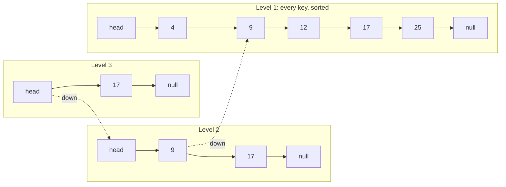

**Short answer:** A skip list is a sorted linked list with extra "express lanes" above it. Each node gets a random height, so the top lanes have few nodes and take long jumps, and search, insert and delete are O(log n) *expected*, O(n) in the worst case.

I would use one when I need sorted data with range scans and many concurrent writers, because an insert changes only a few nearby links and there is no rebalancing. In Java that is `ConcurrentSkipListMap`; Redis sorted sets use a skip list too.

## Explanation



**Search 12:** go right while the next key is smaller, otherwise go down.
- Level 3: next is 17, too big. Go down.
- Level 2: next is 9, smaller, move. Next is 17, too big. Go down.
- Level 1: next is 12. Found, after touching few nodes.

**Insert:** search, remember the last node on every level, then flip a coin for the height and link the new node in. **Delete** unlinks it on each of its levels.

**Why O(log n)?**
- With p = 1/2, about half the nodes reach level 2 and a quarter reach level 3.
- So there are about log2(n) useful levels, and a search takes an expected constant number of steps on each.

**Space:** expected pointers per node = 1 / (1 − p). That is 2 with p = 1/2, and about 1.33 with p = 1/4 (Redis uses 1/4).

| | Skip list | Red-black tree (`TreeMap`) | `HashMap` |
|---|---|---|---|
| Search, insert, delete | O(log n) expected | O(log n) worst case | O(1) expected |
| Sorted order, ranges | yes, walk level 1 | yes | no |
| Balancing | random heights | rotations | none |
| Concurrent version in the JDK | `ConcurrentSkipListMap` | none | `ConcurrentHashMap` |

**When to use one:**
- A concurrent sorted map: leaderboards, timers ordered by expiry, "next key after X".
- In-memory write buffers (memtables) of LSM stores such as LevelDB and RocksDB: fast inserts, then a sorted flush.
- When you need to write an ordered structure yourself: it is much less code than a balanced tree.

**When not to:**
- Exact lookups only: use a hash map.
- Single-threaded sorted data: `TreeMap` is fine, with a worst-case guarantee.
- On disk: B+ trees fit pages better.

## Example

```java
import java.util.concurrent.ThreadLocalRandom;

public final class SkipListSet {
    private static final int MAX_LEVEL = 16;                 // enough for about 2^16 keys with p = 1/2

    private static final class Node {
        final int key;
        final Node[] next;                                   // next[i] = next node on level i
        Node(int key, int levels) { this.key = key; this.next = new Node[levels]; }
    }

    private final Node head = new Node(0, MAX_LEVEL);        // sentinel, its key is never compared

    public boolean contains(int key) {
        Node cur = head;
        for (int level = MAX_LEVEL - 1; level >= 0; level--) {
            while (cur.next[level] != null && cur.next[level].key < key) cur = cur.next[level];   // right
        }                                                                                         // then down
        Node found = cur.next[0];
        return found != null && found.key == key;
    }

    public boolean add(int key) {
        Node[] before = new Node[MAX_LEVEL];                 // last node before key on every level
        Node cur = head;
        for (int level = MAX_LEVEL - 1; level >= 0; level--) {
            while (cur.next[level] != null && cur.next[level].key < key) cur = cur.next[level];
            before[level] = cur;
        }
        if (cur.next[0] != null && cur.next[0].key == key) return false;

        Node node = new Node(key, randomLevels());
        for (int level = 0; level < node.next.length; level++) {
            node.next[level] = before[level].next[level];
            before[level].next[level] = node;
        }
        return true;
    }

    private static int randomLevels() {                      // coin flips: half reach level 2, a quarter level 3
        int levels = 1;
        while (levels < MAX_LEVEL && ThreadLocalRandom.current().nextBoolean()) levels++;
        return levels;
    }
}
```

## Pitfalls and follow-ups

- **MCQ trap: "guaranteed O(log n)".** No. It is expected, or "with high probability". The worst case is O(n), if every node gets the same height.
- **MCQ trap: "needs rebalancing".** No. Random heights replace rotations.
- **MCQ trap: "the input must be shuffled".** No. The randomness is in the heights, so sorted input is fine, unlike in a plain binary search tree.
- **Why is it good for concurrency?** An insert touches a few neighbouring links, which can be set with compare-and-set. A tree rotation changes several nodes at once.
- **`ConcurrentSkipListMap` details?** Null keys and values are not allowed, iterators are weakly consistent, and `size()` walks the list, so it is O(n).
- **Why does Redis use a skip list for sorted sets?** Range and rank queries with simple code. Links store how many nodes they jump over, which gives rank in O(log n), and a hash table beside it gives the score of a member in O(1). Small sorted sets use a compact listpack instead.
- **Weak point?** Pointer chasing: poor cache locality compared with arrays or B-trees.

Deeper: [J6 · Collections internals: ArrayList, HashMap, TreeMap, LinkedHashMap](../academy/lessons/J6.md).
