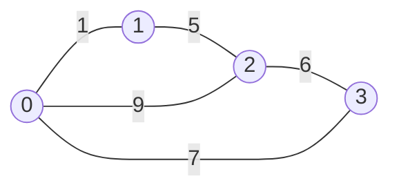

**Short answer:** Sort the edges, and for each edge taken as the minimum, run Kruskal from that position upwards; the last edge added is the smallest possible maximum for that minimum. Keep the tree with the smallest `max - min` and return its weight sum, in O(E² α(V)).

**Assumptions (the report does not fix these, so say them first):**
- Undirected graph, vertices `0..n-1`, `n` is given, edges are `{u, v, weight}` with non-negative weights.
- If several spanning trees share the smallest difference, return the **smallest sum**.
- A disconnected graph returns -1; one vertex returns 0.

## Picture it



Sorted edges: `0-1 (1)`, `1-2 (5)`, `2-3 (6)`, `3-0 (7)`, `0-2 (9)`.

| smallest edge | Kruskal takes | spans? | max − min | sum | best |
|---|---|---|---|---|---|
| 1 | 1, 5, 6 | yes | 6 − 1 = 5 | 12 | diff 5, sum 12 |
| 5 | 5, 6, 7 | yes | 7 − 5 = 2 | 18 | diff 2, sum 18 |
| 6 | only 3 edges left: 6, 7, and 9 closes a cycle | no | | | stop |

Answer 18. The minimum spanning tree (sum 12) is **not** the answer.

**The picture in one sentence:** fix the smallest edge, let Kruskal find the smallest possible largest edge, and slide that starting point along the sorted list.

## Approach

- **Brute force:** check every set of `n - 1` edges. Exponential.
- **Why not a plain MST:** it minimises the maximum edge, but it may use a very small edge that widens the gap.
- **Key insight:** fix the minimum allowed weight. Kruskal on the edges from there up gives a minimum spanning tree of that suffix, which also has the smallest possible maximum edge.
- **The starting edge is always taken,** so the minimum really is its weight. (A self-loop is the one exception; drop those first.)
- **Ties:** that tree also has the smallest sum for its starting point, so comparing (difference, sum) is correct.
- **Early stop:** once a suffix cannot connect the graph, shorter suffixes cannot either.

## Solution

```java
import java.util.*;

class Solution {
    public long sumOfBalancedTree(int n, int[][] edges) {
        if (n == 1) return 0;
        int[][] sorted = Arrays.stream(edges).filter(e -> e[0] != e[1]).toArray(int[][]::new);
        Arrays.sort(sorted, Comparator.comparingInt(e -> e[2]));

        long bestDiff = Long.MAX_VALUE, bestSum = -1;
        for (int start = 0; start + n - 1 <= sorted.length; start++) {
            DisjointSet dsu = new DisjointSet(n);
            int used = 0;
            long sum = 0, diff = 0;
            for (int i = start; i < sorted.length && used < n - 1; i++) {
                if (dsu.union(sorted[i][0], sorted[i][1])) {
                    used++;
                    sum += sorted[i][2];
                    diff = (long) sorted[i][2] - sorted[start][2];
                }
            }
            if (used < n - 1) break;                          // later starts have even fewer edges
            if (diff < bestDiff || (diff == bestDiff && sum < bestSum)) {
                bestDiff = diff;
                bestSum = sum;
            }
        }
        return bestSum;
    }

    private static final class DisjointSet {
        private final int[] parent, size;

        DisjointSet(int n) {
            parent = new int[n];
            size = new int[n];
            for (int i = 0; i < n; i++) { parent[i] = i; size[i] = 1; }
        }

        int find(int x) {
            while (parent[x] != x) {
                parent[x] = parent[parent[x]];                // path halving
                x = parent[x];
            }
            return x;
        }

        boolean union(int a, int b) {
            int ra = find(a), rb = find(b);
            if (ra == rb) return false;
            if (size[ra] < size[rb]) { int t = ra; ra = rb; rb = t; }
            parent[rb] = ra;
            size[ra] += size[rb];
            return true;
        }
    }
}
```

## Complexity

- **Time:** O(E log E) to sort, then up to E Kruskal passes of O(V + E · α(V)). In a connected graph V ≤ E + 1, so O(E² α(V)).
- **Space:** O(V + E).

## Edge cases

- `n = 1`: sum 0. Disconnected graph: -1.
- The graph is already a tree: the answer is the sum of all edges.
- All weights equal: difference 0, every spanning tree has the same sum.
- Parallel edges: keep them all, because a heavier copy may give a smaller gap. Self-loops are dropped.
- Sums use `long`.

## Variations

- **Faster, O(E log E + E · V):** add edges from heaviest to lightest and keep one tree. When an edge closes a cycle, drop the heaviest edge on it; the tree stays the MST of the edges seen so far.

```java
import java.util.*;

class SlidingTree {
    long sumOfBalancedTree(int n, int[][] edges) {
        if (n == 1) return 0;
        int[][] desc = edges.clone();
        Arrays.sort(desc, (a, b) -> Integer.compare(b[2], a[2]));
        List<int[]> tree = new ArrayList<>();                 // MST (or forest) of the edges seen so far
        long bestDiff = Long.MAX_VALUE, bestSum = -1;
        for (int[] e : desc) {
            if (e[0] == e[1]) continue;
            int[] worst = heaviestOnPath(n, tree, e[0], e[1]);
            if (worst != null) tree.removeIf(t -> t == worst);
            tree.add(e);
            if (tree.size() < n - 1) continue;
            long sum = 0, max = e[2];                         // e is always the lightest edge in the tree
            for (int[] t : tree) { sum += t[2]; max = Math.max(max, t[2]); }
            long diff = max - e[2];
            if (diff < bestDiff || (diff == bestDiff && sum < bestSum)) { bestDiff = diff; bestSum = sum; }
        }
        return bestSum;
    }

    /** The heaviest tree edge between a and b, or null if they are not connected. BFS, O(V). */
    private int[] heaviestOnPath(int n, List<int[]> tree, int a, int b) {
        List<List<int[]>> adj = new ArrayList<>();
        for (int i = 0; i < n; i++) adj.add(new ArrayList<>());
        for (int[] t : tree) { adj.get(t[0]).add(t); adj.get(t[1]).add(t); }
        int[][] worst = new int[n][];
        boolean[] seen = new boolean[n];
        Deque<Integer> queue = new ArrayDeque<>(List.of(a));
        seen[a] = true;
        while (!queue.isEmpty()) {
            int u = queue.poll();
            for (int[] t : adj.get(u)) {
                int v = t[0] == u ? t[1] : t[0];
                if (seen[v]) continue;
                seen[v] = true;
                worst[v] = worst[u] == null || t[2] > worst[u][2] ? t : worst[u];
                queue.add(v);
            }
        }
        return worst[b];
    }
}
```

- **Only the difference is asked:** the same code without the sum. A link-cut tree brings it to O(E log E), too long for an interview.
- **The candidate tried Prim plus DP** and solved it partly. Prim grows from a vertex rather than in weight order, so it does not give the sliding range directly.

Related: [T4 · Trees and graphs: traversals, BFS and DFS, union-find](../academy/lessons/T4.md).
