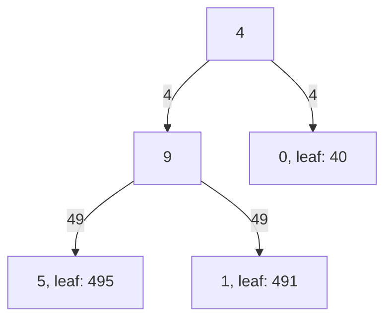

**Short answer:** DFS from the root carrying the number built so far: at each node `value = prefix * 10 + node.val`. At a leaf return that value, otherwise return the sum of both children, which takes O(n) time and O(h) stack.

## Picture it

The edge labels show the number passed down.



| call on node | number passed in | value here | returns |
|---|---|---|---|
| 5 (leaf) | 49 | 495 | 495 |
| 1 (leaf) | 49 | 491 | 491 |
| 9 | 4 | 49 | 495 + 491 = 986 |
| 0 (leaf) | 4 | 40 | 40 |
| 4 (root) | 0 | 4 | 986 + 40 = **1026** |

Rows are in the order the calls return.

**The picture in one sentence:** going down one level appends a digit, and appending a digit is `* 10 + digit`.

## Approach

- **Brute force:** DFS that builds a path string, adds it to a list at each leaf, then parses and sums.
- **Key insight:** the string is only a number in disguise. Carry an `int` instead, so nothing needs copying or undoing.
- **Return the sum** rather than adding to a static field. A static total keeps its value between calls, so a second test case starts from a wrong number.

## Solution

```java
class Solution {
    public int sumNumbers(TreeNode root) {
        return dfs(root, 0);
    }

    private int dfs(TreeNode node, int prefix) {
        if (node == null) return 0;
        int value = prefix * 10 + node.val;
        if (node.left == null && node.right == null) return value;   // leaf: one complete number
        return dfs(node.left, value) + dfs(node.right, value);
    }
}
```

## Complexity

- **Time:** O(n), each node once with O(1) work.
- **Space:** O(h) recursion depth: O(log n) if balanced, O(n) for a chain.

## Edge cases

- Empty tree: 0. Single node: its value.
- A node with one child is **not** a leaf. Adding the value at `null` instead would count it wrongly, and count each leaf twice.
- Leading zeros: path 0 → 1 is the number 1. The arithmetic handles it.
- LeetCode guarantees the answer fits in 32 bits (depth at most 10). Otherwise use `long` or `BigInteger`.

## Follow-up: optimise the string-based DFS

- **What it costs:** each call copies a string of length up to h, so O(n · h) time and memory churn, plus parsing at the leaves.
- **First step:** share one `StringBuilder`, append on the way in and `setLength` on the way out. No copies, but parsing each leaf still costs O(h).
- **Best step:** pass the number as an `int`, as above. Arguments are per call, so there is nothing to undo.
- **Global total or return value?** Both are O(n). The return value has no shared state, so it is safe to call twice or from two threads.

## Variations

- **Iterative** (for a very deep tree): keep nodes and their prefixes on two stacks.

```java
import java.util.*;

class Iterative {
    int sumNumbers(TreeNode root) {
        if (root == null) return 0;
        Deque<TreeNode> nodes = new ArrayDeque<>(List.of(root));
        Deque<Integer> prefixes = new ArrayDeque<>(List.of(0));
        int total = 0;
        while (!nodes.isEmpty()) {
            TreeNode node = nodes.pop();
            int value = prefixes.pop() * 10 + node.val;
            if (node.left == null && node.right == null) total += value;
            if (node.right != null) { nodes.push(node.right); prefixes.push(value); }
            if (node.left != null) { nodes.push(node.left); prefixes.push(value); }
        }
        return total;
    }
}
```

- **O(1) extra space:** Morris traversal. When a thread takes you back up, remove that many digits from the number by dividing by 10 per level.
- **Binary digits (LC 1022):** `value = prefix * 2 + node.val`.
- **Path sums (LC 112, 113, 437):** the same top-down carry with plain addition.

Related: [T4 · Trees and graphs: traversals, BFS and DFS](../academy/lessons/T4.md).
