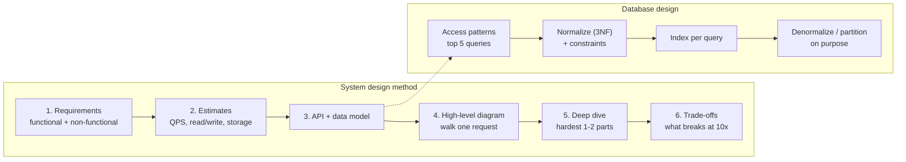
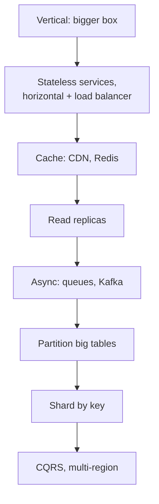

**Short answer:** **Performance** is how fast one request is (latency); **scalability** is whether it stays that fast when load grows 10× or 100× (throughput). For **system design**, follow a fixed method: requirements → estimates → API and data model → high-level diagram → deep dive → trade-offs. For **database design**, start from the access patterns, normalize for correctness, enforce integrity in the database, index per query, then denormalize and partition on purpose. For **scalability**, climb from the cheapest step: vertical → stateless horizontal scaling → cache → read replicas → async queues → partitioning → sharding → CQRS and multi-region, saying the trade-off at each step. For **performance**, measure first, then fix the query, the index, the connections and the request path.

## Picture it

**How to read it:**
- The first picture is the order you speak in. Step 3's data model feeds straight into the database design steps, so the HLD and the schema use the same names.
- The second picture is the scalability ladder. Go down only as far as the numbers from step 2 force you. Each rung adds complexity: stale caches, replica lag, eventual consistency, cross-shard queries.
- Performance work sits beside both: measure, find the bottleneck, fix the cheapest cause.

## Explanation

### 1. System design: a method for the interview

| Step | Time | What you do |
|---|---|---|
| 1. Requirements | 5 min | Functional: the 3–4 core features. Non-functional: latency, availability, consistency, scale. Ask which matters most ("Is the wallet strongly consistent?"). |
| 2. Estimates | 3 min | Users, requests per second, read:write ratio, storage per day. Rough is fine; it drives later choices. |
| 3. API and data model | 5 min | The key endpoints and the main entities. |
| 4. High-level diagram | 10 min | Client → gateway or load balancer → services → database, cache, queue. Walk one request through it end to end. |
| 5. Deep dive | 15 min | The 1–2 hardest parts: hot paths, consistency, failure handling. |
| 6. Trade-offs and bottlenecks | 5 min | What breaks first at 10×, single points of failure, what you would monitor. |

**Building blocks:** load balancer, API gateway (auth, rate limiting), stateless services, cache (Redis), queue or stream (Kafka), SQL and NoSQL stores, CDN, object storage, WebSocket or SSE for push, search (Elasticsearch).

**Patterns worth naming:**
- **Data and messaging:** CQRS, event sourcing, the outbox pattern, sagas for transactions across services, idempotency keys.
- **Resilience:** circuit breaker, retries with backoff and jitter, bulkheads, rate limiting (token bucket), timeouts everywhere.
- **Consistency:** CAP and PACELC. Strong consistency for money; eventual consistency for feeds and history.

### 2. Database design: steps and techniques

1. **Entities and relationships.** Draw the ER diagram: one-to-many, and many-to-many through a join table.
2. **Access patterns first.** List the top 5 queries and their volumes; the schema serves the queries.
3. **Normalize to 3NF** for correctness: each fact stored once, no update anomalies.
4. **Enforce integrity in the database:** primary and foreign keys, `NOT NULL`, `UNIQUE`, `CHECK (stake > 0)`. Correct types: `numeric` for money, `timestamptz`, `bigint` ids.
5. **Index per query.** In a composite index, equality columns come first, then the range or sort column. Use covering, partial and expression indexes where they fit. Every index costs writes.
6. **Denormalize on purpose** for hot reads: summary columns, materialized views, read models fed by events.
7. **Money is a ledger, not an overwritten balance.** Double-entry rows that sum to zero, idempotency keys, an audit trail.
8. **Concurrency.** Optimistic locking (`@Version`) when conflicts are rare, `SELECT ... FOR UPDATE` on hot rows, and a deliberate isolation level.
9. **Growth and change.** Time partitioning for big tables with retention and archiving; soft vs hard delete; zero-downtime migrations (expand → migrate → contract).
10. **SQL vs NoSQL.** SQL for transactions and relations; NoSQL for huge, simple key-based access or flexible documents.

### 3. Scalability techniques

| Technique | Trade-off to say out loud |
|---|---|
| **Vertical scaling** (bigger box) | Simple, with a hard ceiling. |
| **Stateless services, horizontal scaling** behind a load balancer | Session state moves to Redis or tokens. |
| **Caching** (CDN, Redis, in-process) | Invalidation, staleness, thundering herd on expiry. |
| **Read replicas** | Replication lag; read-your-own-writes needs routing to the primary. |
| **Async processing** (queues, Kafka) | Eventual consistency; consumers must be idempotent; dead-letter queues. |
| **Partitioning** (inside one database) | Queries should include the partition key. |
| **Sharding** (across databases) | Cross-shard joins and transactions, rebalancing, choosing the key. |
| **Splitting services by domain** | Network calls, distributed transactions, operational cost. |
| **CQRS and specialised stores** | More moving parts; read models are eventually consistent. |
| **Multi-region** | Latency vs consistency, data residency rules. |

**General rules:** remove single points of failure; avoid hot keys and hot rows (shard counters, batch updates); use backpressure and rate limits so a spike degrades the system gracefully instead of taking it down.

### 4. Performance techniques

- **Measure first.** p95/p99 latency, APM traces, `pg_stat_statements`, then `EXPLAIN (ANALYZE, BUFFERS)`. Never guess.
- **Database:** sargable queries and the right indexes, no N+1 (`JOIN FETCH`, batching), keyset pagination, only the needed columns, batched writes.
- **Connections:** a properly sized HikariCP pool, PgBouncer, HTTP keep-alive.
- **Cache hot data close to the user:** CDN → Redis → in-process (Caffeine).
- **Do less on the request path.** Move slow work (emails, settlement, analytics) onto queues.
- **Parallelise independent calls:** `CompletableFuture`, virtual threads in Java 21.
- **Fewer, smaller round trips:** compression, pagination, aggregating calls in a gateway or BFF, gRPC between services.
- **Short transactions**, with no remote calls inside them: long ones hold locks.
- **JVM:** the right heap and GC (G1 or ZGC), less object churn; profile before tuning.
- **Timeouts on every call**, so one slow dependency can't exhaust your threads.

## Example

"Bet history is slow, and traffic will triple for the World Cup." Walk it in the order above:

1. **Measure:** `pg_stat_statements` shows the history query has the highest total time; `EXPLAIN` shows a Seq Scan, a sort and `OFFSET 2000`.
2. **Performance fix:** an index on `(user_id, placed_at DESC) INCLUDE (stake, status)` plus keyset pagination turns it into an Index Only Scan of 20 rows.
3. **Scale reads:** history tolerates a few seconds of staleness, so it reads from a replica, and the last 20 bets of active users are cached in Redis.
4. **Scale size:** `bets` is partitioned by month; old months are detached and archived instead of deleted.
5. **Protect the core:** bet placement and the wallet stay on the primary with strong consistency; settlement runs async from Kafka with idempotent consumers.
6. **Trade-off said out loud:** history may lag the latest bet by a second or two, so the confirmation screen reads the new bet from the primary (read-your-own-writes).

## Pitfalls and follow-ups

- **Performance vs scalability?** A system can be fast for one user and fall over at 10× (fast, not scalable), or handle any load at a steady 2 seconds (scalable, slow). Fix latency with the performance list and throughput with the ladder.
- **First 10 minutes?** Requirements and estimates, out loud, before any boxes. Jumping straight to Kafka and microservices is the most common mistake.
- **What do you scale first at 10×?** Whatever the measurements say is the bottleneck. Usually it is the database's reads, so cache plus replicas, while the stateless app tier simply scales out.
- **Normalize or denormalize?** Normalize the write model for correctness; denormalize copies for specific hot reads and name who keeps them in sync (a trigger, an event, a refresh).
- **Over-engineering:** don't shard or split into microservices without the numbers to justify it. Say "at this scale one Postgres primary with replicas is enough; here is the point where I would shard".
- **Forgetting failure:** every design needs an answer for "this component dies": retries, idempotency, failover and what the user sees.

Go deeper: [F3 · The system design method and estimation](../academy/lessons/F3.md), [F1 · Building blocks](../academy/lessons/F1.md), [F2 · CAP, consistency, consensus](../academy/lessons/F2.md), [Q7 · Query performance in practice](../academy/lessons/Q7.md), [Q8 · Scaling databases](../academy/lessons/Q8.md). Related answers: [SQL optimization, performance and scalability](sql-optimization-performance-scalability.md), [database design for a betting platform](design-betting-database-schema.md), [design a sports betting platform](design-sports-betting-platform.md).
