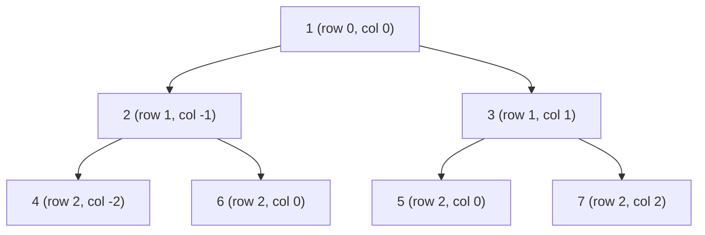

**Short answer:** Give the root position (row 0, column 0); a left child is at (row + 1, col − 1) and a right child at (row + 1, col + 1). Collect every node as (col, row, value), sort by those three keys, and start a new list whenever the column changes, for O(n log n) time.

## Picture it



Sorted by (col, row, value):

| (col, row, value) | new column? | output so far |
|---|---|---|
| (-2, 2, 4) | yes | [4] |
| (-1, 1, 2) | yes | [4] [2] |
| (0, 0, 1) | yes | [4] [2] [1] |
| (0, 2, 5) | no | [4] [2] [1,5] |
| (0, 2, 6) | no | [4] [2] [1,5,6] |
| (1, 1, 3) | yes | [4] [2] [1,5,6] [3] |
| (2, 2, 7) | yes | [4] [2] [1,5,6] [3] [7] |

Nodes 6 and 5 share row 2 and column 0, so the value decides: 5 comes first, although 6 is in the left subtree.

**The picture in one sentence:** give each node coordinates and the traversal becomes one three-key sort.

## Approach

- **Brute force:** find the column range, then walk the whole tree once per column. O(n · width), and you still sort inside each column.
- **Key insight:** the order is fully described by three keys: column, then row, then value.
- **Why plain BFS is not enough:** BFS gives column and row order, but two nodes in the same cell arrive left to right, not by value. That is the difference from LC 314.
- **Any traversal works,** because the sort fixes the order. DFS is the shortest to write.

## Solution

```java
import java.util.*;

class Solution {
    private record Cell(int col, int row, int value) {}

    public List<List<Integer>> verticalTraversal(TreeNode root) {
        List<Cell> cells = new ArrayList<>();
        collect(root, 0, 0, cells);
        cells.sort(Comparator.comparingInt(Cell::col).thenComparingInt(Cell::row).thenComparingInt(Cell::value));

        List<List<Integer>> out = new ArrayList<>();
        int prevCol = 0;
        for (Cell cell : cells) {
            if (out.isEmpty() || cell.col() != prevCol) {
                out.add(new ArrayList<>());
                prevCol = cell.col();
            }
            out.get(out.size() - 1).add(cell.value());
        }
        return out;
    }

    private void collect(TreeNode node, int row, int col, List<Cell> cells) {
        if (node == null) return;
        cells.add(new Cell(col, row, node.val));
        collect(node.left, row + 1, col - 1, cells);
        collect(node.right, row + 1, col + 1, cells);
    }
}
```

## Complexity

- **Time:** O(n log n) for the sort; collecting is O(n).
- **Space:** O(n) for the cells, plus O(h) recursion.

## Edge cases

- Empty tree: empty list.
- Single node: `[[val]]`.
- Two or more nodes in one cell: sorted by value, duplicates kept.
- A chain to one side: every column has one node. A very deep chain can overflow the stack, so use an explicit stack.
- Columns may be negative, so compare with the previous column instead of using the column as an index.

## Variations

- **Vertical order without the value rule (LC 314):** BFS with a map from column to list. Ties keep left-to-right order, so no sort is needed and it is O(n).
- **Smaller sorts:** BFS level by level, sort each level by (column, value), then append to the column lists. The worst case is still O(n log n).
- **Top view / bottom view:** keep only the first or last node seen per column in a BFS. Agree on the rule when two nodes share a cell.

Related: [T4 · Trees and graphs: traversals, BFS and DFS](../academy/lessons/T4.md).
