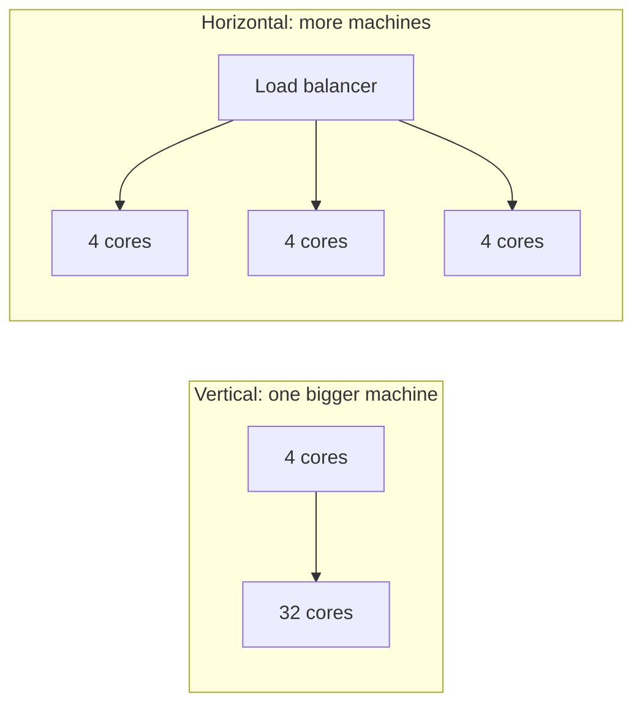

**Short answer:** Vertical scaling (up) means a bigger machine: more CPU, memory or faster disks. Horizontal scaling (out) means more machines sharing the work behind a load balancer or by splitting the data.

Vertical is simple and needs no code change, but it has a ceiling and stays one point of failure. Horizontal goes further and survives a machine dying, but the app must be stateless and the data gets harder to keep consistent.

## Explanation



| | Vertical | Horizontal |
|---|---|---|
| How | bigger instance | more instances |
| Code changes | usually none | stateless app, shared state outside |
| Limit | the largest machine you can buy | coordination and shared resources |
| Failure | one machine down, all down | one of N down, reduced capacity |
| Downtime to scale | often a restart or failover | none |
| Cost | large machines can be poor value | commodity sizes, plus a balancer and operations |
| Consistency | easy, one copy | replication lag, distributed transactions |
| Good for | databases first, caches, quick relief | web and API servers, workers, partitioned data |

**A sensible order:**
1. Measure: is it CPU, memory, disk, network, or a lock? More machines do not fix a lock on one row.
2. Fix the cheap things: an index, a cache, a smaller payload.
3. Scale up the database to a comfortable size.
4. Scale out stateless services.
5. Add read replicas, then partition or shard the data only when you must.

Most real systems do both: medium-sized instances, several of them (sometimes called diagonal scaling).

**Why horizontal is not linear (Amdahl's law):**
- If a share `s` of the work cannot run in parallel, the speed-up is at most `1 / s`.
- With s = 5%, no number of machines gives more than 20×.

## Example

Scaling out a Spring Boot API:

```yaml
apiVersion: autoscaling/v2
kind: HorizontalPodAutoscaler
metadata:
  name: orders-api
spec:
  scaleTargetRef: { apiVersion: apps/v1, kind: Deployment, name: orders-api }
  minReplicas: 3            # survive losing one
  maxReplicas: 20           # 20 pods x 10 DB connections = 200, check the database limit
  metrics:
    - type: Resource
      resource: { name: cpu, target: { type: Utilization, averageUtilization: 60 } }
```

What must change before the second instance starts:
- HTTP sessions move to Redis or to a token.
- In-memory caches and rate-limit counters move to a shared store, or accept being per-instance.
- Uploaded files move to object storage.
- `@Scheduled` jobs need a lock, or they run once *per instance*.
- `synchronized` protects one JVM only; use a database constraint or a conditional update.

For a machine-learning service the same idea applies. A bigger GPU is vertical, more replicas behind a queue is horizontal, and a model too big for one GPU must be split across several.

## Pitfalls and follow-ups

- **Which is better?** Neither. Start up for simplicity, go out for availability and for load beyond one machine.
- **Does scaling out always raise throughput?** No. If the database is the bottleneck, more app servers make it worse by opening more connections.
- **How do you scale a relational database out?** Read replicas for reads (stale by the lag), partitioning for big tables, sharding by key for writes.
- **What does sharding cost?** Cross-shard joins and transactions, hot shards, and resharding. Consistent hashing reduces how much data moves.
- **Scaling vs elasticity?** Scaling is being able to handle more; elasticity is adding and removing capacity automatically as load changes.
- **Why not always a big box?** A single failure domain, and upgrades need a failover.
- **Stateful but out?** Kafka partitions, Redis Cluster slots, Cassandra token ranges: each node owns part of the data.
- **JVM note on scaling up:** a very large heap needs a suitable collector, such as Generational ZGC (`-XX:+UseZGC -XX:+ZGenerational` on Java 21). Several medium JVMs are often easier.

Deeper: [F1 · Building blocks: load balancers, caches, queues, databases](../academy/lessons/F1.md).
