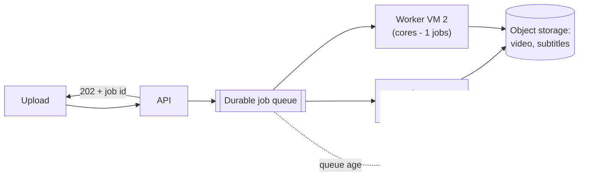

**Short answer:** The work is CPU-bound, so more threads than cores adds no speed, only memory use and context switching. I stop creating a thread per job: jobs go into a bounded queue, and a fixed pool of about `cores - 1` workers takes them.

That stops the crash, but I also find out *what* crashed (usually memory, not the CPU). For growth I put jobs in a durable queue and run separate worker machines that scale on queue age, so the web app stays responsive.

## Explanation



I state my assumption: one process, one thread per video, and the process dies when ten run together.

**1. Find what "crash" means**
- `OutOfMemoryError: Java heap space`: ten videos in memory at once. Likely.
- The container is killed (exit 137): native memory, for example from a codec library or a large model.
- Nothing dies but health checks time out: CPU starvation, and the orchestrator restarts it.
- Tools: logs, container events, a heap dump, CPU and memory graphs per running job.

**2. Why 10 threads do not help**
- On 4 cores, 10 CPU-bound threads each get under half a core. Total time is the same or worse.
- Memory is ten times one job.

**3. Fix in the process**
- A fixed pool with a bounded queue. Size: `min(cores - 1, memory for jobs / memory per job)`.
- Example: 8 cores, 12 GB for jobs, 3 GB each: min(7, 4) = **4** workers. Memory decides here, not cores.
- When the queue is full, reject with 429 rather than accepting work you cannot hold.
- Process the video in chunks from disk, so one job does not hold the whole file.
- Lower the priority of the work so requests still get CPU: a separate process with a CPU limit is the reliable way.

**4. Fix in the system**
- A durable queue (SQS, RabbitMQ, or a Postgres table read with `FOR UPDATE SKIP LOCKED`), so a crash loses no jobs.
- Separate workers: a crash cannot take the API down with it.
- Idempotent jobs: key by video id and version, save progress per chunk, write the output under a fixed name.
- Retry with backoff a few times, then the dead-letter queue, so one bad video cannot kill workers for ever.
- For one long video, split it into segments, process in parallel, and join. Cut at silences, not in the middle of a word.

## Example

```java
import java.util.concurrent.*;

public final class SubtitleService {
    private static final int WORKERS = Math.max(1, Runtime.getRuntime().availableProcessors() - 1);  // spare a core

    private final ThreadPoolExecutor pool = new ThreadPoolExecutor(
            WORKERS, WORKERS, 0, TimeUnit.SECONDS,
            new ArrayBlockingQueue<>(50),                     // bounded: waiting jobs cannot fill the heap
            new ThreadPoolExecutor.AbortPolicy());            // full: reject, the API answers 429

    public Future<String> submit(String videoId) {
        return pool.submit(() -> createSubtitles(videoId));   // RejectedExecutionException when full
    }

    private String createSubtitles(String videoId) throws InterruptedException {
        for (int chunk = 0; chunk < 100; chunk++) {
            if (Thread.interrupted()) throw new InterruptedException("cancelled at chunk " + chunk);
            // decode this chunk, run speech-to-text, write the text to disk, free the memory
        }
        return "subtitles-" + videoId + ".srt";
    }

    public void close() throws InterruptedException {
        pool.shutdown();                                      // no new jobs, finish the accepted ones
        if (!pool.awaitTermination(60, TimeUnit.SECONDS)) pool.shutdownNow();
    }
}
```

The queue holds video *ids*, not video bytes. Fifty waiting jobs cost almost nothing.

## Pitfalls and follow-ups

- **`Executors.newFixedThreadPool(n)`?** It limits threads but its queue is unbounded, so waiting jobs can grow without limit. `newCachedThreadPool` has no thread limit and would repeat the crash.
- **Virtual threads?** No. They help when threads *wait*; CPU-bound work still needs a core each.
- **A `Semaphore` instead?** It can cap running jobs, but the waiting threads still exist and there is no queue limit. The pool gives both.
- **`CallerRunsPolicy`?** It slows the producer, but here it would run a long CPU job on a request thread.
- **`availableProcessors()` in a container?** The JVM reads the container's CPU limit, so it is right with a limit set. Override with `-XX:ActiveProcessorCount`.
- **The native library is multi-threaded itself?** Then 4 jobs × 8 threads is again too many. Set its thread count and lower the pool.
- **Short jobs stuck behind a 3-hour film?** Two queues (short and long) with their own workers, or split long videos into segments.
- **How do you prove it?** Submit 100 jobs: at most N run, memory stays flat, extra ones get 429, kill a worker and its job is retried.

Deeper: [B4 · Executors and sizing thread pools](../academy/lessons/B4.md).
