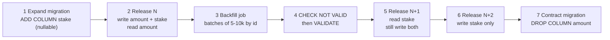

**Short answer:** In PostgreSQL most `ALTER TABLE` forms take an `ACCESS EXCLUSIVE` lock, so the danger is a long lock or a full table rewrite, not the DDL itself. I use only operations that are metadata-only or take weak locks, set a `lock_timeout` so a migration never stalls traffic, build indexes with `CREATE INDEX CONCURRENTLY`, and do anything bigger (renames, type changes) with **expand and contract** across several app releases, backfilling in small batches. At every step the old and the new app version must both work, because a rolling deploy runs them side by side.

## Picture it



**How to read it:**
- Steps 1 and 7 are schema changes; steps 2, 5 and 6 are app releases; step 3 is a data job. No step needs downtime.
- After step 2 every new row has both columns, so the backfill (3) only has to fix old rows.
- Step 5 switches reads only after the data is complete and checked (4). It still writes both, so pods on release N, which read `amount`, stay correct during the rolling deploy.
- Only when no running version reads `amount` (6) is it safe to drop it (7). Each arrow is a point you can stop at or roll back to.

## Explanation

**Why it is hard: the lock queue.** `ALTER TABLE` usually needs `ACCESS EXCLUSIVE`, which conflicts with everything, even `SELECT`. If one long report query holds a lock on `bets`, the `ALTER` waits, and every later read and write queues *behind the waiting ALTER*. A metadata-only change can still take the site down this way. So every migration starts with `SET lock_timeout = '2s'` (fail fast, then retry), and each statement stays short.

**Safe versus unsafe on a 500M-row table:**

| Operation | Cost |
|---|---|
| `ADD COLUMN` nullable, no default | Metadata only, brief lock |
| `ADD COLUMN ... DEFAULT <constant>` | Metadata only from **PG 11**; before 11 (or with a volatile default like `clock_timestamp()`) it rewrites the table |
| `ALTER COLUMN TYPE` | Usually a full rewrite under `ACCESS EXCLUSIVE` (exceptions: binary-compatible changes such as `varchar(50)` to `varchar(100)` or `text`) |
| `SET NOT NULL` | Full scan under `ACCESS EXCLUSIVE`, unless (**PG 12+**) a validated `CHECK (col IS NOT NULL)` already proves it |
| `ADD CONSTRAINT ... NOT VALID` then `VALIDATE CONSTRAINT` | Add is brief; validate scans under `SHARE UPDATE EXCLUSIVE`, which allows reads and writes |
| `CREATE INDEX` | `SHARE` lock: blocks writes for the whole build |
| `CREATE INDEX CONCURRENTLY` | Allows reads and writes; slower |
| `RENAME COLUMN`, `DROP COLUMN` | Metadata only, but breaks any app version still using the old name |

Foreign keys follow the same pattern: `ADD FOREIGN KEY ... NOT VALID` (brief, takes `SHARE ROW EXCLUSIVE` on both tables), then `VALIDATE CONSTRAINT`.

**Expand and contract** turns one breaking change into several compatible ones: add the new thing, write to both, backfill, switch reads, stop writing the old thing, drop it. The same pattern handles type changes (e.g. `int` to `bigint`: new column, dual-write, backfill, swap).

## Example

Flyway migrations on `bets`, renaming `amount` to `stake`, adding a non-null column, and an index:

```sql
-- V41__expand_bets.sql  (runs in a transaction, every statement is fast)
SET lock_timeout = '2s';
ALTER TABLE bets ADD COLUMN stake numeric(12,2);                 -- nullable: metadata only
ALTER TABLE bets ADD COLUMN channel text NOT NULL DEFAULT 'WEB'; -- PG 11+: metadata only
```

```sql
-- Backfill: run from a job, not from Flyway. One short transaction per batch.
UPDATE bets
SET    stake = amount
WHERE  id >= :from AND id < :from + 10000
AND    stake IS NULL;
-- commit, save :from as a checkpoint, sleep, check replica lag, repeat
```

```sql
-- V42__stake_not_null.sql
SET lock_timeout = '2s';
ALTER TABLE bets ADD CONSTRAINT bets_stake_nn CHECK (stake IS NOT NULL) NOT VALID;
ALTER TABLE bets VALIDATE CONSTRAINT bets_stake_nn;  -- scans, but reads and writes continue
ALTER TABLE bets ALTER COLUMN stake SET NOT NULL;    -- PG 12+: uses the constraint, no scan
ALTER TABLE bets DROP CONSTRAINT bets_stake_nn;
```

```sql
-- V43__idx_bets_customer.sql  (must run outside a transaction)
CREATE INDEX CONCURRENTLY IF NOT EXISTS idx_bets_customer_placed
    ON bets (customer_id, placed_at);
```

Flyway detects `CREATE INDEX CONCURRENTLY` on PostgreSQL and runs that migration without a transaction; keep it alone in its own file (you cannot mix it with transactional statements). In Liquibase, use `runInTransaction="false"` on the changeset. Much later, `V50__contract_bets.sql` drops `amount`.

## Pitfalls and follow-ups

- **Which ALTERs block writes, and for how long?** Almost all take `ACCESS EXCLUSIVE`, which blocks reads and writes. Metadata-only ones hold it for milliseconds. A rewrite (type change, pre-11 default) or scan (`SET NOT NULL` without a constraint) holds it for the whole operation, which is minutes to hours at 500M rows. Plain `CREATE INDEX` blocks writes, not reads, for the full build. And any of them can block everything while *waiting*, hence `lock_timeout`.
- **Why CONCURRENTLY, and what goes wrong?** It builds the index without blocking writes, using two table scans and waiting for older transactions. It is slower, cannot run inside a transaction block, and can wait a long time on a long-running transaction. If it fails (deadlock, a duplicate in a `UNIQUE` index, cancellation) it leaves an `INVALID` index that is not used for queries but is still updated on every write. Find it in `pg_index` (`indisvalid = false`), `DROP INDEX CONCURRENTLY`, and retry (or `REINDEX INDEX CONCURRENTLY`, PG 12+).
- **Rename with expand and contract?** See the picture. Release N writes both columns and reads the old one; backfill; release N+1 reads the new one. You can stop writing `amount` in N+1 only if a DB trigger keeps it in sync for old pods during the rollout; without a trigger, add release N+2 that writes only `stake`, then drop `amount`. Never rename in place: pods still on the old version fail on the first query.
- **Backfill 500M rows safely?** Batch by primary-key range (5–10k rows), one short transaction per batch, so row locks are held briefly and each commit adds little WAL. Make it resumable (checkpoint the last id, `WHERE stake IS NULL` makes reruns safe), throttle with a sleep, pause when replica lag or I/O rises, and run off-peak. Every updated row is a new tuple version, so watch bloat and let autovacuum keep up. Do it in an app job (e.g. Spring Batch or a scheduled task), not in one Flyway script.
- **How do you run migrations in Spring Boot?** Flyway or Liquibase run on startup or, better at scale, as a separate pipeline step before the deploy. CI runs them against a real Postgres (Testcontainers) so a bad migration fails the build. Migrations must be backward compatible with the running version.
- **When the rewrite cannot be avoided?** `pg_repack` rebuilds a table online with a short final lock. For huge changes, build a new table and move to it with logical replication, then switch.
- **Partitioned tables?** On PG 11+, `CREATE INDEX` on a partitioned parent cannot be `CONCURRENTLY`; create it on the parent with `ON ONLY`, build each partition's index concurrently, then attach each one with `ALTER INDEX ... ATTACH PARTITION`.

Go deeper: [Q6 · Transactions, isolation, locking and MVCC](../academy/lessons/Q6.md) explains the lock modes and why updates create tuple versions; [Q8 · Scaling databases](../academy/lessons/Q8.md) covers replicas and partitioning; see also [SQL optimization, performance and scalability](sql-optimization-performance-scalability.md). Reference: [ALTER TABLE](https://www.postgresql.org/docs/current/sql-altertable.html), [CREATE INDEX](https://www.postgresql.org/docs/current/sql-createindex.html), [Explicit locking](https://www.postgresql.org/docs/current/explicit-locking.html).
